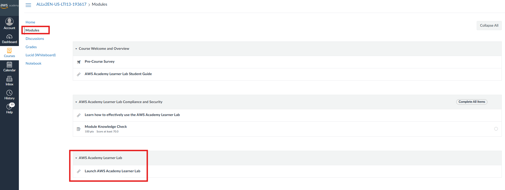

# Cluster AWS Academy en une commande

Ce guide crée le **cluster de référence de la formation** sur AWS Academy (1 control plane, 2 workers, kubeadm, Calico, Ingress NGINX, StorageClass `local-path`) avec **une seule commande**. Votre seule action est de fournir vos identifiants AWS.

Le résultat est identique au cluster construit pas à pas à l'[Atelier 01](labs/01-provisionnement-cluster.md) : les ateliers 02 à 08 fonctionnent sans adaptation.

<div class="admonition info" markdown>
<p class="admonition-title"><strong>Quand utiliser ce chemin express ?</strong></p>

* Recréer un cluster après une session AWS Academy réinitialisée ou une destruction par erreur.
* Rattraper un stagiaire absent ou bloqué à l'Atelier 01.
* Préparer en 10 minutes le cluster de démonstration du formateur.

Le parcours d'apprentissage reste l'**Atelier 01** : c'est en tapant `kubeadm init` et `kubeadm join` que l'on comprend comment un cluster s'assemble (chapitre 3 du programme, « Installation et configuration »).

</div>

---

## Ce que fait le script

| Étape | Action | Durée |
| :---: | :--- | :--- |
| 1 | Vérifie `terraform`, `aws`, `kubectl` et `ssh` ; sous Windows, installe les outils manquants avec `winget` | 0 à 3 min |
| 2 | Vérifie que les identifiants AWS de `~/.aws/credentials` autorisent bien EC2 | 10 s |
| 3 | Initialise Terraform ; utilise `labsuser.pem` si vous l'avez téléchargée, sinon crée une paire de clés SSH dans AWS | 30 s |
| 4 | Crée les 3 instances EC2 (ou redémarre celles arrêtées la veille) | 1 min |
| 5 | Attend que `bootstrap.sh` ait installé containerd, kubeadm, kubelet et kubectl sur chaque nœud | 3 à 5 min |
| 6 | `kubeadm init` + Calico sur `k8s-control`, puis `kubeadm join` sur les deux workers, et attend les 3 nœuds `Ready` | 2 à 3 min |
| 7 | `setup-addons.sh` : Helm, StorageClass `local-path` (par défaut), Ingress NGINX (NodePort `30080`), alias `k` | 1 à 2 min |
| 8 | Copie le kubeconfig sur votre poste (`terraform/kubeconfig.yaml`) et affiche les nœuds | 10 s |

Le script peut être **relancé à volonté** : chaque étape déjà faite est sautée.

---

## Étape 1 : Démarrer le Learner Lab

1. Sur **AWS Academy**, ouvrez le cours **AWS Academy Learner Lab** → **Modules** → **Launch AWS Academy Learner Lab**.
2. Cliquez sur **Start Lab** et attendez le voyant **vert**.
3. Ouvrez **AWS Details** → **AWS CLI** → **Show** : gardez cette fenêtre à portée de main.



<div class="admonition note" markdown>
<p class="admonition-title"><strong>Clé SSH : facultative</strong></p>

Vous pouvez télécharger **Download PEM** et enregistrer `labsuser.pem` dans `labs/01-Installation-Cluster/terraform/`. Sinon, le script crée lui-même une paire de clés `k8s-formation-key` et l'enregistre au même endroit, sous le même nom.

</div>

---

## Étape 2 : Enregistrer vos identifiants AWS

Copiez le bloc **AWS Details → AWS CLI → Show**, de `[default]` jusqu'à la fin de `aws_session_token=...` :

```ini
[default]
aws_access_key_id=ASI...
aws_secret_access_key=...
aws_session_token=...
```

Ouvrez le fichier des identifiants, remplacez **tout** son contenu par ce bloc, puis enregistrez :

| Système | Commande |
| :--- | :--- |
| **Windows** | `notepad "$env:USERPROFILE\.aws\credentials"` |
| **Linux / macOS** | `mkdir -p ~/.aws && nano ~/.aws/credentials` |

<div class="admonition warning" markdown>
<p class="admonition-title"><strong>Identifiants personnels et temporaires</strong></p>

Ne collez jamais ce bloc dans un support, un chat ou un commit. Il change à **chaque Start Lab** et expire au bout de 4 heures : recopiez-le à chaque nouvelle session.

</div>

---

## Étape 3 : Lancer le script

Prérequis : **Git**. Sous Linux et macOS, installez aussi **Terraform** et l'**AWS CLI** (tableau des outils de [Prérequis & Environnement](setup-environnement.md)). Sous Windows, le script les installe pour vous.

**Windows (PowerShell)**

```powershell
git clone https://github.com/Rym28/kubernetes-training.git formation
cd formation
powershell -ExecutionPolicy Bypass -File .\labs\01-Installation-Cluster\scripts\create-cluster.ps1
```

**Linux / macOS (Bash)**

```bash
git clone https://github.com/Rym28/kubernetes-training.git formation
cd formation
bash labs/01-Installation-Cluster/scripts/create-cluster.sh
```

Dépôt déjà cloné ? Placez-vous à sa racine et lancez seulement la dernière ligne.

Laissez le script travailler, **environ 10 minutes**. Il se termine par :

```text
==================================================================
 Cluster prêt en 9 min : k8s-control + k8s-worker-1 + k8s-worker-2
==================================================================
```

---

## Étape 4 : Utiliser le cluster

Le script affiche les commandes à reprendre. Depuis la racine du dépôt :

**Windows (PowerShell)**

```powershell
$env:KUBECONFIG = "$PWD\labs\01-Installation-Cluster\terraform\kubeconfig.yaml"
kubectl get nodes
```

**Linux / macOS (Bash)**

```bash
export KUBECONFIG=$PWD/labs/01-Installation-Cluster/terraform/kubeconfig.yaml
kubectl get nodes
```

Résultat attendu :

```text
NAME           STATUS   ROLES           AGE   VERSION
k8s-control    Ready    control-plane   6m    v1.30.x
k8s-worker-1   Ready    <none>          4m    v1.30.x
k8s-worker-2   Ready    <none>          4m    v1.30.x
```

Redéfinissez `KUBECONFIG` dans chaque nouveau terminal. Poste verrouillé (port 6443 filtré) ? Travaillez en **Option B** : la commande `ssh` affichée en fin de script ouvre une session sur `k8s-control`, où `kubectl` est déjà configuré et les manifests sont dans `~/labs/`.

---

## Maîtriser le budget (50 $ pour la formation)

| Moment | Windows (PowerShell) | Linux / macOS (Bash) |
| :--- | :--- | :--- |
| **Le soir** : éteindre les instances (le cluster est conservé) | `powershell -ExecutionPolicy Bypass -File .\labs\01-Installation-Cluster\scripts\stop-session.ps1` | `bash labs/01-Installation-Cluster/scripts/stop-session.sh` |
| **Le matin** : redémarrer et vérifier | Relancez `create-cluster.ps1` | Relancez `create-cluster.sh` |
| **Fin de formation** : tout supprimer | `powershell -ExecutionPolicy Bypass -File .\labs\01-Installation-Cluster\scripts\destroy-cluster.ps1 -AutoApprove` | `bash labs/01-Installation-Cluster/scripts/destroy-cluster.sh -y` |

Le matin, après **Start Lab**, recopiez le nouveau bloc dans `~/.aws/credentials` (étape 2), puis relancez `create-cluster` : il redémarre les instances, saute l'installation déjà faite et régénère le kubeconfig. `k8s-control` garde son adresse (Elastic IP) ; les workers changent d'IP publique, ce qui n'a pas d'effet sur `kubectl`.

---

## Dépannage

<details class="tip" markdown>
<summary><strong>Indice : « AWS refuse les identifiants » ou « voc-cancel-cred »</strong></summary>

* Le Learner Lab n'est pas démarré, ou le voyant n'est pas encore vert.
* Le fichier contient le bloc d'une **session précédente** : AWS Academy bloque les anciens identifiants (politique `voc-cancel-cred`) dès qu'un nouveau Start Lab a lieu. Recopiez le bloc actuel (étape 2).
* Le bloc copié est incomplet : il doit contenir les trois lignes `aws_access_key_id`, `aws_secret_access_key` et `aws_session_token`.
* Vérification rapide : `aws ec2 describe-vpcs --query "Vpcs[0].VpcId" --output text` doit afficher un `vpc-...`.

</details>

<details class="tip" markdown>
<summary><strong>Indice : Windows refuse d'exécuter le script</strong></summary>

* « L'exécution de scripts est désactivée » : lancez le script avec `powershell -ExecutionPolicy Bypass -File …`, comme indiqué à l'étape 2.
* « … n'est pas signé numériquement » (dépôt récupéré en `.zip`) : débloquez les scripts une fois avec `Get-ChildItem -Recurse -Filter *.ps1 | Unblock-File`.
* `winget` vient d'installer un outil mais le script ne le trouve pas : ouvrez un nouveau terminal et relancez.

</details>

<details class="tip" markdown>
<summary><strong>Indice : <code>terraform apply</code> échoue</strong></summary>

* `UnauthorizedOperation` : seules les régions `us-east-1` et `us-west-2` sont autorisées (`-Region us-west-2` / `--region us-west-2`).
* `InvalidKeyPair.NotFound` : la session AWS Academy a été réinitialisée et la paire de clés a disparu. Supprimez `labsuser.pem` et `express.auto.tfvars` de `labs/01-Installation-Cluster/terraform/` (s'il n'existe plus d'instance), puis relancez.
* « Des instances existent mais labsuser.pem est absente » : téléchargez `labsuser.pem` depuis **AWS Details** dans `labs/01-Installation-Cluster/terraform/`.

</details>

<details class="tip" markdown>
<summary><strong>Indice : le script s'arrête sur un nœud (SSH, bootstrap, join)</strong></summary>

Relancez simplement le script : il reprend là où il s'est arrêté. Si l'erreur persiste, connectez-vous au nœud avec la commande `ssh` de l'Atelier 01 et consultez :

```bash
sudo tail -n 50 /var/log/cloud-init-output.log   # installation de containerd / kubeadm
kubectl get pods -n calico-system                 # sur k8s-control : réseau des Pods
cat /tmp/setup-addons.log                         # sur k8s-control : composants additionnels
```

</details>

---

## Critères de Validation (Checklist)

- [ ] `aws sts get-caller-identity` affiche un `Arn` contenant `voclabs`.
- [ ] `kubectl get nodes` affiche `k8s-control`, `k8s-worker-1` et `k8s-worker-2` à l'état `Ready`.
- [ ] `kubectl get pods -n calico-system` : les pods `calico-node` sont `Running`.
- [ ] `kubectl get storageclass` affiche `local-path (default)`.
- [ ] `kubectl get pods -n ingress-nginx` : le contrôleur est `Running`.
