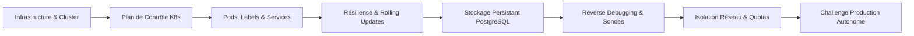

# Kubernetes : Orchestration et Déploiement en Production

Bienvenue sur le portail des ateliers pratiques **Kubernetes**.  
Cet espace regroupe les guides techniques, l'architecture de référence et les **8 ateliers pratiques** articulés autour d'une application d'entreprise multi-tiers : le **Campus Summer Portal**.

---

## Architecture des Ateliers

Les ateliers sont organisés de manière progressive, de l'infrastructure de base jusqu'aux règles de sécurité avancées en production :

### Caractéristiques Techniques des Travaux Pratiques
* **Approche 100% Déclarative & DevOps** : Mise en œuvre des manifestes YAML selon les standards de production.
* **Environnements Flexibles** : Exécution sur machines virtuelles cloud **AWS** (création manuelle puis industrialisation **Terraform**) ou cluster local **Minikube**.
* **Indices Interactifs Pliables** : Chaque atelier intègre des indices progressifs permettant de résoudre les blocages de manière autonome.
* **Compatibilité Multi-OS** : Commandes et syntaxes fournies pour **Windows (PowerShell)** et **Linux (Ubuntu) / macOS (Bash)**.

---

## Parcours des Ateliers Pratiques

-   :material-server-network: __Atelier 01 : Provisionnement du Cluster__
    
    ---
    
    De la console AWS à l'Infrastructure as Code (Terraform) et l'initialisation multi-nœuds Kubeadm / Calico.
    
    [:octicons-arrow-right-24: Accéder à l'Atelier 01](labs/00-provisioning-cluster.md)

-   :material-cube-outline: __Atelier 02 : Premiers Pods__
    
    ---
    
    Manifest et cycle de vie du Pod, `port-forward`, technique DevOps du `--dry-run=client -o yaml`, limites du pod isolé.
    
    [:octicons-arrow-right-24: Accéder à l'Atelier 02](labs/02-premiers-pods-labels.md)

-   :material-refresh: __Atelier 03 : Déploiements & Résilience__
    
    ---
    
    Contrôleurs Deployment & ReplicaSets, auto-guérison (*Self-Healing*), Rolling Updates sans coupure et Rollback d'urgence.
    
    [:octicons-arrow-right-24: Accéder à l'Atelier 03](labs/03-deployments-resilience.md)

-   :material-lan: __Atelier 04 : Réseau, Services & DNS__
    
    ---
    
    Volatilité des IP de pods, Service ClusterIP, résolution DNS interne CoreDNS, exposition NodePort et répartition de charge.
    
    [:octicons-arrow-right-24: Accéder à l'Atelier 04](labs/04-services-reseau.md)

-   :material-database: __Atelier 05 : Stockage & Données Persistantes__
    
    ---
    
    ConfigMaps, Secrets base64, StorageClass, PV/PVC et déploiement PostgreSQL avec validation de la persistance post-crash.
    
    [:octicons-arrow-right-24: Accéder à l'Atelier 05](labs/05-configuration-persistance.md)

-   :material-bug-outline: __Atelier 06 : Exploitation & Reverse Debugging__
    
    ---
    
    Logs, `kubectl exec`, résolution de 3 pannes (CrashLoopBackOff, OOMKilled, Service sans réponse), Node Problem Detector et supervision Prometheus / Loki / Grafana.
    
    [:octicons-arrow-right-24: Accéder à l'Atelier 06](labs/06-exploitation-debugging.md)

-   :material-shield-lock-outline: __Atelier 07 : Sécurité, Quotas & Réseau__
    
    ---
    
    Gouvernance de ressources (ResourceQuota, LimitRange), cloisonnement réseau NetworkPolicy et durcissement non-root.
    
    [:octicons-arrow-right-24: Accéder à l'Atelier 07](labs/07-securite-quotas.md)

-   :material-trophy-outline: __Atelier 08 : Challenge Final d'Intégration__
    
    ---
    
    Déploiement en totale autonomie de la plateforme 3-tiers complète dans un namespace `campus-prod` durci.
    
    [:octicons-arrow-right-24: Accéder à l'Atelier 08](labs/08-challenge-integration.md)

---

## Démarrage Rapide

Consultez le [Guide d'installation de l'environnement](setup-environnement.md) pour préparer votre poste avant d'attaquer le premier atelier.

Avant le premier atelier, répondez au [test de positionnement](evaluation.md) : vous le repasserez en fin de formation pour mesurer votre progression.
