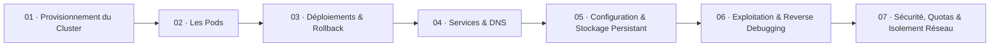

# Kubernetes : Orchestration et Déploiement en Production

Bienvenue sur le portail des ateliers pratiques **Kubernetes**.  
Cet espace regroupe les guides techniques, l'architecture de référence et les **7 ateliers pratiques** articulés autour d'une application d'entreprise multi-tiers : le **Campus Summer Portal**.

---

## Architecture des Ateliers

Les ateliers sont organisés de manière progressive, de l'infrastructure de base jusqu'aux règles de sécurité avancées en production :

### Caractéristiques Techniques des Travaux Pratiques
* **Approche 100% Déclarative & DevOps** : Mise en œuvre des manifestes YAML selon les standards de production.
* **Environnements Flexibles** : Cluster multi-nœuds **Kubeadm** sur 3 instances **AWS** EC2 provisionnées par **Terraform**, ou cluster local **Minikube** en secours (ateliers 03 à 07).
* **Indices Interactifs Pliables** : Chaque atelier intègre des indices progressifs permettant de résoudre les blocages de manière autonome.
* **Compatibilité Multi-OS** : Commandes et syntaxes fournies pour **Windows (PowerShell)** et **Linux (Ubuntu) / macOS (Bash)**.

---

## Parcours des Ateliers Pratiques

-   :material-server-network: __Atelier 01 : Provisionnement du Cluster__
    
    ---
    
    Cluster local Minikube, puis 3 instances EC2 provisionnées par Terraform (AWS Learner Lab), cluster multi-nœuds Kubeadm / Calico et administration depuis votre poste.
    
    [:octicons-arrow-right-24: Accéder à l'Atelier 01](labs/01-provisionnement-cluster.md)

-   :material-cube-outline: __Atelier 02 : Les Pods : les Trois Briques du Campus Summer Portal__
    
    ---
    
    Manifest et cycle de vie du Pod, `describe`, `port-forward`, diagnostic d'une erreur classique, `--dry-run=client -o yaml`, `kubectl exec` et limites du pod isolé.
    
    [:octicons-arrow-right-24: Accéder à l'Atelier 02](labs/02-pods-trois-briques.md)

-   :material-refresh: __Atelier 03 : Déploiements — Résilience & Rollback__
    
    ---
    
    Base PostgreSQL de développement, Deployment & ReplicaSets, auto-guérison (*Self-Healing*), mise à l'échelle, Rolling Update sans coupure et Rollback.
    
    [:octicons-arrow-right-24: Accéder à l'Atelier 03](labs/03-deploiements-resilience-rollback.md)

-   :material-lan: __Atelier 04 : Réseau, Services & Découverte DNS__
    
    ---
    
    Volatilité des IP de pods, Service ClusterIP et Endpoints, découverte DNS (CoreDNS), exposition NodePort et accès depuis le navigateur.
    
    [:octicons-arrow-right-24: Accéder à l'Atelier 04](labs/04-reseau-services-dns.md)

---

## Démarrage Rapide

Consultez le [Guide d'installation de l'environnement](setup-environnement.md) pour préparer votre poste avant d'attaquer le premier atelier.

Les modalités d'évaluation (QCM de fin de journée et test de positionnement de fin de formation) sont décrites dans la page [Évaluation des acquis](evaluation.md).
