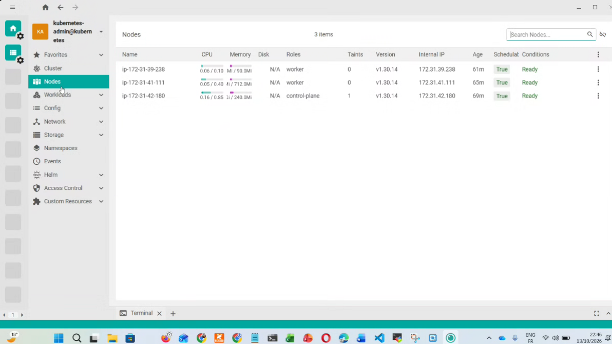

# Atelier 06 : Exploitation, Observabilité & Reverse Debugging

### Objectifs Pédagogiques :
* Lire les logs d'une application (`kubectl logs` en direct, multi-pods, conteneur précédent) et la chronologie des événements du cluster.
* Exécuter une commande dans un conteneur avec `kubectl exec` pour vérifier ce qu'il voit : sa configuration et son réseau.
* Appliquer une méthode de dépannage, du général au détail, sur 3 incidents classiques : `CrashLoopBackOff`, `OOMKilled` et Service sans réponse.
* Détecter une panne du système d'un nœud avec **Node Problem Detector** et retirer ce nœud du service (`kubectl cordon`).
* Mesurer la consommation avec **Metrics Server** (`kubectl top`), collecter métriques et logs avec **Prometheus**, **Fluent Bit** et **Loki**, et les consulter dans **Grafana**.
* Situer cette pile par rapport aux services managés des clouds, dont **StackDriver** (aujourd'hui Google Cloud Observability).

<div class="admonition info" markdown>
<p class="admonition-title"><strong>Compatibilité OS</strong></p>

Les commandes de cet atelier sont **rigoureusement identiques** sous **Windows (PowerShell)**, **Linux (Ubuntu)** et **macOS (Terminal)** : les manifests sont fournis en fichiers dans `manifests/`, `npd/` et `monitoring/`. Quand une commande diffère, les deux variantes sont fournies.

</div>

<div class="admonition note" markdown>
<p class="admonition-title"><strong>Environnement : le cluster 3 nœuds (1 control plane + 2 workers) de l'Atelier 01</strong></p>

Node Problem Detector surveille les **workers**, et l'étape 11 en retire un du service : réalisez ce lab sur ce cluster, piloté au choix :

* **Option A (Recommandée - Confort DevOps Local) :** depuis votre machine locale, avec votre `kubectl` et votre `kubeconfig`. Dans **chaque nouveau terminal**, placé à la racine du dépôt, pointez d'abord `kubectl` vers le fichier `kubeconfig.yaml` récupéré à l'étape 17 de l'Atelier 01 :
    * Windows (PowerShell) : `$env:KUBECONFIG = "$PWD\labs\01-Installation-Cluster\terraform\kubeconfig.yaml"`
    * Linux / macOS (Bash) : `export KUBECONFIG=$PWD/labs/01-Installation-Cluster/terraform/kubeconfig.yaml`
    * Vérification : `kubectl get nodes` doit afficher les 3 nœuds à l'état `Ready`.
* **Option B (PC d'entreprise verrouillé) :** en SSH sur `k8s-control` : l'outillage et les manifests sont pré-installés dans `~/labs/`.

🛟 **Secours : Minikube sur votre poste** (session AWS indisponible), piloté forcément depuis votre poste comme en Option A. Remplacez `k8s-worker-1` par `minikube`, y compris dans `manifests/inject-kernel-err.yaml`. Pour ouvrir Grafana (étape 14), utilisez `minikube service grafana -n monitoring --url`.

</div>

<div class="admonition note" markdown>
<p class="admonition-title"><strong>Namespace de travail : <code>campus-dev</code></strong></p>

Ce lab est **indépendant des autres** : son étape 0 crée `campus-dev` s'il n'existe pas encore, puis y installe ou met à jour tout ce dont il a besoin. Vous pouvez le réaliser sans avoir fait les labs précédents ; pour le recommencer à zéro, utilisez l'encadré « Repartir de zéro » de l'étape 0.

</div>

---

## Contexte Métier
Le Campus Summer Portal est en production. L'administrateur doit trouver la cause d'une panne de pod ou de nœud, puis suivre en continu la consommation et les logs de tout le cluster. Il se pose trois questions ; on commence toujours par `kubectl`, puis on outille : historique, alertes, tableaux de bord.

| Question | Outils de base | Outils de supervision |
| :--- | :--- | :--- |
| **Logs** : que raconte l'application ? | `kubectl logs`, `kubectl exec` | Fluent Bit + Loki |
| **État** : le nœud est-il sain ? | `kubectl describe node`, événements | Node Problem Detector |
| **Métriques** : combien consomme-t-elle ? | `kubectl top` (Metrics Server) | Prometheus + Grafana |

<div class="admonition tip" markdown>
<p class="admonition-title"><strong>Mode d'emploi</strong></p>

* Les encadrés rouges **« À vous de répondre »** contiennent les questions. Pour les commandes déjà vues dans les labs précédents, on vous demande la commande au lieu de vous la donner : cherchez avec `kubectl --help`, `kubectl <commande> --help` ou `kubectl explain`.
* Les commandes nouvelles sont données.
* Les encadrés **« Indice »** sont repliés : cliquez dessus seulement si vous bloquez.

</div>

---

## Étape 0 : Préparer l'environnement

Le dossier `starter/` du lab installe l'application complète :

| Fichier | Contenu |
| :--- | :--- |
| `01-config.yaml` | Le ConfigMap `campus-config` (paramètres non sensibles de l'API). |
| `02-postgres.yaml` | Le PVC `pvc-postgres`, la base PostgreSQL persistante et son Service `postgres`. |
| `03-backend.yaml` | L'API `campus-backend` (2 réplicas, configuration lue dans le ConfigMap et le Secret) et son Service `campus-backend`. |
| `04-frontend.yaml` | Le frontend et son Service NodePort `campus-frontend-svc` (port `30088`). |

Les identifiants de la base ne sont **pas** versionnés dans le starter : vous créez le Secret `campus-db-credentials` par une commande, comme à l'Atelier 05.

Créez le namespace `campus-dev` s'il n'existe pas encore, sélectionnez-le, puis appliquez le starter. Si vous sortez du lab précédent, vos objets sont conservés et simplement mis à jour. Depuis la racine du dépôt (Option A) ou depuis `~` sur `k8s-control` (Option B : mettez d'abord le dépôt à jour avec `git -C ~/formation pull`, puis remplacez `labs/` par `~/labs/`) :

```bash
kubectl create namespace campus-dev --dry-run=client -o yaml | kubectl apply -f -   # sans effet s'il existe déjà
kubectl config set-context --current --namespace=campus-dev
kubectl create secret generic campus-db-credentials --from-literal=POSTGRES_DB=campus --from-literal=POSTGRES_USER=campus --from-literal='POSTGRES_PASSWORD=CampusSecret2026!' --dry-run=client -o yaml | kubectl apply -f -
kubectl apply -f "labs/06-Administration & Supervision/starter/"
kubectl rollout status deployment/campus-postgres --timeout=180s
kubectl rollout status deployment/campus-backend --timeout=300s
```

<details class="warning" markdown>
<summary><strong>Environnement incohérent ou lab à recommencer ? Repartez de zéro</strong></summary>

Supprimez le namespace et tout son contenu, puis relancez les commandes ci-dessus :

```bash
kubectl delete namespace campus-dev   # ⚠️ supprime tout le contenu de campus-dev
```

*La suppression peut prendre jusqu'à une minute : `kubectl` rend la main quand elle est terminée.*

</details>

L'API n'a pas de sonde de santé : `rollout status` rend la main dès que les conteneurs tournent, avant que Spring Boot ait fini de démarrer (20 secondes à 2 minutes). Vérifiez que chaque pod backend a bien démarré :

**Linux / macOS**

```bash
kubectl logs -l app=campus-backend --prefix --tail=-1 | grep "Started CampusOpsApplication"
```

**Windows (PowerShell)**

```powershell
kubectl logs -l app=campus-backend --prefix --tail=-1 | Select-String "Started CampusOpsApplication"
```

Relancez la commande jusqu'à obtenir **2 lignes**, une par pod backend.

Placez-vous ensuite dans le dossier du lab, qui contient les fichiers `manifests/`, `npd/` et `monitoring/` utilisés plus loin : `cd "labs/06-Administration & Supervision"` (Option A) ou `cd ~/"labs/06-Administration & Supervision"` (Option B).

---

## Exercice 1 : Lire les logs et les événements

<div class="admonition abstract" markdown>
<p class="admonition-title"><strong>Ce que vous allez comprendre</strong></p>

Les **logs** sont les messages qu'une application écrit sur sa sortie standard ; Kubernetes les conserve pour chaque conteneur. Les **événements** retracent ce que le cluster a fait : placement d'un pod, téléchargement d'image, redémarrage, erreur.

</div>

### Étape 1 : Lire et suivre les logs du backend

`--tail=20` limite l'affichage aux 20 dernières lignes ; `-f` (*follow*) suit ensuite les nouvelles lignes en direct. Quittez avec `Ctrl + C` :

```bash
kubectl logs -f deployment/campus-backend --tail=20
```

<div class="admonition question" markdown>
<p class="admonition-title"><strong>À vous de répondre</strong></p>

1. Quelle ligne indique que Spring Boot a fini de démarrer ? En combien de secondes ?
2. Le Deployment a 2 pods : de quel pod viennent les lignes affichées ?

</div>

### Étape 2 : Lire les logs de tous les pods d'une étiquette

`--prefix` indique devant chaque ligne le pod d'où elle vient :

```bash
kubectl logs -l app=campus-backend --tail=5 --prefix
```

<div class="admonition question" markdown>
<p class="admonition-title"><strong>À vous de répondre</strong></p>

1. Combien de lignes obtenez-vous, et pour combien de pods ?
2. Quelle option de `kubectl logs` lirait les logs du conteneur **précédent**, celui qui a planté ? (Vous l'avez vue à l'Atelier 03.)

</div>

### Étape 3 : Lire la chronologie des événements

Les événements du namespace, triés par date de création :

```bash
kubectl get events --sort-by=.metadata.creationTimestamp
```

<div class="admonition question" markdown>
<p class="admonition-title"><strong>À vous de répondre</strong></p>

1. Quelles raisons (colonne `REASON`) retrouvez-vous pour la création d'un pod, dans l'ordre ?
2. Les logs d'un pod supprimé sont-ils encore lisibles avec `kubectl logs` ? Que faut-il pour les conserver ?

</div>

<details class="tip" markdown>
<summary><strong>Indice : des logs qui meurent avec le pod</strong></summary>

Un pod crée successivement les événements `Scheduled` (placé sur un nœud), `Pulled` (image disponible), `Created` puis `Started` (conteneur lancé).

Les logs d'un pod **meurent avec lui**. En production, on les centralise hors du cluster : c'est le rôle de Fluent Bit et Loki (exercice 5).

</details>

---

## Exercice 2 : Exécuter une commande dans un conteneur

<div class="admonition abstract" markdown>
<p class="admonition-title"><strong>Ce que vous allez comprendre</strong></p>

Quand les logs ne suffisent pas, on vérifie ce que voit le conteneur lui-même : sa configuration et son réseau. `kubectl exec` lance une commande **dans** un conteneur en cours d'exécution.

</div>

### Étape 4 : Vérifier la configuration reçue par le backend

Vous avez utilisé `kubectl exec` à l'Atelier 02. Vous voulez exécuter `env | grep SPRING` dans un pod du Deployment `campus-backend`.

<div class="admonition question" markdown>
<p class="admonition-title"><strong>À vous de répondre</strong></p>

1. Quelle commande exécute `env | grep SPRING` dans le backend ?
2. Quelle URL de base de données l'application a-t-elle reçue ? D'où vient chaque variable : du ConfigMap, du Secret ou du manifest du Deployment (`starter/03-backend.yaml`) ?
3. La variable `SPRING_DATASOURCE_PASSWORD` s'affiche-t-elle en clair ? Qu'en concluez-vous sur les droits `exec` ?

</div>

<details class="tip" markdown>
<summary><strong>Indice : une commande avec un « | » dans le conteneur</strong></summary>

Tout ce qui suit `--` s'exécute dans le conteneur. Le `|` serait interprété par **votre** terminal : encapsulez la commande dans `sh -c "…"`, comme pour `cat /etc/hosts` à l'Atelier 02. On peut viser le Deployment directement (`deployment/campus-backend`) : `kubectl` choisit l'un de ses pods.

</details>

### Étape 5 : Vérifier le réseau vu du frontend

`wget -qO-` télécharge une page et l'affiche, sans autre message :

```bash
kubectl exec deployment/campus-frontend -- wget -qO- http://campus-backend:8080/actuator/health
```

<div class="admonition question" markdown>
<p class="admonition-title"><strong>À vous de répondre</strong></p>

1. Que répond l'API ? Le frontend joint-il le backend ?
2. Par quel nom le frontend joint-il le backend ? Sur quel objet repose ce nom (Atelier 04) ?

</div>

<div class="admonition warning" markdown>
<p class="admonition-title"><strong><code>exec</code> sert à observer, pas à corriger</strong></p>

Toute modification faite dans le conteneur disparaît au prochain redémarrage du pod : on corrige le manifest, jamais le conteneur en direct. Pour un terminal interactif : `kubectl exec -it deployment/campus-frontend -- sh` (quittez avec `exit`).

</div>

---

## Exercice 3 : Dépanner avec méthode

<div class="admonition abstract" markdown>
<p class="admonition-title"><strong>Ce que vous allez comprendre</strong></p>

Face à un incident, on suit toujours le même ordre, du général au détail. Le statut du pod oriente vers le bon outil.

</div>

| Étape | Commande | Ce que vous cherchez |
| :--- | :--- | :--- |
| 1. Voir | `kubectl get pods -o wide` | `STATUS`, `RESTARTS`, `NODE` |
| 2. Comprendre | `kubectl describe pod <pod>` | Les `Events` (placement, image) et le `Last State` du conteneur |
| 3. Lire | `kubectl logs <pod> --previous` | L'erreur écrite par l'application |
| 4. Entrer | `kubectl exec <pod> -- …` | La configuration et le réseau vus du pod |
| 5. Élargir | `kubectl describe node`, `kubectl top` | Le nœud, les ressources |

### Étape 6 : Incident A, un pod qui redémarre en boucle

L'image `busybox` exécute un script qui affiche deux messages puis s'arrête avec le code d'erreur 42. Lancez-le et observez-le (`Ctrl + C` pour quitter) :

```bash
kubectl run crash-app --image=busybox:1.36 -- sh -c "echo Demarrage; sleep 3; echo Erreur fatale; exit 42"
kubectl get pod crash-app -w
```

<div class="admonition question" markdown>
<p class="admonition-title"><strong>À vous de répondre</strong></p>

1. Par quels statuts passe le pod ? Que fait la colonne `RESTARTS` ?
2. Quelle commande affiche la section `Last State` du conteneur ? Quel `Exit Code` y lisez-vous, et que signifie un code différent de 0 ?
3. Quelle commande affiche le message écrit par le conteneur **qui a planté** ? Quel est ce message ?
4. Supprimez le pod `crash-app`.

</div>

<details class="tip" markdown>
<summary><strong>Indice : <code>logs --previous</code> ne répond pas</strong></summary>

Si la commande répond `unable to retrieve container logs`, le pod est dans le court état `Error`, entre deux redémarrages : relancez-la quand il affiche `CrashLoopBackOff`. Le délai entre deux redémarrages double à chaque échec (10 s, 20 s, 40 s… jusqu'à 5 minutes).

</details>

### Étape 7 : Incident B, un manque de mémoire

`manifests/oom-victim.yaml` lance un conteneur limité à 50 Mi de mémoire (`limits.memory`), qui tente d'en allouer 150 Mo. Lancez-le et observez-le (`Ctrl + C` pour quitter) :

```bash
kubectl apply -f manifests/oom-victim.yaml
kubectl get pod oom-victim -w
```

<div class="admonition question" markdown>
<p class="admonition-title"><strong>À vous de répondre</strong></p>

1. Quel statut prend le pod avant `CrashLoopBackOff` ?
2. Avec la même commande qu'à l'étape 6, quelle `Reason` lisez-vous dans `Last State` ? Qui a tué le processus ?
3. Proposez deux corrections possibles.
4. Supprimez le pod `oom-victim`.

</div>

### Étape 8 : Incident C, un Service sans réponse

Un collègue a créé un Service `campus-api` pour le backend. Créez-le, puis interrogez-le depuis un pod de test :

```bash
kubectl create service clusterip campus-api --tcp=8080:8080
kubectl run test-api --image=curlimages/curl:8.11.1 --rm -i --restart=Never -- curl -s -m 5 http://campus-api:8080/actuator/health
```

`kubectl` affiche `pod campus-dev/test-api terminated (Error)` : aucune réponse. Le Service existe pourtant.

<div class="admonition question" markdown>
<p class="admonition-title"><strong>À vous de répondre</strong></p>

1. Quel est le réflexe « Service muet ? » vu à l'Atelier 04 ? Que renvoie-t-il ici ?
2. Comparez le sélecteur du Service (`kubectl describe service campus-api`) et les labels des pods backend (`kubectl get pods -l app=campus-backend --show-labels`). Où est l'erreur ?
3. Corrigez le sélecteur avec la commande ci-dessous, puis relancez le pod de test : que répond maintenant l'API ?

</div>

```bash
kubectl set selector service campus-api app=campus-backend
```

Supprimez ensuite le Service : `kubectl delete service campus-api`.

---

## Exercice 4 : Détecter une panne de nœud

<div class="admonition abstract" markdown>
<p class="admonition-title"><strong>Ce que vous allez comprendre</strong></p>

Le `kubelet` ne surveille que la mémoire, le disque et le nombre de processus du nœud. Un blocage du noyau Linux ne rend pas le nœud `NotReady` : le scheduler continue d'y envoyer des pods. **Node Problem Detector** (NPD) lit les journaux système de chaque nœud et signale ces pannes dans les **conditions** du nœud. NPD détecte ; c'est l'administrateur qui retire le nœud du service.

</div>

### Étape 9 : Déployer Node Problem Detector

NPD tourne en **DaemonSet** : un controller qui place un pod sur chaque nœud.

```bash
kubectl apply -f npd/npd.yaml
kubectl rollout status daemonset/node-problem-detector -n kube-system
kubectl get pods -n kube-system -l app=node-problem-detector -o wide
```

<div class="admonition question" markdown>
<p class="admonition-title"><strong>À vous de répondre</strong></p>

1. Combien de pods NPD voyez-vous, et sur quels nœuds ? Pourquoi aucun sur `k8s-control` ?
2. Quelle commande affiche la description du nœud `k8s-worker-1` ? Dans sa section `Conditions`, quelles conditions NPD a-t-il ajoutées, et avec quelle valeur ?

</div>

<details class="tip" markdown>
<summary><strong>Indice : les nouvelles conditions n'apparaissent pas</strong></summary>

NPD publie ses conditions quelques secondes après son démarrage : relancez la commande. Le control plane porte une *taint* (`node-role.kubernetes.io/control-plane`) qui refuse les pods ordinaires.

</details>

### Étape 10 : Simuler une erreur du noyau sur `k8s-worker-1`

`manifests/inject-kernel-err.yaml` lance un pod **privilégié** (accès complet au nœud, réservé à cette simulation) qui écrit une fausse erreur dans le journal du noyau. NPD classe cette erreur en `KernelDeadlock` :

```bash
kubectl apply -f manifests/inject-kernel-err.yaml
kubectl get events -A --field-selector reason=KernelDeadlock
kubectl delete pod inject-kernel-err
```

<div class="admonition question" markdown>
<p class="admonition-title"><strong>À vous de répondre</strong></p>

1. Relisez les conditions de `k8s-worker-1` : quelle condition est passée à `True` ?
2. Le nœud est-il toujours `Ready` ? Pourquoi est-ce dangereux pour les prochains pods ?

</div>

<div class="admonition warning" markdown>
<p class="admonition-title"><strong>Pod privilégié</strong></p>

Un pod privilégié a tous les pouvoirs sur le nœud : il n'est utilisé ici que pour la simulation. L'Atelier 07 montre comment durcir les conteneurs de l'application (`securityContext` : pas de root, pas d'élévation de privilèges).

</div>

### Étape 11 : Retirer le nœud du service

`kubectl cordon` marque un nœud comme non planifiable, sans toucher aux pods qui y tournent ; `kubectl uncordon` le remet en service :

```bash
kubectl cordon k8s-worker-1
kubectl get nodes
kubectl uncordon k8s-worker-1
```

<div class="admonition question" markdown>
<p class="admonition-title"><strong>À vous de répondre</strong></p>

1. Quel statut affiche `k8s-worker-1` après `cordon` ?
2. Les pods qui tournaient déjà sur ce nœud ont-ils été déplacés ?
3. Avant une réparation, quelle commande viderait le nœud de ses pods (voir l'encadré ci-dessous) ?

</div>

<div class="admonition info" markdown>
<p class="admonition-title"><strong><code>cordon</code> ou <code>drain</code> ?</strong></p>

`cordon` bloque l'arrivée de nouveaux pods. `kubectl drain k8s-worker-1 --ignore-daemonsets` fait un `cordon`, puis déplace les pods du nœud vers les autres nœuds : c'est la commande d'une maintenance. Nous ne la lançons pas ici pour ne pas déplacer la base de données, dont le volume est sur le disque du nœud (Atelier 05).

</div>

---

## Exercice 5 : Mesurer la consommation et centraliser les logs

<div class="admonition abstract" markdown>
<p class="admonition-title"><strong>Ce que vous allez comprendre</strong></p>

Pour suivre un cluster en continu, il faut collecter régulièrement les **métriques** (mémoire, CPU…) et les **logs** de tous les conteneurs, les conserver, et pouvoir les consulter après coup. C'est le rôle d'une pile de supervision.

</div>

| Outil | Rôle |
| :--- | :--- |
| **Metrics Server** | Mesure la consommation **actuelle** des nœuds et des pods, sans historique : c'est elle qu'affiche `kubectl top`. Pas installé par défaut avec kubeadm. |
| **Prometheus** | Interroge régulièrement les nœuds et conserve les métriques dans le temps. |
| **Fluent Bit** | Agent présent sur chaque nœud (DaemonSet) : lit les logs des conteneurs et les envoie à Loki. |
| **Loki** | Stocke les logs et les classe par labels (pod, namespace, application). |
| **Grafana** | Interface web qui interroge Prometheus et Loki. |

### Étape 12 : Déployer la pile de supervision

Tous les outils sont placés dans le namespace `monitoring`, sauf Metrics Server, qui rejoint les composants système dans `kube-system` :

```bash
kubectl apply -f monitoring/00-namespace.yaml -f monitoring/01-metrics-server.yaml -f monitoring/02-loki.yaml -f monitoring/03-fluentbit.yaml -f monitoring/04-prometheus.yaml -f monitoring/05-grafana.yaml
kubectl get pods -n monitoring
```

Attendez que tous les pods soient `Running` (1 à 2 minutes). Fluent Bit ne collecte que les lignes écrites **après** son démarrage : redémarrez le backend pour produire des logs à centraliser.

<div class="admonition question" markdown>
<p class="admonition-title"><strong>À vous de répondre</strong></p>

1. Combien de pods `fluent-bit` voyez-vous ? Pourquoi ce nombre ?
2. Quelle commande (Atelier 03) redémarre progressivement tous les pods du Deployment `campus-backend` ?

</div>

<details class="tip" markdown>
<summary><strong>Indice : redémarrer un Deployment</strong></summary>

Les commandes de `kubectl rollout` pilotent les mises à jour : `kubectl rollout --help` liste une sous-commande qui recrée les pods sans changer le manifest.

</details>

### Étape 13 : Mesurer la consommation

Metrics Server relève les mesures toutes les 15 à 60 secondes : juste après son installation, `kubectl top` répond `metrics not available yet`. Attendez une minute et relancez.

```bash
kubectl top nodes
kubectl top pods
```

<div class="admonition question" markdown>
<p class="admonition-title"><strong>À vous de répondre</strong></p>

1. Dans quelles unités s'affichent le CPU et la mémoire ? Que vaut `250m` ?
2. Quel pod de `campus-dev` consomme le plus de mémoire ?
3. Ces valeurs sont-elles celles déclarées dans les manifests, ou la consommation réelle ?

</div>

### Étape 14 : Consulter métriques et logs dans Grafana

Ouvrez **`http://<IP_PUBLIQUE_D_UN_WORKER>:30300`** et connectez-vous avec `admin` / `admin2026`. Grafana est déjà relié à Prometheus et à Loki. Ouvrez le menu **Explore**, puis :

* choisissez la source **Prometheus** et exécutez cette requête, qui additionne la mémoire utilisée par les conteneurs de `campus-dev`, pod par pod :

    ```promql
    sum(container_memory_working_set_bytes{namespace="campus-dev", container!=""}) by (pod)
    ```

* choisissez la source **Loki** et exécutez cette requête, qui sélectionne les logs portant le label `app=campus-backend` :

    ```logql
    {app="campus-backend"}
    ```

<div class="admonition question" markdown>
<p class="admonition-title"><strong>À vous de répondre</strong></p>

1. Combien de courbes affiche la requête Prometheus ? Retrouvez-vous l'ordre de grandeur de `kubectl top pods` ?
2. Dans Loki, retrouvez-vous les logs des pods backend **remplacés** à l'étape 12 ? Pourquoi est-ce impossible avec `kubectl logs` ?

</div>

<details class="tip" markdown>
<summary><strong>Indice : Grafana ne s'affiche pas</strong></summary>

* Utilisez l'IP **publique** d'un worker ; elle change à chaque redémarrage de la session AWS.
* Si le port 30300 est filtré par votre réseau d'entreprise (Option A) : `kubectl port-forward svc/grafana 3000:3000 -n monitoring`, puis `http://localhost:3000`.
* Loki vide : les logs n'arrivent qu'après le redémarrage du backend de l'étape 12. Élargissez la période en haut à droite (*Last 15 minutes*).

</details>

<div class="admonition info" markdown>
<p class="admonition-title"><strong>StackDriver et les clouds</strong></p>

Sur un cluster managé, cette pile est fournie par le cloud. Chez Google, ce service s'appelait **StackDriver** ; il se nomme aujourd'hui **Google Cloud Observability** (Cloud Logging pour les logs, Cloud Monitoring pour les métriques) et il est activé par défaut sur GKE. Les équivalents sont **CloudWatch** chez AWS et **Azure Monitor** chez Microsoft. Les principes sont les mêmes : un agent par nœud collecte logs et métriques, une interface les interroge.

</div>

<details class="example" markdown>
<summary><strong>Pour aller plus loin (optionnel, ~5 min) : superviser le cluster avec FreeLens</strong></summary>

[**FreeLens**](https://freelensapp.github.io/) est un IDE graphique installé sur **votre poste**, qui montre en direct l'état des objets du cluster, sans rien installer dans le cluster. C'est le fork communautaire libre de Lens/OpenLens.

1. Installez FreeLens (Windows, macOS ou Linux) depuis [freelensapp.github.io](https://freelensapp.github.io/).
2. **Catalog → Clusters → Add from Kubeconfig**, puis sélectionnez le fichier `kubeconfig.yaml` préparé à l'Atelier 01.
3. Ouvrez le cluster : rejouez l'incident A (étape 6) et observez le pod changer d'état dans **Workloads → Pods**.



FreeLens lit les métriques de **Metrics Server** : sans lui, les graphiques de consommation restent vides. En Option B, FreeLens doit joindre le port 6443 du cluster depuis votre poste : sans cet accès, contentez-vous de Grafana.

</details>

---

## Critères de Validation (Checklist)

- [ ] Vous savez lire les logs d'un pod en direct, ceux de tous les pods d'une étiquette (`--prefix`) et ceux du conteneur précédent (`--previous`).
- [ ] Vous avez vérifié avec `kubectl exec` la configuration reçue par le backend (`env`) et le réseau vu du frontend (`wget` vers `campus-backend`).
- [ ] Vous avez diagnostiqué `CrashLoopBackOff` (`Exit Code`), `OOMKilled` (`Reason`) et un Service sans réponse (Endpoints vides), en suivant la méthode get → describe → logs → exec → nœud.
- [ ] Vous avez déployé Node Problem Detector, constaté la condition `KernelDeadlock=True` et retiré le nœud du service avec `kubectl cordon`, puis l'avez remis en service.
- [ ] `kubectl top nodes` et `kubectl top pods` affichent la consommation (Metrics Server).
- [ ] Vous avez retrouvé dans Grafana la mémoire des pods (Prometheus) et les logs du backend (Loki).
- [ ] Vous savez citer l'équivalent managé de cette pile chez Google (StackDriver, aujourd'hui Google Cloud Observability), AWS et Azure.
