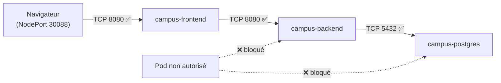

# Atelier 07 : Sécurité, Quotas de Ressources & Isolement Réseau (NetworkPolicy)

### Objectifs Pédagogiques :
* Protéger le cluster contre la surconsommation et l'effet « Noisy Neighbor » avec le couple **ResourceQuota** et **LimitRange**.
* Cloisonner le trafic réseau selon le modèle **Zéro-Trust** avec les **NetworkPolicies** : politique *Default Deny*, puis ouverture explicite des seuls flux légitimes (navigateur → frontend → backend → PostgreSQL).
* Auditer les privilèges et déléguer des accès avec les **ServiceAccounts** et le modèle **RBAC** (`kubectl auth can-i`).
* Vérifier que l'**API Server** est protégé par l'authentification et qu'**etcd** n'est pas joignable depuis Internet.

<div class="admonition info" markdown>
<p class="admonition-title"><strong>Compatibilité OS</strong></p>

Les commandes de cet atelier (`kubectl apply`, `kubectl describe resourcequota`, `kubectl auth can-i`) sont **rigoureusement identiques** sous **Windows (PowerShell)**, **Linux (Ubuntu)** et **macOS (Terminal)**. Quand une commande diffère, les deux variantes sont fournies.

</div>

<div class="admonition note" markdown>
<p class="admonition-title"><strong>Environnement : le cluster 3 nœuds (1 control plane + 2 workers) de l'Atelier 01</strong></p>

Les NetworkPolicies exigent un plugin réseau qui les applique (Calico, installé à l'Atelier 01) : réalisez ce lab sur ce cluster, piloté au choix :

* **Option A (Recommandée - Confort DevOps Local) :** depuis votre machine locale, avec votre `kubectl` et votre `kubeconfig`. Dans **chaque nouveau terminal**, placé à la racine du dépôt, pointez d'abord `kubectl` vers le fichier `kubeconfig.yaml` récupéré à l'étape 1 de l'exercice 4 de l'Atelier 01 :
    * Windows (PowerShell) : `$env:KUBECONFIG = "$PWD\labs\01-Installation-Cluster\terraform\kubeconfig.yaml"`
    * Linux / macOS (Bash) : `export KUBECONFIG=$PWD/labs/01-Installation-Cluster/terraform/kubeconfig.yaml`
    * Vérification : `kubectl get nodes` doit afficher les 3 nœuds à l'état `Ready`.
* **Option B (PC d'entreprise verrouillé) :** en SSH sur `k8s-control` : l'outillage et les manifests sont pré-installés dans `~/labs/`.

🛟 **Secours : Minikube sur votre poste** (session AWS indisponible). Les exercices 1 et 3 fonctionnent à l'identique. L'exercice 2 exige un Minikube démarré avec Calico (`minikube start --cni=calico`) : sans lui, les NetworkPolicies sont acceptées mais **n'ont aucun effet**. L'exercice 4 n'a pas d'équivalent sur Minikube.

</div>

<div class="admonition note" markdown>
<p class="admonition-title"><strong>Namespace de travail : <code>campus-dev</code></strong></p>

Ce lab est **indépendant des autres** : son étape 0 crée `campus-dev` s'il n'existe pas encore, puis y installe ou met à jour tout ce dont il a besoin. Vous pouvez le réaliser sans avoir fait les labs précédents ; pour le recommencer à zéro, utilisez l'encadré « Repartir de zéro » de l'étape 0.

</div>

---

## Contexte Métier
En environnement partagé ou de production réglementée (secteur bancaire, assurance, santé), laisser un conteneur consommer toute la mémoire d'un nœud ou permettre à n'importe quel conteneur compromis d'atteindre le port 5432 de PostgreSQL constitue une faille critique. Cet atelier verrouille les ressources, cloisonne le réseau et contrôle les droits d'accès à l'API.

Tous les manifests de l'atelier sont **fournis** dans le dossier `labs/07-Sécurité Cluster/manifests/` : vous les lisez, les appliquez et observez leurs effets.

<div class="admonition tip" markdown>
<p class="admonition-title"><strong>Mode d'emploi</strong></p>

* Les encadrés rouges **« À vous de répondre »** contiennent les questions. Toutes les commandes sont données.
* Répondez aux questions **pendant les attentes** (démarrage du backend, création des pods de test).
* Les encadrés **« Indice »** sont repliés : cliquez dessus seulement si vous bloquez.

</div>

---

## Étape 0 : Préparer l'environnement

Le dossier `starter/` du lab installe l'application complète dans l'état de fin de l'Atelier 05, complétée de sondes de santé sur le backend :

| Fichier | Contenu |
| :--- | :--- |
| `01-config.yaml` | Le ConfigMap `campus-config` (paramètres non sensibles de l'API). |
| `02-postgres.yaml` | Le PV `pv-postgres`, le PVC `pvc-postgres`, la base PostgreSQL persistante et son Service `postgres`. |
| `03-backend.yaml` | L'API `campus-backend` (2 réplicas, ConfigMap, Secret et sondes de santé, **sans** ressources : le LimitRange de l'exercice 1 les fournira) et son Service `campus-backend`. |
| `04-frontend.yaml` | Le frontend et son Service NodePort `campus-frontend-svc` (port `30088`). |

Les identifiants de la base ne sont **pas** versionnés dans le starter : vous créez le Secret `campus-db-credentials` par une commande, comme à l'Atelier 05.

Créez le namespace `campus-dev` s'il n'existe pas encore, sélectionnez-le, puis appliquez le starter. Si vous sortez du lab précédent, vos objets sont conservés et simplement mis à jour. Depuis la racine du dépôt (Option A) ou depuis `~` sur `k8s-control` (Option B : mettez d'abord le dépôt à jour avec `git -C ~/formation pull`, puis remplacez `labs/` par `~/labs/`) :

```bash
kubectl create namespace campus-dev --dry-run=client -o yaml | kubectl apply -f -   # sans effet s'il existe déjà
kubectl config set-context --current --namespace=campus-dev
kubectl create secret generic campus-db-credentials --from-literal=POSTGRES_DB=campus --from-literal=POSTGRES_USER=campus --from-literal='POSTGRES_PASSWORD=CampusSecret2026!' --dry-run=client -o yaml | kubectl apply -f -
kubectl apply -f "labs/07-Sécurité Cluster/starter/"
kubectl rollout status deployment/campus-postgres --timeout=180s
kubectl rollout status deployment/campus-backend --timeout=300s
```

<details class="warning" markdown>
<summary><strong>Environnement incohérent ou lab à recommencer ? Repartez de zéro</strong></summary>

Supprimez le namespace et tout son contenu, puis relancez les commandes ci-dessus :

```bash
kubectl delete namespace campus-dev   # ⚠️ supprime tout le contenu de campus-dev
kubectl delete pv pv-postgres --ignore-not-found   # le PV n'appartient à aucun namespace
```

*La suppression peut prendre jusqu'à une minute : `kubectl` rend la main quand elle est terminée.*

</details>

Le backend a maintenant des sondes de santé : `rollout status` attend que Spring Boot ait fini de démarrer (20 secondes à 2 minutes). **Pendant cette attente**, ouvrez dans votre éditeur `labs/07-Sécurité Cluster/manifests/01-limitrange.yaml` et `02-resourcequota.yaml` et lisez-les, sans les appliquer : le LimitRange ne doit arriver qu'**après** la fin du déploiement (question 2 de l'étape 1 de l'exercice 1).

Placez-vous ensuite dans le dossier du lab : les commandes suivantes utilisent des chemins courts (`manifests/…`).

```bash
cd "labs/07-Sécurité Cluster"   # Option B : cd ~/"labs/07-Sécurité Cluster"
```

---

## Exercice 1 : Limiter les ressources avec LimitRange & ResourceQuota

<div class="admonition abstract" markdown>
<p class="admonition-title"><strong>Ce que vous allez comprendre</strong></p>

Un `ResourceQuota` plafonne la consommation totale d'un namespace. Dès qu'il plafonne le CPU ou la mémoire, **tout pod sans `requests` ni `limits` est refusé** : c'est pourquoi on installe toujours d'abord un `LimitRange`, qui fournit des valeurs par défaut.

</div>

### Étape 1 : Installer un LimitRange

Appliquez le LimitRange lu à l'étape 0, affichez son détail, puis les ressources déclarées par les pods backend en cours d'exécution :

```bash
kubectl apply -f manifests/01-limitrange.yaml
kubectl describe limitrange campus-default-limits
kubectl get pods -l app=campus-backend -o custom-columns=POD:.metadata.name,RESSOURCES:.spec.containers[0].resources
```

<div class="admonition question" markdown>
<p class="admonition-title"><strong>À vous de répondre</strong></p>

1. Un conteneur créé **sans** section `resources` : quelles `requests` et quelles `limits` recevra-t-il ?
2. Les pods backend **déjà en cours d'exécution** ont-ils reçu ces valeurs (colonne `RESSOURCES`) ? Pourquoi ?

</div>

<details class="tip" markdown>
<summary><strong>Indice : quand le LimitRange agit-il ?</strong></summary>

Un LimitRange agit au moment de l'**admission**, c'est-à-dire quand l'API Server accepte un nouveau pod. Il ne modifie jamais un pod existant.

</details>

### Étape 2 : Plafonner le namespace avec un ResourceQuota

Le fichier `manifests/02-resourcequota.yaml` plafonne le namespace à : 10 pods, 2 cœurs et 2 Gio de RAM en `requests`, 4 cœurs et 4 Gio de RAM en `limits`. Appliquez-le, puis affichez sa consommation :

```bash
kubectl apply -f manifests/02-resourcequota.yaml
kubectl describe resourcequota campus-compute-quota
```

<div class="admonition question" markdown>
<p class="admonition-title"><strong>À vous de répondre</strong></p>

1. Combien de pods sont déjà comptés (colonne `Used`) ? Combien de `requests.cpu` sont consommées, et pourquoi cette valeur ?
2. Sans le LimitRange de l'étape 1, que se passerait-il si vous lanciez maintenant un pod sans section `resources` ?

</div>

<div class="admonition info" markdown>
<p class="admonition-title"><strong>Pourquoi 10 pods ?</strong></p>

Le namespace en compte déjà 5. Une mise à jour progressive avec `maxSurge: 1` a besoin d'une place pour le pod supplémentaire, et vos pods de test aussi. Un quota trop serré bloquerait les déploiements : dimensionnez-le toujours en tenant compte des *rolling updates*.

</div>

### Étape 3 : Tester le rejet

Le fichier `manifests/03-pod-trop-gros.yaml` décrit un pod qui demande **5 cœurs CPU**. Appliquez-le, puis cherchez le pod :

```bash
kubectl apply -f manifests/03-pod-trop-gros.yaml
kubectl get pod pod-trop-gros
```

<div class="admonition question" markdown>
<p class="admonition-title"><strong>À vous de répondre</strong></p>

1. Quel message renvoie l'API Server ? Quelles limites du quota sont dépassées ? Le pod existe-t-il ?
2. À quel moment le refus a-t-il lieu : avant ou après le placement sur un nœud ?

</div>

---

## Exercice 2 : Cloisonner le réseau avec les NetworkPolicies

<div class="admonition abstract" markdown>
<p class="admonition-title"><strong>Ce que vous allez comprendre</strong></p>

Par défaut, le réseau Kubernetes est **plat** : n'importe quel pod peut joindre n'importe quel autre. Le modèle Zéro-Trust consiste à **tout fermer**, puis à ouvrir uniquement les flux légitimes.

</div>

### Étape 1 : Constater que le réseau est ouvert

Un pod de test, sans aucun label, tente de joindre PostgreSQL avec l'outil `pg_isready` (l'image `postgres:16-alpine` est déjà présente sur les nœuds) :

```bash
kubectl run rogue-pod --image=postgres:16-alpine --rm -i --restart=Never -- pg_isready -h postgres -p 5432 -t 3
```

<div class="admonition question" markdown>
<p class="admonition-title"><strong>À vous de répondre</strong></p>

1. Que répond `pg_isready` ?
2. Ce pod n'a rien à voir avec l'application. Quel risque cela représente-t-il ?

</div>

### Étape 2 : Tout fermer (*Default Deny*)

Le fichier `manifests/04-default-deny-ingress.yaml` refuse **tout** le trafic entrant vers **tous** les pods du namespace (`podSelector: {}`). Appliquez-le, puis relancez le pod de test de l'étape 1 :

```bash
kubectl apply -f manifests/04-default-deny-ingress.yaml
kubectl run rogue-pod --image=postgres:16-alpine --rm -i --restart=Never -- pg_isready -h postgres -p 5432 -t 3
```

Rechargez ensuite le portail dans votre navigateur (`http://<IP_PUBLIQUE_WORKER>:30088`).

<div class="admonition question" markdown>
<p class="admonition-title"><strong>À vous de répondre</strong></p>

1. Que répond maintenant `pg_isready` ?
2. Le portail s'affiche-t-il encore ? Pourquoi ?
3. Les pods restent `Running` et `READY` : pourquoi les sondes de santé du kubelet ne sont-elles pas bloquées ?

</div>

<details class="tip" markdown>
<summary><strong>Indice : NetworkPolicy et sondes</strong></summary>

Une NetworkPolicy `Ingress` vide (`podSelector: {}` sans règle `ingress`) bloque toutes les connexions entrantes. Le trafic du **nœud** qui héberge le pod, celui du `kubelet` qui exécute les sondes, reste toujours autorisé.

</details>

### Étape 3 : Ouvrir les trois flux légitimes



Le fichier `manifests/05-campus-networkpolicies.yaml` contient trois NetworkPolicies, une par flux. Appliquez-le, puis listez et décrivez les NetworkPolicies du namespace :

```bash
kubectl apply -f manifests/05-campus-networkpolicies.yaml
kubectl get networkpolicy
kubectl describe networkpolicy
```

<div class="admonition question" markdown>
<p class="admonition-title"><strong>À vous de répondre</strong></p>

1. Pour chacune des trois nouvelles règles, indiquez : les pods **protégés** (`podSelector`), les sources **autorisées** (`from`) et le **port** ouvert.
2. La règle `allow-web-to-frontend` n'a pas de champ `from`. Que signifie cette absence ? Pourquoi est-elle nécessaire pour le NodePort ?

</div>

<details class="tip" markdown>
<summary><strong>Indice : lire une NetworkPolicy</strong></summary>

* `spec.podSelector` : les pods **auxquels la règle s'applique** (la destination).
* `ingress[].from` : qui a le droit d'entrer. Absent = toutes les sources.
* `ingress[].ports` : sur quel port.

Les règles s'additionnent : un flux passe dès qu'une règle l'autorise.

</details>

### Étape 4 : Tester l'intrusion et les flux légitimes

Relancez le pod de test de l'étape 1. Puis lancez un pod de test qui **porte le label du backend** :

```bash
kubectl run test-auth --image=postgres:16-alpine --labels='app=campus-backend' --rm -i --restart=Never -- pg_isready -h postgres -p 5432 -t 3
```

Testez enfin la chaîne complète à travers le frontend (ou rechargez le portail dans votre navigateur) :

**Linux / macOS**

```bash
curl -s http://<IP_PUBLIQUE_WORKER>:30088/actuator/health
```

**Windows (PowerShell)**

```powershell
curl.exe -s http://<IP_PUBLIQUE_WORKER>:30088/actuator/health
```

<div class="admonition question" markdown>
<p class="admonition-title"><strong>À vous de répondre</strong></p>

1. Que répond `pg_isready` pour `rogue-pod` ? Et pour `test-auth` ? Pourquoi cette différence ?
2. Le portail fonctionne-t-il de nouveau ? Que contient la réponse de `/actuator/health` ?
3. `test-auth` a obtenu l'accès simplement en **se déclarant** backend. Quelle faiblesse cela révèle-t-il ? Quel mécanisme (exercice 3) permet de la limiter ?

</div>

<details class="tip" markdown>
<summary><strong>Indice : le portail reste inaccessible</strong></summary>

* Vérifiez les labels des pods : `kubectl get pods --show-labels`. Les règles reposent sur `app=campus-frontend`, `app=campus-backend` et `app=campus-postgres`.
* Listez les règles actives et leur cible : `kubectl describe networkpolicy`.
* Utilisez l'IP **publique** actuelle d'un worker : elle change à chaque redémarrage de la session AWS.

</details>

---

## Exercice 3 : Contrôler l'accès à l'API avec RBAC

<div class="admonition abstract" markdown>
<p class="admonition-title"><strong>Ce que vous allez comprendre</strong></p>

Chaque appel à l'API Kubernetes est fait par une **identité** (un utilisateur, ou un **ServiceAccount** pour un programme) et autorisé, ou non, par des règles **RBAC**. Un compte ne reçoit que les droits dont il a besoin.

</div>

### Étape 1 : Auditer les droits

`kubectl auth whoami` affiche votre identité ; `kubectl auth can-i` répond `yes` ou `no` à la question « ai-je le droit de… ? ». L'option `--as` pose la question pour une autre identité :

```bash
kubectl auth whoami
kubectl auth can-i create pods
kubectl auth can-i delete namespaces
kubectl auth can-i list secrets --as=system:serviceaccount:campus-dev:default
```

<div class="admonition question" markdown>
<p class="admonition-title"><strong>À vous de répondre</strong></p>

1. Sous quel nom d'utilisateur et dans quel groupe travaillez-vous ? Pourquoi toutes vos réponses sont-elles `yes` ?
2. Que répond la dernière commande ? Qui est `system:serviceaccount:campus-dev:default`, et quels pods l'utilisent ?

</div>

### Étape 2 : Déléguer un accès en lecture seule

Une chaîne d'intégration continue doit seulement **lire** l'état des pods. Créez-lui un compte de service, un rôle en lecture seule et la liaison entre les deux :

```bash
kubectl create serviceaccount campus-ci-runner
kubectl create role pod-reader --verb=get,list,watch --resource=pods
kubectl create rolebinding read-pods --role=pod-reader --serviceaccount=campus-dev:campus-ci-runner
```

Vérifiez les droits accordés :

```bash
kubectl auth can-i list pods --as=system:serviceaccount:campus-dev:campus-ci-runner
kubectl auth can-i delete pods --as=system:serviceaccount:campus-dev:campus-ci-runner
kubectl auth can-i list pods -n kube-system --as=system:serviceaccount:campus-dev:campus-ci-runner
```

<div class="admonition question" markdown>
<p class="admonition-title"><strong>À vous de répondre</strong></p>

1. Quelles sont les trois réponses ? Expliquez chacune.
2. Quel est le rôle de chacun des trois objets créés (ServiceAccount, Role, RoleBinding) ?
3. Un `Role` agit dans un seul namespace. Quel objet faudrait-il pour donner un droit sur tout le cluster ?

</div>

---

## Exercice 4 : Protéger l'API Server et etcd

<div class="admonition abstract" markdown>
<p class="admonition-title"><strong>Ce que vous allez comprendre</strong></p>

`etcd` contient **tout** l'état du cluster, Secrets compris. Quiconque le lit directement contourne le RBAC. Sa première protection est le **réseau** : etcd ne doit jamais être joignable depuis Internet ; seul l'API Server, protégé par l'authentification, y accède.

</div>

### Tester l'exposition réseau depuis votre poste

Récupérez l'adresse de l'API Server inscrite dans votre kubeconfig, puis interrogez depuis **votre poste** l'API Server (port 6443) et etcd (port 2379) :

```bash
kubectl config view --minify -o jsonpath='{.clusters[0].cluster.server}'
```

**Linux / macOS**

```bash
curl -sk https://<IP_PUBLIQUE_k8s-control>:6443/version
curl -sk https://<IP_PUBLIQUE_k8s-control>:6443/api/v1/namespaces/campus-dev/secrets
curl -sk --max-time 5 https://<IP_PUBLIQUE_k8s-control>:2379/version ; echo "Code retour : $?"
```

**Windows (PowerShell)**

```powershell
curl.exe -sk https://<IP_PUBLIQUE_k8s-control>:6443/version
curl.exe -sk https://<IP_PUBLIQUE_k8s-control>:6443/api/v1/namespaces/campus-dev/secrets
curl.exe -sk --max-time 5 https://<IP_PUBLIQUE_k8s-control>:2379/version ; echo "Code retour : $LASTEXITCODE"
```

*En Option B, lancez ces trois `curl` depuis votre poste (`curl` est présent sur Windows 10/11, macOS et Linux).*

<div class="admonition question" markdown>
<p class="admonition-title"><strong>À vous de répondre</strong></p>

1. L'API Server répond-il à `/version` sans authentification ? Et à la liste des Secrets ? Sous quelle identité votre requête a-t-elle été traitée ?
2. etcd répond-il ? Que signifie le code retour `28` de `curl` ?

</div>

<details class="tip" markdown>
<summary><strong>Indice : et le port 6443 ouvert à <code>0.0.0.0/0</code> ?</strong></summary>

C'est un compromis de formation, pour que chacun utilise `kubectl` depuis son poste. En production, l'API Server n'est exposé qu'aux plages d'administration (VPN, bastion) ou via un endpoint privé. C'est le premier des « points à sécuriser » : **l'accès à l'API Kubernetes**.

</details>

<div class="admonition info" markdown>
<p class="admonition-title"><strong>Synthèse : les points à sécuriser</strong></p>

| Point à sécuriser | Mesure vue dans cet atelier |
| :--- | :--- |
| Accès à l'API Kubernetes | RBAC + ServiceAccounts dédiés (Ex. 3), exposition réseau du port 6443 (Ex. 4) |
| Limitation des ressources | `LimitRange` + `ResourceQuota` (Ex. 1) |
| Contrôle des accès réseau | `NetworkPolicy` *Default Deny* + flux autorisés (Ex. 2) |
| Restriction des accès à `etcd` | Isolement réseau : port 2379 fermé depuis Internet (Ex. 4) |

</div>

<div class="admonition note" markdown>
<p class="admonition-title"><strong>Et pour l'Atelier 06 ?</strong></p>

Laissez tout en place : l'étape 0 de l'Atelier 06 retire les NetworkPolicies, le ResourceQuota et le LimitRange, qui gêneraient ses incidents simulés.

</div>

---

## Critères de Validation (Checklist)

- [ ] Le LimitRange `campus-default-limits` et le ResourceQuota `campus-compute-quota` sont actifs (`kubectl describe resourcequota campus-compute-quota`).
- [ ] Le pod `pod-trop-gros` a été refusé par l'API Server (`exceeded quota`).
- [ ] La politique `default-deny-ingress` est active et seuls les trois flux légitimes sont ouverts (`kubectl get networkpolicy` en liste 4).
- [ ] `rogue-pod` n'atteint plus PostgreSQL, et le portail fonctionne toujours de bout en bout.
- [ ] Vous savez auditer des droits avec `kubectl auth can-i` et déléguer un accès en lecture seule (ServiceAccount + Role + RoleBinding).
- [ ] etcd ne répond pas depuis votre poste (`curl` sur le port `2379` : code retour `28`).
