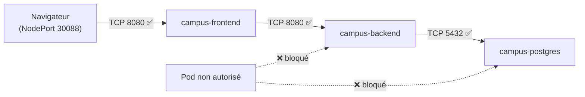

# Lab 07 : Sécurité, Quotas de Ressources & Isolement Réseau (NetworkPolicy)

### Objectifs Pédagogiques :
* Protéger le cluster contre la surconsommation et l'effet « Noisy Neighbor » avec le couple **ResourceQuota** et **LimitRange**.
* Cloisonner le trafic réseau selon le modèle **Zéro-Trust** avec les **NetworkPolicies** : politique *Default Deny*, puis ouverture explicite des seuls flux légitimes (navigateur → frontend → backend → PostgreSQL).
* Durcir les conteneurs selon les standards de sécurité NSA/CISA avec les **SecurityContext** (interdiction du compte root, système de fichiers en lecture seule).
* Auditer les privilèges et déléguer des accès avec les **ServiceAccounts** et le modèle **RBAC** (`kubectl auth can-i`).
* Restreindre les accès à **etcd** (isolement réseau, TLS mutuel, droits sur les clés) et constater l'absence de chiffrement des Secrets au repos.

> 📌 **Note Compatibilité OS :**  
> Les commandes de cet atelier (`kubectl apply`, `kubectl describe resourcequota`, `kubectl auth can-i`, `kubectl exec`) sont **rigoureusement identiques** sous **Windows (PowerShell)**, **Linux (Ubuntu)** et **macOS (Terminal)**.
>
> 💡 **Modalités d'exécution (Au choix) :**  
> * **Option A (Recommandée - Confort DevOps Local) :** Exécutez les commandes directement depuis votre machine locale avec votre `kubectl` et votre `kubeconfig`.  
> * **Option B (Secours - PC d'entreprise verrouillé) :** Connectez-vous en SSH sur `k8s-control` : l'outillage et les manifests sont pré-installés dans `~/labs/`.
>
> 🗂️ **Namespace de travail : `campus-dev`.** Ce lab est **indépendant des autres** : son étape 0 recrée `campus-dev` à neuf et y installe tout ce dont il a besoin. Vous pouvez le réaliser sans avoir fait les labs précédents, ou le recommencer à tout moment.

---

## Contexte Métier
En environnement partagé ou de production réglementée (secteur bancaire, assurance, santé), laisser un conteneur consommer toute la mémoire d'un nœud physique ou permettre à n'importe quel conteneur compromis d'accéder directement au port 5432 de la base de données PostgreSQL constitue une faille critique de sécurité. Cet atelier vous guide pour verrouiller les ressources système, cloisonner le réseau et durcir les conteneurs au niveau du noyau Linux.

---

## Étape 0 : Préparer l'environnement

Le dossier `starter/` du lab installe l'application complète dans l'état de fin du Lab 06 :

| Fichier | Contenu |
| :--- | :--- |
| `01-config.yaml` | Le ConfigMap `campus-config` (paramètres non sensibles de l'API). |
| `02-postgres.yaml` | Le PVC `pvc-postgres`, la base PostgreSQL persistante et son Service `postgres`. |
| `03-backend.yaml` | L'API `campus-backend` (2 réplicas, ConfigMap, Secret et sondes de santé, **sans** `securityContext` ni ressources : ce lab les ajoute) et son Service `campus-backend`. |
| `04-frontend.yaml` | Le frontend et son Service NodePort `campus-frontend-svc` (port `30088`). |

Les identifiants de la base ne sont **pas** versionnés dans le starter : vous créez le Secret `campus-db-credentials` par une commande, comme au Lab 05.

Repartez d'un namespace `campus-dev` vide, puis appliquez le starter. Depuis la racine du dépôt (Option A) ou depuis `~` sur `k8s-control` (Option B : mettez d'abord le dépôt à jour avec `git -C ~/formation pull`, puis remplacez `labs/` par `~/labs/`) :

```bash
kubectl delete namespace campus-dev --ignore-not-found   # ⚠️ supprime tout le contenu de campus-dev
kubectl create namespace campus-dev
kubectl config set-context --current --namespace=campus-dev
kubectl create secret generic campus-db-credentials --from-literal=POSTGRES_DB=campus --from-literal=POSTGRES_USER=campus --from-literal='POSTGRES_PASSWORD=CampusSecret2026!'
kubectl apply -f labs/07-securite-quotas/starter/
kubectl rollout status deployment/campus-postgres --timeout=180s
kubectl rollout status deployment/campus-backend --timeout=300s
```

*La suppression du namespace peut prendre jusqu'à une minute. Spring Boot met ensuite 20 secondes à 2 minutes à démarrer.*

---

## Exercice 1 : Gouvernance des Ressources avec LimitRange & ResourceQuota

En entreprise, un `ResourceQuota` seul crée un piège fréquent : dès qu'un quota de CPU/RAM est actif sur un namespace, **tout pod créé sans spécification explicite de `requests` et `limits` est immédiatement rejeté** par l'API Server ! C'est pourquoi on configure toujours un `LimitRange` en amont.

### 1. Configurer un LimitRange pour injecter des valeurs par défaut
Créez le fichier `campus-limitrange.yaml` qui attribue automatiquement des limites aux conteneurs qui n'en déclarent pas :

```yaml
apiVersion: v1
kind: LimitRange
metadata:
  name: campus-default-limits
spec:
  limits:
  - default:
      cpu: "500m"
      memory: "512Mi"
    defaultRequest:
      cpu: "100m"
      memory: "128Mi"
    type: Container
```

Appliquez le LimitRange :

```bash
kubectl apply -f campus-limitrange.yaml
kubectl describe limitrange campus-default-limits
```

### 2. Définir le plafond global avec un ResourceQuota
Créez le fichier `campus-quota.yaml` pour plafonner l'utilisation globale cumulée du namespace :
* Maximum 10 Pods au total
* Maximum 2 cœurs CPU (requests)
* Maximum 2 Go de RAM (requests)
* Maximum 4 cœurs CPU (limits)
* Maximum 4 Go de RAM (limits)

```yaml
apiVersion: v1
kind: ResourceQuota
metadata:
  name: campus-compute-quota
spec:
  hard:
    pods: "10"
    requests.cpu: "2"
    requests.memory: 2Gi
    limits.cpu: "4"
    limits.memory: 4Gi
```

> 💡 **Pourquoi 10 pods ?** Votre namespace en compte déjà 5 (2 backend, 2 frontend, 1 base). Une mise à jour progressive avec `maxSurge: 1` a besoin d'une place libre pour le pod supplémentaire, et vos pods de test aussi. Un quota trop serré bloquerait silencieusement les déploiements : dimensionnez toujours un quota en tenant compte des *rolling updates*.

Appliquez le ResourceQuota et visualisez la consommation en direct :

```bash
kubectl apply -f campus-quota.yaml
kubectl describe resourcequota campus-compute-quota
```

### 3. Test de rejet par l'Admission Controller
Tentez de déployer un pod sollicitant 5 cœurs CPU (dépassant le plafond autorisé de 4 cœurs) :

```bash
cat << 'EOF' | kubectl apply -f -
apiVersion: v1
kind: Pod
metadata:
  name: pod-trop-gros
spec:
  containers:
  - name: sleeper
    image: busybox:1.36
    command: ["sleep", "3600"]
    resources:
      requests:
        cpu: "5"
      limits:
        cpu: "5"
EOF
```

*Observez l'erreur immédiate renvoyée par l'API Server :*
> `Error from server (Forbidden): error when creating "STDIN": pods "pod-trop-gros" is forbidden: exceeded quota: campus-compute-quota, requested: limits.cpu=5,requests.cpu=5, used: ...`

Le cluster a automatiquement protégé ses ressources physiques !

---

## Exercice 2 : Cloisonnement Réseau Zéro-Trust avec NetworkPolicy

Par défaut dans Kubernetes, **le réseau est entièrement plat** : n'importe quel pod du cluster peut contacter le port 5432 de PostgreSQL, même un pod web compromis ou un script tiers.

### 1. État des lieux : un réseau entièrement ouvert
Vérifiez qu'un pod quelconque, sans aucun label, peut joindre PostgreSQL. Nous utilisons l'image `postgres:16-alpine`, déjà présente sur les nœuds, pour son outil de test `pg_isready` :

```bash
kubectl run rogue-pod --image=postgres:16-alpine --rm -i --restart=Never -- pg_isready -h postgres -p 5432 -t 3
```
*Résultat : `postgres:5432 - accepting connections`. N'importe quel conteneur compromis du cluster pourrait attaquer la base.*

### 2. Règle d'or Zéro-Trust : Isoler par défaut (*Default Deny Ingress*)
Créez le fichier `default-deny-ingress.yaml`, qui coupe **tout** le trafic entrant vers **tous** les pods du namespace (`podSelector: {}`) :

```yaml
apiVersion: networking.k8s.io/v1
kind: NetworkPolicy
metadata:
  name: default-deny-ingress
spec:
  podSelector: {}
  policyTypes:
  - Ingress
```

```bash
kubectl apply -f default-deny-ingress.yaml
```

> ⚠️ **Note sur le plugin CNI :** Les `NetworkPolicies` nécessitent un pilote réseau (CNI) compatible (Calico, Cilium, Weave, ou Kube-Router). Sur votre cluster AWS Kubeadm, Calico a été déployé au Lab 00 et applique nativement les NetworkPolicies.

Constatez les effets, puis rechargez le portail dans votre navigateur (`http://<IP_PUBLIQUE_WORKER>:30088`) :

```bash
kubectl run rogue-pod --image=postgres:16-alpine --rm -i --restart=Never -- pg_isready -h postgres -p 5432 -t 3
```
*La base ne répond plus (`no response`), mais le portail est également devenu inaccessible : plus rien n'entre dans aucun pod du namespace. Le modèle Zéro-Trust impose maintenant d'**autoriser explicitement** chaque flux légitime.*

> 💡 Les sondes `liveness` et `readiness` continuent de fonctionner : le trafic provenant du nœud qui héberge le pod (celui du `kubelet`) est toujours autorisé par les NetworkPolicies.

### 3. Ouvrir les trois flux légitimes du Campus Summer Portal



Créez le fichier `campus-networkpolicies.yaml`, qui contient les trois règles :

```yaml
# Flux 1 : le navigateur (via le NodePort) vers le frontend, sur son port 8080
apiVersion: networking.k8s.io/v1
kind: NetworkPolicy
metadata:
  name: allow-web-to-frontend
spec:
  podSelector:
    matchLabels:
      app: campus-frontend
  policyTypes:
  - Ingress
  ingress:
  - ports:
    - protocol: TCP
      port: 8080
---
# Flux 2 : uniquement le frontend vers l'API backend
apiVersion: networking.k8s.io/v1
kind: NetworkPolicy
metadata:
  name: allow-frontend-to-backend
spec:
  podSelector:
    matchLabels:
      app: campus-backend
  policyTypes:
  - Ingress
  ingress:
  - from:
    - podSelector:
        matchLabels:
          app: campus-frontend
    ports:
    - protocol: TCP
      port: 8080
---
# Flux 3 : uniquement le backend vers PostgreSQL
apiVersion: networking.k8s.io/v1
kind: NetworkPolicy
metadata:
  name: allow-only-backend-to-postgres
spec:
  podSelector:
    matchLabels:
      app: campus-postgres
  policyTypes:
  - Ingress
  ingress:
  - from:
    - podSelector:
        matchLabels:
          app: campus-backend
    ports:
    - protocol: TCP
      port: 5432
```

> 💡 Une règle `ingress` sans champ `from` (flux 1) accepte toutes les sources, mais seulement sur le port indiqué. C'est nécessaire pour le NodePort : le trafic arrive des nœuds, avec des adresses sources variables.

Appliquez les règles :

```bash
kubectl apply -f campus-networkpolicies.yaml
kubectl get networkpolicy
```

### 4. Test d'intrusion : Tentative d'accès pirate non autorisée
Relancez le conteneur pirate, sans le label `app=campus-backend` :

```bash
kubectl run rogue-pod --image=postgres:16-alpine --rm -i --restart=Never -- pg_isready -h postgres -p 5432 -t 3
```

*Résultat attendu :* `postgres:5432 - no response`. Le paquet est rejeté par le filtre réseau du noyau, programmé par Calico !

### 5. Validation des flux légitimes
1. Un conteneur de test portant l'étiquette autorisée `app=campus-backend` atteint la base :
   ```bash
   kubectl run test-auth --image=postgres:16-alpine --labels='app=campus-backend' --rm -i --restart=Never -- pg_isready -h postgres -p 5432 -t 3
   ```
   *Résultat attendu :* `postgres:5432 - accepting connections`. L'accès est accordé exclusivement au microservice habilité.

2. Rechargez le portail dans votre navigateur : il fonctionne de nouveau, données comprises. Vérifiez aussi la chaîne complète en ligne de commande, à travers le frontend :
   ```bash
   curl -s http://<IP_PUBLIQUE_WORKER>:30088/actuator/health
   ```
   *La réponse contient `"status":"UP"` et l'état de la base : navigateur → frontend → backend → PostgreSQL, chaque flux est explicitement autorisé.*

<details>
<summary>💡 <b>Indice : le portail reste inaccessible après l'application des règles</b></summary>

* Vérifiez les labels de vos pods : `kubectl get pods --show-labels`. Les règles reposent sur `app=campus-frontend`, `app=campus-backend` et `app=campus-postgres`.
* Listez les règles actives et leur cible : `kubectl describe networkpolicy`.
</details>

> ⚠️ Attention, le pod `test-auth` prouve aussi une faiblesse : **n'importe qui peut poser un label**. Une NetworkPolicy fondée sur les labels n'est solide que si les droits de créer des pods sont eux-mêmes restreints, ce que permet le RBAC (exercice 4).

---

## Exercice 3 : Durcissement des Conteneurs avec SecurityContext

Selon le guide de durcissement Kubernetes de la NSA et de la CISA, un conteneur de production ne doit jamais s'exécuter en tant qu'utilisateur `root` (UID 0), ne doit jamais pouvoir élever ses privilèges et doit idéalement monter son disque racine en lecture seule (*Read-only root filesystem*).

### 1. Intégrer les directives de sécurité au déploiement Backend
Créez le fichier `deployment-backend.yaml` en partant de `starter/03-backend.yaml` (partie Deployment) et complétez-le avec un bloc `securityContext` au niveau du pod et du conteneur, ainsi que des ressources explicites (sans elles, le `LimitRange` de l'exercice 1 imposerait ses valeurs par défaut) :

```yaml
apiVersion: apps/v1
kind: Deployment
metadata:
  name: campus-backend
spec:
  replicas: 2
  strategy:
    type: RollingUpdate
    rollingUpdate:
      maxSurge: 1
      maxUnavailable: 0
  selector:
    matchLabels:
      app: campus-backend
  template:
    metadata:
      labels:
        app: campus-backend
    spec:
      affinity:
        podAntiAffinity:
          preferredDuringSchedulingIgnoredDuringExecution:
          - weight: 100
            podAffinityTerm:
              topologyKey: kubernetes.io/hostname
              labelSelector:
                matchLabels:
                  app: campus-backend
      securityContext:
        runAsNonRoot: true
        runAsUser: 10001
        runAsGroup: 10001
        fsGroup: 10001
      containers:
      - name: campus-backend
        image: regaieg/campus:backend-1.0.0
        ports:
        - containerPort: 8080
        securityContext:
          allowPrivilegeEscalation: false
          readOnlyRootFilesystem: false
          capabilities:
            drop:
            - ALL
        resources:
          requests:
            cpu: 150m
            memory: 256Mi
          limits:
            cpu: 500m
            memory: 512Mi
        startupProbe:
          httpGet:
            path: /actuator/health/liveness
            port: 8080
          periodSeconds: 5
          failureThreshold: 36
        readinessProbe:
          httpGet:
            path: /actuator/health
            port: 8080
          periodSeconds: 5
          failureThreshold: 3
        livenessProbe:
          httpGet:
            path: /actuator/health/liveness
            port: 8080
          periodSeconds: 10
          failureThreshold: 3
        envFrom:
        - configMapRef:
            name: campus-config
        env:
        - name: SPRING_DATASOURCE_URL
          value: "jdbc:postgresql://postgres:5432/campus"
        - name: SPRING_DATASOURCE_USERNAME
          valueFrom:
            secretKeyRef:
              name: campus-db-credentials
              key: POSTGRES_USER
        - name: SPRING_DATASOURCE_PASSWORD
          valueFrom:
            secretKeyRef:
              name: campus-db-credentials
              key: POSTGRES_PASSWORD
```

> 💡 **Pourquoi `readOnlyRootFilesystem: false` ?** Spring Boot écrit des fichiers temporaires dans `/tmp`. Passer le système de fichiers en lecture seule exigerait de monter un volume `emptyDir` sur `/tmp` : c'est le niveau de durcissement suivant, à mettre en œuvre en production.

Appliquez le déploiement durci :

```bash
kubectl apply -f deployment-backend.yaml
kubectl rollout status deployment/campus-backend
```

### 2. Vérifier l'identité système du processus dans le conteneur
Vérifiez l'UID sous lequel tourne le conteneur :

```bash
kubectl exec -it deployment/campus-backend -- id
```

*Vous constatez : `uid=10001(10001) gid=10001(10001) groups=10001(10001)`. Le processus ne possède aucun droit d'administration sur le système hôte ! Les messages `id: cannot find name for user ID 10001` sont normaux : cet UID n'est pas déclaré dans le fichier `/etc/passwd` de l'image, ce qui n'empêche pas le processus de tourner.*

---

## Exercice 4 : Audit RBAC & ServiceAccount Dédié

Par défaut, chaque pod reçoit un jeton d'authentification lié au compte de service nommé `default` de son namespace (ici `system:serviceaccount:campus-dev:default`). Si ce jeton est compromis, un attaquant pourrait interroger l'API Kubernetes.

### 1. Tester les autorisations avec `kubectl auth can-i`
La commande `kubectl auth can-i` est l'outil indispensable de l'administrateur pour vérifier instantanément les droits d'un utilisateur ou d'un compte de service :

```bash
# Vérifier ce que vous avez le droit de faire
kubectl auth can-i create pods
kubectl auth can-i delete namespaces
kubectl auth can-i create clusterroles

# Vérifier les droits du compte de service par défaut
kubectl auth can-i list secrets --as=system:serviceaccount:campus-dev:default
```
*Le résultat doit être `no` : le compte de service applicatif standard n'a pas le droit d'énumérer les secrets du cluster.*

### 2. Créer un ServiceAccount restreint pour une tâche d'automatisation
Créez un compte de service dédié nommé `campus-ci-runner` et associez-lui un rôle en lecture seule :

```bash
kubectl create serviceaccount campus-ci-runner
kubectl create role pod-reader --verb=get,list,watch --resource=pods
kubectl create rolebinding read-pods --role=pod-reader --serviceaccount=campus-dev:campus-ci-runner
```

Validez les droits accordés :

```bash
kubectl auth can-i list pods --as=system:serviceaccount:campus-dev:campus-ci-runner
kubectl auth can-i delete pods --as=system:serviceaccount:campus-dev:campus-ci-runner
```
*Le premier retourne `yes`, le second retourne `no` ! Votre délégation RBAC est parfaitement étanche.*

---

## Exercice 5 : Restreindre les Accès à `etcd` et à l'API Server

`etcd` contient **l'intégralité** de l'état du cluster, y compris tous les `Secrets`. Quiconque peut lire `etcd` directement contourne totalement le RBAC de l'API Server. Sa protection repose sur 4 verrous : le **réseau**, l'**authentification mutuelle TLS**, les **droits sur les fichiers de clés** et le **chiffrement des données au repos**.

> 📌 **Modalité :** cet exercice s'exécute **sur `k8s-control` en SSH** (Option B), car il inspecte les fichiers du plan de contrôle. Il n'est pas réalisable sur KillerCoda ni sur Minikube de manière fiable.

### 1. Verrou réseau : qui peut joindre le port 2379 ?

1. Repérez les adresses d'écoute d'`etcd` :
   ```bash
   sudo ss -tlnp | grep -E ':2379|:2380'
   sudo grep -E 'listen-client-urls|listen-peer-urls' /etc/kubernetes/manifests/etcd.yaml
   ```
   *`etcd` écoute sur `127.0.0.1` et sur l'IP privée du nœud, jamais sur l'IP publique.*

2. Ouvrez `labs/00-provisioning-cluster/terraform/main.tf` et relisez les règles `ingress` du Security Group : seuls les ports `22`, `6443` et `30000-32767` sont ouverts sur Internet. Le port `2379` n'est joignable que depuis les nœuds du cluster (règle `self = true`).

<details>
<summary>💡 <b>Indice 1 : Et le port 6443 ouvert à 0.0.0.0/0 ?</b></summary>

C'est un compromis de formation pour que chacun puisse utiliser `kubectl` depuis son poste. En production, l'API Server n'est exposé qu'aux plages d'adresses d'administration (VPN, bastion) ou via un endpoint privé. C'est le premier des « points à sécuriser » : **l'accès à l'API Kubernetes**.
</details>

### 2. Verrou TLS mutuel : sans certificat client, pas de dialogue

1. Vérifiez qu'`etcd` exige un certificat client signé par sa propre autorité :
   ```bash
   sudo grep -E 'client-cert-auth|trusted-ca-file|cert-file|key-file' /etc/kubernetes/manifests/etcd.yaml
   ```

2. Tentez une connexion sans certificat client :
   ```bash
   curl -sk https://127.0.0.1:2379/version ; echo "Code retour : $?"
   ```
   *La négociation TLS échoue : `etcd` refuse tout client qui ne présente pas de certificat valide.*

3. Identifiez le **seul** client légitime d'`etcd`, l'API Server, et les certificats qu'il utilise :
   ```bash
   sudo grep -E 'etcd-(servers|cafile|certfile|keyfile)' /etc/kubernetes/manifests/kube-apiserver.yaml
   ```

### 3. Verrou système : les clés privées sont réservées à `root`

```bash
sudo ls -l /etc/kubernetes/pki/etcd/
```
*Les fichiers `.key` sont en mode `600` et appartiennent à `root`. C'est pourquoi toute commande `etcdctl` doit être préfixée par `sudo` : un accès SSH non privilégié au nœud ne suffit pas pour lire `etcd`.*

### 4. Verrou des données : vos Secrets sont-ils chiffrés dans `etcd` ?

1. Créez un secret de test, puis lisez-le **directement** dans `etcd`, sans passer par l'API :
   ```bash
   kubectl create secret generic test-etcd --from-literal=motdepasse=SuperSecret2026

   sudo ETCDCTL_API=3 etcdctl \
     --endpoints=https://127.0.0.1:2379 \
     --cacert=/etc/kubernetes/pki/etcd/ca.crt \
     --cert=/etc/kubernetes/pki/etcd/server.crt \
     --key=/etc/kubernetes/pki/etcd/server.key \
     get /registry/secrets/campus-dev/test-etcd | grep -a -o "motdepasse.*SuperSecret2026"
   ```
   *La sortie `motdepasseSuperSecret2026` montre la clé et la valeur en clair (`grep -a` traite le contenu binaire comme du texte) : par défaut, Kubeadm ne chiffre pas les Secrets au repos. L'encodage base64 vu au Lab 05 n'est **pas** un chiffrement.*

2. Supprimez le secret de test :
   ```bash
   kubectl delete secret test-etcd
   ```

<details>
<summary>💡 <b>Indice 2 : Comment chiffrer les Secrets au repos ?</b></summary>

On fournit à l'API Server un fichier `EncryptionConfiguration` via l'option `--encryption-provider-config` :

```yaml
apiVersion: apiserver.config.k8s.io/v1
kind: EncryptionConfiguration
resources:
- resources: ["secrets"]
  providers:
  - aescbc:
      keys:
      - name: cle-2026
        secret: <clé de 32 octets encodée en base64>
  - identity: {}
```

Les nouveaux Secrets sont alors chiffrés avant d'être écrits dans `etcd` ; les anciens doivent être réécrits (`kubectl get secrets -A -o json | kubectl replace -f -`). En production, on préfère un fournisseur **KMS** (AWS KMS, Google Cloud KMS, Azure Key Vault) pour que la clé ne soit jamais stockée sur le nœud.

Cette manipulation redémarre l'API Server : elle est démontrée par le formateur et non réalisée par chaque stagiaire.
</details>

### 5. Synthèse : les points à sécuriser

| Point à sécuriser | Mesure vue dans cet atelier |
| :--- | :--- |
| Accès à l'API Kubernetes | RBAC + ServiceAccounts dédiés (Ex. 4), exposition réseau du port 6443 |
| Limitation des ressources | `LimitRange` + `ResourceQuota` (Ex. 1) |
| Contrôle des accès réseau | `NetworkPolicy` *Default Deny* (Ex. 2) |
| Durcissement des conteneurs | `securityContext` non-root (Ex. 3) |
| Restriction des accès à `etcd` | Isolement réseau, TLS mutuel, droits `root`, chiffrement au repos (Ex. 5) |

---

## Critères de Validation (Checklist)

- [ ] Le couple `LimitRange` et `ResourceQuota` protège le cluster contre l'épuisement des CPU/RAM.
- [ ] La tentative de déploiement dépassant les quotas a été formellement rejetée par l'API Server.
- [ ] La politique `default-deny-ingress` est active et seuls les trois flux légitimes sont ouverts.
- [ ] Le trafic pirate vers le port `5432` de PostgreSQL est bloqué, et le portail fonctionne toujours de bout en bout.
- [ ] Le conteneur s'exécute avec l'UID `10001` sans privilèges root (`runAsNonRoot: true`).
- [ ] Vous savez auditer et déléguer des privilèges RBAC avec `kubectl auth can-i`.
- [ ] Vous avez vérifié qu'`etcd` refuse tout client sans certificat et n'est pas exposé sur Internet.
- [ ] Vous avez constaté qu'un Secret est lisible en clair dans `etcd` et connaissez la parade (`EncryptionConfiguration` / KMS).
