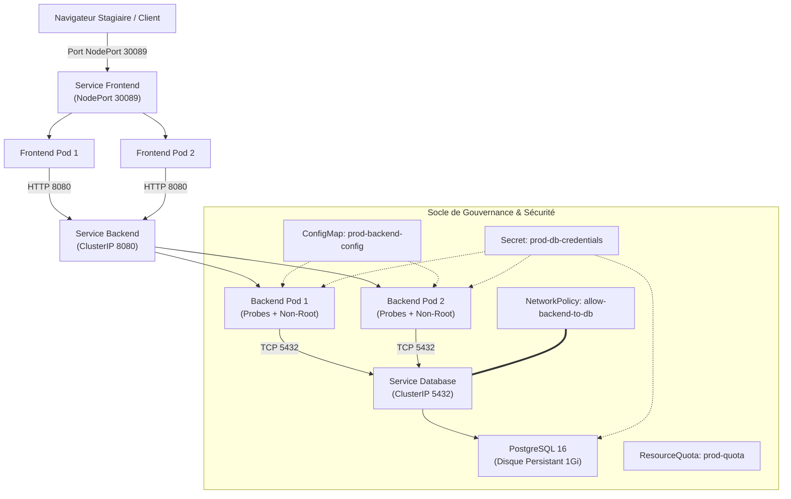

# Lab 08 : Challenge Final d'Intégration en Autonomie

### Objectif :
Mettre en œuvre l'ensemble des compétences acquises durant ces 2 journées pour concevoir, déployer et valider en autonomie l'architecture complète, résiliente et sécurisée du **Campus Summer Portal** de A à Z dans un environnement isolé de production.

> 📌 **Note Compatibilité OS :**  
> L'ensemble du déploiement s'exécute de façon déclarative via `kubectl apply -f ...` : c'est **rigoureusement identique** sous Windows (PowerShell), Linux (Ubuntu) et macOS (Terminal).
>
> 💡 **Modalités d'exécution (Au choix) :**  
> * **Option A (Recommandée - Confort DevOps Local) :** Éditez et appliquez vos manifests directement depuis votre machine locale avec votre IDE et votre `kubectl`. Zéro transfert de fichiers !  
> * **Option B (Secours - PC d'entreprise verrouillé) :** Connectez-vous en SSH sur `k8s-control` : les répertoires et manifests sont pré-déployés dans `~/labs/`.
>
> 🗂️ **Changement d'environnement : ce challenge se déroule dans `campus-prod`**, et non dans `campus-dev`. Vos manifests déclarent explicitement `metadata.namespace: campus-prod` et vos commandes utilisent `-n campus-prod` : votre contexte peut rester sur `campus-dev`, et votre environnement de développement reste intact.

---

## Architecture Cible de Production

Vous devez livrer un namespace isolé nommé `campus-prod` hébergeant la pile complète à trois niveaux (*Three-Tier Architecture*) :



---

## Cahier des Charges & Déroulé en 4 Jalons

Pour réussir ce challenge avancez méthode par méthode en respectant les 4 jalons ci-dessous.

---

## Jalon 1 : Isolation du Namespace & Socle de Configuration

### Spécifications :
1. Créez un namespace dédié nommé `campus-prod`.
2. Créez un Secret nommé `prod-db-credentials` dans `campus-prod` avec :
   * `POSTGRES_DB` : `campus`
   * `POSTGRES_USER` : `campus`
   * `POSTGRES_PASSWORD` : `ProductionSecretKey2026!`
3. Créez un ConfigMap nommé `prod-backend-config` dans `campus-prod` avec :
   * `SPRING_PROFILES_ACTIVE` : `production`
   * `SERVER_PORT` : `8080`
   * `LOGGING_LEVEL_COM_OKDLAB` : `INFO`
   * `JAVA_TOOL_OPTIONS` : `-XX:MaxRAMPercentage=75`
4. Créez un `ResourceQuota` nommé `prod-quota` plafonnant le namespace à :
   * Maximum 8 Pods
   * Requests CPU : `2` / Requests RAM : `2Gi`
   * Limits CPU : `4` / Limits RAM : `4Gi`
5. Créez un `LimitRange` nommé `prod-limits` pour fournir les requêtes et limites par défaut exigées par le `ResourceQuota` (`default: cpu 200m, memory 256Mi` / `defaultRequest: cpu 50m, memory 64Mi`).

<details>
<summary>💡 <b>Indice 1 : Solution Jalon 1 (Namespace, ConfigMap, Secret, Quota, LimitRange)</b></summary>

Créez le fichier `01-socle-config.yaml` :

```yaml
apiVersion: v1
kind: Namespace
metadata:
  name: campus-prod
---
apiVersion: v1
kind: Secret
metadata:
  name: prod-db-credentials
  namespace: campus-prod
type: Opaque
stringData:
  POSTGRES_DB: "campus"
  POSTGRES_USER: "campus"
  POSTGRES_PASSWORD: "ProductionSecretKey2026!"
---
apiVersion: v1
kind: ConfigMap
metadata:
  name: prod-backend-config
  namespace: campus-prod
data:
  SPRING_PROFILES_ACTIVE: "production"
  SERVER_PORT: "8080"
  LOGGING_LEVEL_COM_OKDLAB: "INFO"
  JAVA_TOOL_OPTIONS: "-XX:MaxRAMPercentage=75"
---
apiVersion: v1
kind: ResourceQuota
metadata:
  name: prod-quota
  namespace: campus-prod
spec:
  hard:
    pods: "8"
    requests.cpu: "2"
    requests.memory: 2Gi
    limits.cpu: "4"
    limits.memory: 4Gi
---
apiVersion: v1
kind: LimitRange
metadata:
  name: prod-limits
  namespace: campus-prod
spec:
  limits:
  - default:
      cpu: 200m
      memory: 256Mi
    defaultRequest:
      cpu: 50m
      memory: 64Mi
    type: Container
```

Appliquez-le :
```bash
kubectl apply -f 01-socle-config.yaml
```
</details>

---

## Jalon 2 : Persistance & Base de Données Sécurisée

### Spécifications :
1. Créez un PVC nommé `prod-postgres-pvc` de `1Gi` avec `ReadWriteOnce`.
2. Déployez PostgreSQL 16 (`image: postgres:16-alpine`, `replicas: 1`) :
   * Consommez les variables `POSTGRES_DB`, `POSTGRES_USER`, `POSTGRES_PASSWORD` depuis le Secret.
   * Spécifiez `PGDATA` vers `/var/lib/postgresql/data/pgdata`.
   * Montez le volume sur `/var/lib/postgresql/data`.
   * Définissez des limites de ressources raisonnables (`requests: cpu 100m, memory 256Mi` / `limits: cpu 250m, memory 512Mi`).
3. Créez un Service de type `ClusterIP` nommé `postgres` écoutant sur le port `5432`.
4. Créez une `NetworkPolicy` nommée `allow-backend-to-postgres` autorisant **exclusivement** les pods portant le label `app: campus-backend` à atteindre le port TCP `5432` du pod `app: campus-postgres`.

<details>
<summary>💡 <b>Indice 2 : Solution Jalon 2 (PVC, Deployment PostgreSQL, Service, NetworkPolicy)</b></summary>

Créez le fichier `02-database.yaml` :

```yaml
apiVersion: v1
kind: PersistentVolumeClaim
metadata:
  name: prod-postgres-pvc
  namespace: campus-prod
spec:
  accessModes:
    - ReadWriteOnce
  resources:
    requests:
      storage: 1Gi
---
apiVersion: apps/v1
kind: Deployment
metadata:
  name: campus-postgres
  namespace: campus-prod
spec:
  replicas: 1
  selector:
    matchLabels:
      app: campus-postgres
  template:
    metadata:
      labels:
        app: campus-postgres
    spec:
      containers:
      - name: postgres
        image: postgres:16-alpine
        ports:
        - containerPort: 5432
        resources:
          requests:
            cpu: 100m
            memory: 256Mi
          limits:
            cpu: 250m
            memory: 512Mi
        env:
        - name: POSTGRES_DB
          valueFrom:
            secretKeyRef:
              name: prod-db-credentials
              key: POSTGRES_DB
        - name: POSTGRES_USER
          valueFrom:
            secretKeyRef:
              name: prod-db-credentials
              key: POSTGRES_USER
        - name: POSTGRES_PASSWORD
          valueFrom:
            secretKeyRef:
              name: prod-db-credentials
              key: POSTGRES_PASSWORD
        - name: PGDATA
          value: /var/lib/postgresql/data/pgdata
        volumeMounts:
        - name: db-data
          mountPath: /var/lib/postgresql/data
      volumes:
      - name: db-data
        persistentVolumeClaim:
          claimName: prod-postgres-pvc
---
apiVersion: v1
kind: Service
metadata:
  name: postgres
  namespace: campus-prod
spec:
  type: ClusterIP
  selector:
    app: campus-postgres
  ports:
  - port: 5432
    targetPort: 5432
---
apiVersion: networking.k8s.io/v1
kind: NetworkPolicy
metadata:
  name: allow-backend-to-postgres
  namespace: campus-prod
spec:
  podSelector:
    matchLabels:
      app: campus-postgres
  policyTypes:
  - Ingress
  ingress:
  - from:
    - podSelector:
        matchLabels:
          app: campus-backend
    ports:
    - protocol: TCP
      port: 5432
```

Appliquez-le :
```bash
kubectl apply -f 02-database.yaml
kubectl wait --for=condition=ready pod -l app=campus-postgres -n campus-prod --timeout=90s
```
</details>

---

## Jalon 3 : API Backend Microservices & Sondes de Santé

### Spécifications :
1. Créez un déploiement `campus-backend` avec `2 réplicas` (image `regaieg/campus:backend-1.0.0`, port conteneur `8080`).
2. Injectez la variable `SPRING_DATASOURCE_URL` avec la chaîne JDBC : `jdbc:postgresql://postgres:5432/campus`.
3. Injectez `SPRING_DATASOURCE_USERNAME` et `SPRING_DATASOURCE_PASSWORD` depuis le secret `prod-db-credentials`.
4. Chargez les variables non sensibles via `envFrom: configMapRef: prod-backend-config`.
5. Configurez les trois sondes vues au Lab 06 (port `8080`) : **Startup Probe** et **Liveness Probe** sur `/actuator/health/liveness`, **Readiness Probe** sur `/actuator/health`. Avec seulement 400m de CPU, Spring Boot peut mettre plus d'une minute à démarrer : la startup probe doit lui en laisser le temps.
6. Ajoutez le durcissement de sécurité NSA : `runAsNonRoot: true`, `runAsUser: 10001`.
7. Allouez les ressources : `requests: cpu 150m, memory 256Mi` / `limits: cpu 400m, memory 512Mi`.
8. Exposez ce backend via un Service `ClusterIP` nommé **`campus-backend`** sur le port `8080`. Ce nom n'est pas négociable : c'est l'hôte amont `http://campus-backend:8080` attendu par le reverse proxy Nginx du frontend (Lab 02).

<details>
<summary>💡 <b>Indice 3 : Solution Jalon 3 (Deployment Backend avec Probes, SecurityContext et Service)</b></summary>

Créez le fichier `03-backend.yaml` :

```yaml
apiVersion: apps/v1
kind: Deployment
metadata:
  name: campus-backend
  namespace: campus-prod
spec:
  replicas: 2
  selector:
    matchLabels:
      app: campus-backend
  template:
    metadata:
      labels:
        app: campus-backend
    spec:
      securityContext:
        runAsNonRoot: true
        runAsUser: 10001
        runAsGroup: 10001
      containers:
      - name: backend
        image: regaieg/campus:backend-1.0.0
        ports:
        - containerPort: 8080
        resources:
          requests:
            cpu: 150m
            memory: 256Mi
          limits:
            cpu: 400m
            memory: 512Mi
        env:
        - name: SPRING_DATASOURCE_URL
          value: "jdbc:postgresql://postgres:5432/campus"
        - name: SPRING_DATASOURCE_USERNAME
          valueFrom:
            secretKeyRef:
              name: prod-db-credentials
              key: POSTGRES_USER
        - name: SPRING_DATASOURCE_PASSWORD
          valueFrom:
            secretKeyRef:
              name: prod-db-credentials
              key: POSTGRES_PASSWORD
        envFrom:
        - configMapRef:
            name: prod-backend-config
        startupProbe:
          httpGet:
            path: /actuator/health/liveness
            port: 8080
          periodSeconds: 5
          failureThreshold: 36
        livenessProbe:
          httpGet:
            path: /actuator/health/liveness
            port: 8080
          periodSeconds: 10
        readinessProbe:
          httpGet:
            path: /actuator/health
            port: 8080
          periodSeconds: 5
---
apiVersion: v1
kind: Service
metadata:
  name: campus-backend
  namespace: campus-prod
spec:
  type: ClusterIP
  selector:
    app: campus-backend
  ports:
  - port: 8080
    targetPort: 8080
```

Appliquez-le :
```bash
kubectl apply -f 03-backend.yaml
kubectl rollout status deployment/campus-backend -n campus-prod
```
</details>

---

## Jalon 4 : Frontend Web, Exposition NodePort & Validation Automatisée

### Spécifications :
1. Créez le déploiement `campus-frontend` (`2 réplicas`, image `regaieg/campus:frontend-1.0.0`, port `8080`).
2. Définissez les ressources : `requests: cpu 50m, memory 64Mi` / `limits: cpu 150m, memory 128Mi`.
3. Exposez le frontend avec un Service **NodePort** nommé `campus-frontend-svc` sur le port `80`, `targetPort: 8080` et `nodePort: 30089`.  
   *(Note : le port standard `30080` est alloué au contrôleur Ingress NGINX et `30088` au frontend du Lab 04).*

<details>
<summary>💡 <b>Indice 4 : Solution Jalon 4 (Frontend & Service NodePort)</b></summary>

Créez le fichier `04-frontend.yaml` :

```yaml
apiVersion: apps/v1
kind: Deployment
metadata:
  name: campus-frontend
  namespace: campus-prod
spec:
  replicas: 2
  selector:
    matchLabels:
      app: campus-frontend
  template:
    metadata:
      labels:
        app: campus-frontend
    spec:
      containers:
      - name: frontend
        image: regaieg/campus:frontend-1.0.0
        ports:
        - containerPort: 8080
        resources:
          requests:
            cpu: 50m
            memory: 64Mi
          limits:
            cpu: 150m
            memory: 128Mi
---
apiVersion: v1
kind: Service
metadata:
  name: campus-frontend-svc
  namespace: campus-prod
spec:
  type: NodePort
  selector:
    app: campus-frontend
  ports:
  - port: 80
    targetPort: 8080
    nodePort: 30089
```

Appliquez-le :
```bash
kubectl apply -f 04-frontend.yaml
kubectl rollout status deployment/campus-frontend -n campus-prod
```
</details>

---

## Script d'Auto-Évaluation Automatisée de Conformité

Pour valider l'intégralité de votre travail comme lors d'un audit de conformité de production, exécutez ce script de vérification dans un terminal **Bash** (Linux, macOS, Git Bash ou `k8s-control`) :

```bash
cat << 'EOF' > test-challenge.sh
#!/bin/bash
set -e
echo "=== 1. VERIFICATION DU NAMESPACE & QUOTA ==="
kubectl get ns campus-prod
kubectl describe resourcequota prod-quota -n campus-prod

echo -e "\n=== 2. VERIFICATION DU VOLUME PERSISTANT ==="
kubectl get pvc prod-postgres-pvc -n campus-prod | grep "Bound" && echo "-> PVC Bound OK"

echo -e "\n=== 3. ETAT DE SANTE DES PODS (PROBES & REPLICAS) ==="
kubectl get pods -n campus-prod -o wide

echo -e "\n=== 4. TEST DU DNS INTERNE ET DES ENDPOINTS ==="
kubectl get endpoints campus-backend postgres campus-frontend-svc -n campus-prod

echo -e "\n=== 5. VALIDATION DU PROCESSUS NON-ROOT BACKEND ==="
kubectl exec -n campus-prod deployment/campus-backend -- id

echo -e "\n=== 6. TEST DE CONNECTIVITE METIER API ET BASE ==="
kubectl run audit-curl --image=curlimages/curl -n campus-prod --rm -i --restart=Never -- \
  curl -s http://campus-backend:8080/actuator/health
echo ""
echo "=== TOUS LES VOYANTS SONT AU VERT ! CHALLENGE REUSSI ==="
EOF

chmod +x test-challenge.sh
./test-challenge.sh
```

---

## Crash-Test Final en Direct : Démonstration de Résilience

1. Récupérez l'adresse IP publique de l'un de vos nœuds workers (ex. `k8s-worker-1`).
2. Ouvrez directement votre navigateur web sur le port NodePort exposé :
   **`http://<IP_PUBLIQUE_WORKER>:30089`**
3. Saisissez une nouvelle candidature pour un stage dans le formulaire et cliquez sur **Envoyer la candidature** :
   * Constatez que la candidature s'affiche immédiatement dans la liste et que le compteur s'incrémente en direct.
4. Dans votre terminal, simulez une panne totale en supprimant brutalement le pod de base de données :
   ```bash
   kubectl delete pod -l app=campus-postgres -n campus-prod --force --grace-period=0
   ```
5. Attendez que le contrôleur recrée le pod sainement :
   ```bash
   kubectl wait --for=condition=ready pod -l app=campus-postgres -n campus-prod --timeout=60s
   ```
6. Rafraîchissez votre navigateur sur **`http://<IP_PUBLIQUE_WORKER>:30089`** :
   * **La candidature est intacte et toujours affichée !**
   * Le backend a géré la reconnexion à la base de données.
   * Le stockage persistant a protégé les données d'entreprise.

---

## Critères d'Évaluation Finale (Checklist)

- [ ] L'infrastructure complète est déployée dans le namespace isolé `campus-prod`.
- [ ] Le `ResourceQuota` et le `LimitRange` encadrent strictement l'empreinte mémoire et CPU.
- [ ] PostgreSQL tourne avec son volume persistant `Bound` de `1Gi`.
- [ ] La `NetworkPolicy` protège la base contre toute tentative d'intrusion hors du backend.
- [ ] Les 2 réplicas backend sont sains (`1/1 Running`) et validés par leurs `liveness` et `readiness` probes.
- [ ] Le backend fonctionne avec un utilisateur non-root (`UID 10001`).
- [ ] Le frontend est exposé en `NodePort 30089` et accessible directement depuis le navigateur.
- [ ] Le crash-test de suppression du pod de base de données a été exécuté avec succès sans perte de données.

---

## Clôture de la Formation : Libération Complète des Ressources AWS (Teardown)

Félicitations ! Vous avez conçu, déployé, sécurisé, supervisé et validé l'intégralité de l'architecture microservices de bout en bout sur Kubernetes.

À l'issue de ces 2 journées de formation, il est **impératif de détruire l'ensemble de l'infrastructure cloud** afin de libérer 100% des ressources et de ne laisser aucun coût résiduel sur votre compte AWS :

### Destruction de l'infrastructure via Terraform

Depuis votre machine locale (poste apprenant), placez-vous dans le répertoire Terraform et déclenchez la suppression complète :

#### Option A : Via la commande Terraform directe

* **Sous Windows (PowerShell) :**
  ```powershell
  cd labs\00-provisioning-cluster\terraform
  terraform destroy -auto-approve
  ```

* **Sous Linux / macOS (Bash) :**
  ```bash
  cd labs/00-provisioning-cluster/terraform
  terraform destroy -auto-approve
  ```

#### Option B : Via les scripts de clôture fournis

* **Sous Windows (PowerShell) :**
  ```powershell
  .\labs\00-provisioning-cluster\scripts\destroy-cluster.ps1 -AutoApprove
  ```

* **Sous Linux / macOS (Bash) :**
  ```bash
  ./labs/00-provisioning-cluster/scripts/destroy-cluster.sh -y
  ```

> 💡 **Que se passe-t-il lors de la destruction ?**  
> Terraform libère l'IP élastique fixe (EIP), résilie les 3 instances EC2, supprime tous les volumes de stockage EBS attachés ainsi que le groupe de sécurité réseau. Votre compte AWS retombe ainsi à une facturation strictement nulle.
