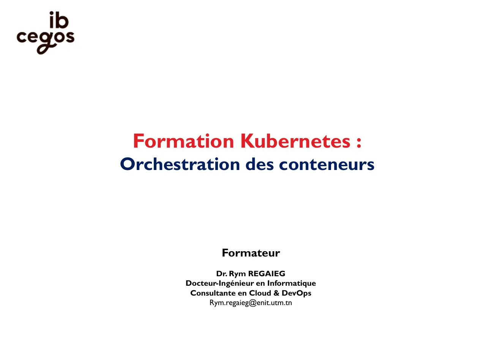

# Support de Cours et Ateliers pratiques

Cette page rassemble les supports de la **partie cours** de la formation **Kubernetes**. Ils complètent les ateliers pratiques et préparent l'[évaluation des acquis](evaluation.md).

<strong>Comment utiliser ces supports</strong>

Le support de présentation reprend les apports théoriques du formateur (environ 30 % du temps de formation). Les fiches PDF des ateliers sont la version imprimable des énoncés publiés dans l'onglet **Ateliers Pratiques**.

---

## Support de présentation

Le support de cours **Kubernetes — XW335** (133 diapositives) est consultable en lecture seule ci-dessous. Naviguez avec les boutons ou les flèches du clavier (cliquez d'abord sur la visionneuse).

<!-- Support en lecture seule : le PDF n'est pas publié (il est conservé hors du dépôt, dans supports/).
Pour ouvrir le téléchargement en fin de session : copier supports/XW335_Kubernetes_Support-Cours.pdf
dans docs/assets/, puis ajouter ici :
[:material-file-pdf-box: Télécharger le support de cours (PDF)](assets/XW335_Kubernetes_Support-Cours.pdf){ .md-button .md-button--primary }
-->

  

  

    <button type="button" class="sv-first md-button" title="Première diapositive">⏮</button>
    <button type="button" class="sv-prev md-button" title="Précédente">◀</button>
    <input class="sv-input" type="number" min="1" value="1" aria-label="Numéro de diapositive"> / 133
    <button type="button" class="sv-next md-button" title="Suivante">▶</button>
    <button type="button" class="sv-full md-button" title="Plein écran">⛶</button>
  

---

## Plan du cours

Le cours suit les 5 chapitres du programme officiel. Le tableau indique les ateliers qui mettent chaque chapitre en pratique.

| # | Chapitre | Notions abordées | Mise en pratique |
| :---: | :--- | :--- | :--- |
| 1 | **Introduction** | Origine du projet, fonctionnalités, containers supportés, plates-formes utilisant Kubernetes, composants, définitions (pods, labels, controllers, services) | [Atelier 02](labs/02-pods-trois-briques.md), [Atelier 03](labs/03-deploiements-resilience-rollback.md), [Atelier 04](labs/04-reseau-services-dns.md) |
| 2 | **Architecture** | Master : etcd (stockage des configurations), API Server ; Nœuds : hébergement des containers, Kubelet | Démonstration formateur |
| 3 | **Installation et configuration** | Solutions d'installation ; kubectl, minikube, kubeadm ; mémoire, stockage, CPU, affectation de pods à des nœuds ; configuration d'applications et exécution | [Atelier 01](labs/01-provisionnement-cluster.md), [Atelier 02](labs/02-pods-trois-briques.md), [Atelier 05](labs/05-configuration-stockage-persistant.md) |
| 4 | **Administration** | Supervision, logs, debugging ; `kubectl exec` ; Node Problem Detector ; StackDriver | Jour 2 |
| 5 | **Sécurité** | Points à sécuriser ; accès à l'API ; limitation des ressources ; contrôle des accès réseau ; restrictions des accès à etcd | Jour 2 |

---

## Fiches PDF des ateliers

| Atelier | Fiche PDF |
| :--- | :---: |
| Atelier 01 : Provisionnement du Cluster | [:material-file-pdf-box: PDF](https://github.com/Rym28/kubernetes-training/raw/main/pdf/ateliers/Atelier-01-Installation-Cluster.pdf) |
| Atelier 02 : Les Pods | [:material-file-pdf-box: PDF](https://github.com/Rym28/kubernetes-training/raw/main/pdf/ateliers/Atelier-02-Les-Pods.pdf) |
| Atelier 03 : Déploiements — Résilience & Rollback | [:material-file-pdf-box: PDF](https://github.com/Rym28/kubernetes-training/raw/main/pdf/ateliers/Atelier-03-Les-Deploiements-Scheduling.pdf) |
| Atelier 04 : Réseau, Services & Découverte DNS | [:material-file-pdf-box: PDF](https://github.com/Rym28/kubernetes-training/raw/main/pdf/ateliers/Atelier-04-Les-Services.pdf) |
| Atelier 05 : Configuration & Stockage Persistant | [:material-file-pdf-box: PDF](https://github.com/Rym28/kubernetes-training/raw/main/pdf/ateliers/Atelier-05-Les-Volumes.pdf) |
