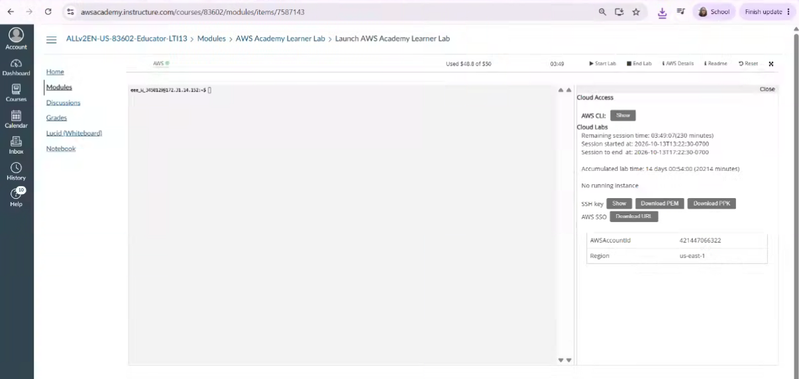
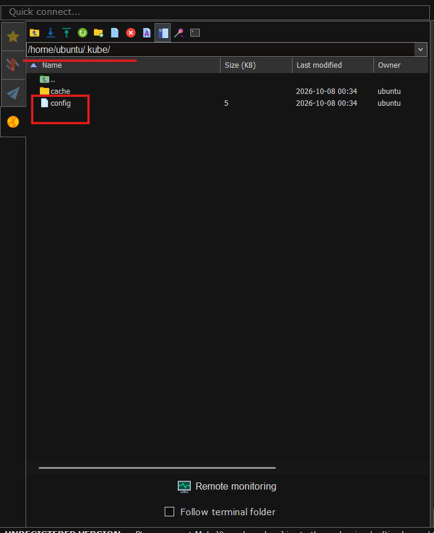

# Lab 00 : Provisionnement du Cluster — D'un cluster mono-nœud avec Minikube au cluster multi-nœuds avec Kubeadm

### Objectifs Pédagogiques :
1. **Installer** un cluster local **Minikube** et en **identifier** les limites.
2. **Provisionner** les 3 instances EC2 du cluster avec **Terraform**.
3. **Se connecter** aux nœuds en SSH et **piloter** plusieurs terminaux avec **MobaXterm**.
4. **Assembler** un cluster multi-nœuds avec **Kubeadm** et le CNI **Calico**.
5. **Administrer** le cluster depuis son poste avec `kubectl`.

### Outils nécessaires

* **Minikube** : un cluster Kubernetes à un seul nœud, sur votre poste.
* **AWS Academy Learner Lab** : un compte AWS temporaire (sessions de 4 h) fourni par la formation.
* **EC2** : le service de machines virtuelles d'AWS ; une machine s'appelle une **instance**.
* **Terraform** : crée les instances EC2 à partir de fichiers de configuration, sans clic dans la console AWS.
* **Client SSH** : `ssh` en ligne de commande, ou **MobaXterm** sous Windows, qui ouvre plusieurs sessions et peut taper la même commande dans toutes (*Multi-Exec*).
* **kubeadm** : l'outil officiel qui initialise un plan de contrôle et fait rejoindre les nœuds au cluster.
* **kubelet** et **containerd** : l'agent du nœud et le runtime de conteneurs, installés par le script `bootstrap.sh` du dépôt.
* **Calico** : le plugin réseau (CNI, *Container Network Interface*) qui donne une adresse IP à chaque pod et relie les pods entre nœuds.

### Où lancer les commandes

Ce lab utilise deux sortes de machines, que le titre de chaque bloc de commandes désigne :

* **votre poste** (*Votre poste — …*) : étapes 0 à 3 et étape 6 ;
* **les nœuds du cluster**, dans une session SSH ouverte à l'étape 4 : *Les trois nœuds — SSH*, *k8s-control — SSH* ou *k8s-worker-1 et k8s-worker-2 — SSH*.

> 📌 **Note Compatibilité OS :** sur votre poste, les commandes sont données pour **Windows (PowerShell)** et **Linux/macOS (Bash)** lorsqu'elles diffèrent. Les nœuds sont sous **Ubuntu** : les commandes y sont toujours des commandes Linux, quel que soit le système de votre poste.

### Le parcours en un coup d'œil

```text
 Étape 0          Étape 1          Étape 2           Étape 3             Étape 4         Étape 5              Étape 6
 git clone  ──▶   Minikube   ──▶   AWS Academy ──▶   Terraform     ──▶   SSH        ──▶  kubeadm init/join ──▶ kubectl local
 (dépôt)          (poste local)    (clé + accès)     (3 instances EC2)   (MobaXterm)     (vous installez K8s)  (kubeconfig)
```

---

## Contexte Métier

L'Université Horizon lance le **Campus Summer Portal**, un portail de stages pour 25 000 étudiants composé de trois briques : un **frontend** Nginx, une **API** Spring Boot et une base **PostgreSQL**.

Pour le développer, chaque ingénieur dispose d'un cluster local (**Minikube**). Mais pour l'éprouver en conditions réelles (pannes de nœuds, réseau distribué, stockage), il faut un cluster **multi-nœuds** : 1 Control Plane et 2 Workers.

### Solutions d'installation de Kubernetes

| Solution | Usage | Exemple |
| :--- | :--- | :--- |
| Cluster local à un nœud | Développement, tests | **Minikube** (étape 1), kind |
| Installation sur ses propres machines | Contrôle complet, on-premise, formation | **kubeadm** (étapes 3 à 5) |
| Service managé *(hors programme, pour information)* | Production cloud : le fournisseur gère le plan de contrôle | EKS (AWS), GKE (Google), AKS (Azure) |

Vous allez construire vous-même le cluster multi-nœuds :

| Qui ? | Fait quoi ? |
| :--- | :--- |
| **Terraform** | Crée l'infrastructure AWS : 3 instances EC2, disques, Security Group, Elastic IP. |
| **`bootstrap.sh`** (lancé par `cloud-init`) | Prépare l'OS de chaque instance et installe `containerd`, `kubeadm`, `kubelet`, `kubectl`. |
| **Vous** | Initialisez le Control Plane, installez le réseau Calico et raccordez les Workers. |

> 💰 Budget AWS Academy : **50 $** pour toute la formation. Pensez à éteindre vos instances chaque soir (voir étape 3.4).

---

## Étape 0 : Récupérer le dépôt de la formation

> 🎯 **Objectif :** disposer en local des fichiers de la formation (Terraform, scripts, manifests des labs).

**Votre poste — PowerShell ou terminal Linux**

```bash
git clone https://github.com/Rym28/kubernetes-training.git formation
cd formation
```

> 📂 Tous les chemins de ce lab (ex. `labs/00-provisioning-cluster/terraform/`) sont relatifs à ce dossier `formation`.

✅ **Point de contrôle :** `ls` (ou `dir`) affiche notamment le dossier `labs/`.

---

## Étape 1 : Le Cluster Local avec Minikube

> 🎯 **Objectif :** disposer d'un cluster Kubernetes sur votre poste et lancer vos premières commandes `kubectl`.

### 1.1 Installer Minikube

**Prérequis :** 2 vCPU, 4 Go de RAM libres et **Docker Desktop** démarré. Vérifiez :

**Votre poste — PowerShell ou terminal Linux**

```bash
docker ps
minikube version
```

Si `minikube` n'est pas reconnu, installez-le :

| Système | Commande |
| :--- | :--- |
| Windows (PowerShell) | `winget install Kubernetes.minikube` |
| macOS | `brew install minikube` |
| Linux | `curl -LO https://storage.googleapis.com/minikube/releases/latest/minikube-linux-amd64 && sudo install minikube-linux-amd64 /usr/local/bin/minikube` |

> 💡 **Poste d'entreprise verrouillé (pas de Docker, pas de droits admin) ?** Ne perdez pas de temps : passez directement à l'**étape 2**. Le cluster AWS est l'environnement de référence de la formation.

### 1.2 Démarrer et observer le cluster

**Votre poste — PowerShell ou terminal Linux**

```bash
minikube start --cpus=2 --memory=4096 --driver=docker
minikube status
kubectl get nodes -o wide
minikube addons list
```

**Observez :** un **seul nœud** (`minikube`) joue à la fois le rôle de Control Plane et de Worker.

<details>
<summary>💡 <b>Pourquoi ne pas faire toute la formation sur Minikube ?</b></summary>

* **Un seul nœud** : impossible de simuler la panne d'un worker ou de répartir des Pods sur plusieurs machines (Lab 03).
* **Stockage sur une seule machine** : on ne voit pas qu'un volume reste attaché au nœud qui l'héberge (Lab 05).
* **Installation masquée** : Minikube installe Kubernetes à votre place. Avec `kubeadm`, vous verrez ce qui se passe sous le capot (Lab 01).
</details>

✅ **Point de contrôle :** `kubectl get nodes` affiche le nœud `minikube` à l'état `Ready`.

---

## Étape 2 : Préparer l'environnement cloud AWS pour construire le cluster multi-nœuds

> 🎯 **Objectif :** démarrer votre session AWS Academy et récupérer la clé SSH et les identifiants dont Terraform a besoin.

### 2.1 Démarrer le Learner Lab

1. Connectez-vous à **AWS Academy**, ouvrez votre cours **Learner Lab** et cliquez sur **Start Lab**.


2. Attendez 1 à 2 minutes que le voyant passe au **vert** :


### 2.2 Récupérer la clé SSH et les identifiants

Cliquez sur **AWS Details** :



1. **Download SSH Key** : enregistrez la clé privée `labsuser.pem` dans `labs/00-provisioning-cluster/terraform/`.
2. **AWS CLI → Show** : gardez cette fenêtre ouverte, vous copierez les 3 identifiants à l'étape 3.3.

> 🔒 **Sécurité :** la clé `.pem` et les identifiants donnent accès à votre compte AWS. Ne les committez jamais (le `.gitignore` exclut `*.pem`) et ne les collez dans aucune messagerie ni aucun outil en ligne. Les identifiants **expirent après 4 heures** : recopiez-les à chaque nouvelle session.

✅ **Point de contrôle :** le voyant est vert et `labsuser.pem` est dans le dossier `terraform/`.

---

## Étape 3 : Création des 3 Instances EC2 avec Terraform

> 🎯 **Objectif :** créer les 3 serveurs du cluster en **une seule commande**, sans un clic dans la console AWS.

```text
                 VPC AWS Learner Lab
                          │
       ┌──────────────────┼──────────────────┐
       ▼                  ▼                  ▼
 [ k8s-control ]   [ k8s-worker-1 ]   [ k8s-worker-2 ]
   Control Plane       Worker             Worker
   t3.large (2 vCPU, 8 Go) · Ubuntu 24.04 · Security Group k8s-formation-sg
```

### 3.1 Installer Terraform

**Votre poste — PowerShell ou terminal Linux**

```bash
terraform version
```

Si la commande n'est pas reconnue :

| Système | Commande |
| :--- | :--- |
| Windows (PowerShell) | `winget install HashiCorp.Terraform` |
| macOS | `brew tap hashicorp/tap && brew install hashicorp/tap/terraform` |
| Linux | Suivre la [procédure APT officielle HashiCorp](https://developer.hashicorp.com/terraform/install#linux) |

> 💡 **Sans droits administrateur (Windows) :** téléchargez le zip sur [developer.hashicorp.com/terraform/install](https://developer.hashicorp.com/terraform/install) et copiez `terraform.exe` dans `labs/00-provisioning-cluster/terraform/`.

### 3.2 Se placer dans le dossier Terraform

**Votre poste — PowerShell ou terminal Linux**

```bash
cd labs/00-provisioning-cluster/terraform
ls
```

Résultat attendu :

```text
labsuser.pem  main.tf  outputs.tf  provider.tf  scripts  terraform.tfvars.example  variables.tf
```

> ⚠️ `labsuser.pem` n'apparaît pas ? Revenez à l'étape 2.2 : la clé doit être dans ce dossier pour les étapes suivantes.

<details>
<summary>🔍 <b>Pour aller plus loin (optionnel) : ce que Terraform va créer</b></summary>

* **`variables.tf`** et **`terraform.tfvars.example`** : les réglages et leurs valeurs par défaut (région `us-east-1`, clé `vockey`, type `t3.large`, disques de 35 Go et 30 Go). Pour en changer un, copiez `terraform.tfvars.example` en `terraform.tfvars` et modifiez la copie.
* **`main.tf`** : les 3 instances EC2, l'Elastic IP de `k8s-control` et le **Security Group**, c'est-à-dire le pare-feu des instances : il liste les ports ouverts et les sources autorisées.

| Port | Usage |
| :--- | :--- |
| 22 | SSH vers les nœuds |
| 6443 | `kubectl` depuis votre poste vers l'API Server |
| 30000-32767 | Services NodePort (application, Grafana) |
| Tout le trafic entre les nœuds | API Server, etcd, kubelet, réseau Calico |

</details>

#### Ce que `bootstrap.sh` prépare sur chaque nœud

Le script `scripts/bootstrap.sh` est injecté dans le `user_data` de chaque instance et exécuté par `cloud-init` au premier démarrage. Il applique les prérequis de `kubeadm` :

| Réglage | Pourquoi Kubernetes en a besoin |
| :--- | :--- |
| `hostnamectl set-hostname` | Kubernetes reprend le nom d'hôte comme nom de nœud (`k8s-worker-1`…), réutilisé par les labs (`kubectl label node …`). |
| `swapoff -a` | Le kubelet exige une gestion de la mémoire sans swap. |
| Modules `overlay` et `br_netfilter` | `overlay` : système de fichiers en couches des images de conteneurs. `br_netfilter` : filtrage du trafic entre pods. |
| Paramètres `sysctl` | Laissent passer le trafic des pods (routage IP, filtrage des ponts). |
| `containerd` (`SystemdCgroup = true`) | Le runtime de conteneurs (CRI), configuré pour gérer les ressources des conteneurs avec systemd, comme le kubelet. |
| `kubelet`, `kubeadm`, `kubectl` v1.30 (`apt-mark hold`) | L'agent du nœud, l'outil d'installation et le client, verrouillés à cette version. |

> 📦 Le script clone aussi le dépôt de la formation dans `~/formation` et crée le raccourci `~/labs` sur chaque nœud.

### 3.3 Exporter les identifiants AWS

**Pourquoi ?** Terraform crée les instances en appelant l'API d'AWS depuis votre poste. AWS doit donc savoir **qui** fait la demande et **sur quel compte** : sans identifiants, `terraform apply` est refusé.

* `AWS_ACCESS_KEY_ID` et `AWS_SECRET_ACCESS_KEY` : l'identifiant et le mot de passe de votre compte Learner Lab pour l'API.
* `AWS_SESSION_TOKEN` : un jeton temporaire, propre au Learner Lab, qui expire avec la session (4 h).
* `AWS_DEFAULT_REGION` : la région où créer les instances (`us-east-1`).

Terraform lit automatiquement ces **variables d'environnement** : aucun identifiant n'est écrit dans un fichier, donc rien de secret ne risque d'être committé.

> 🔑 Ne confondez pas : la clé `labsuser.pem` (étape 2.2) sert à vous connecter **aux instances** en SSH ; ces identifiants servent à **créer** les instances via l'API AWS.

Collez les valeurs affichées dans **AWS Details → AWS CLI** :

**Votre poste — Windows (PowerShell)**
```powershell
$env:AWS_ACCESS_KEY_ID="ASI..."
$env:AWS_SECRET_ACCESS_KEY="..."
$env:AWS_SESSION_TOKEN="..."
$env:AWS_DEFAULT_REGION="us-east-1"
```

**Votre poste — Linux / macOS (Bash)**
```bash
export AWS_ACCESS_KEY_ID="ASI..."
export AWS_SECRET_ACCESS_KEY="..."
export AWS_SESSION_TOKEN="..."
export AWS_DEFAULT_REGION="us-east-1"
```

> Ces variables ne valent que pour le terminal où vous les avez définies : lancez Terraform dans ce même terminal.

### 3.4 Lancer le provisionnement

**Votre poste — PowerShell ou terminal Linux**

```bash
terraform init
terraform apply -auto-approve
terraform output
```

En **1 à 2 minutes**, les 3 instances sont créées. Notez l'**IP publique** et l'**IP privée** (`172.31.x.y`) de chaque instance, affichées par `terraform output`.

> ⏳ Terraform rend la main avant que `cloud-init` ait fini d'installer Kubernetes (**3 à 5 minutes** de plus). Profitez-en pour configurer vos connexions SSH (étape 4).

<details>
<summary>💡 <b>Indice : <code>terraform apply</code> échoue</b></summary>

* `ExpiredToken` / `InvalidClientTokenId` : identifiants expirés ou incomplets. Recopiez-les depuis *AWS Details* (le `AWS_SESSION_TOKEN` est très long).
* `UnauthorizedOperation` : le Learner Lab n'autorise que `us-east-1` et `us-west-2` (variable `aws_region`, voir 3.2).
* `InvalidKeyPair.NotFound` : la paire de clés doit s'appeler `vockey` (variable `key_name`).
</details>

<details>
<summary>💰 <b>Maîtriser le budget : pause du soir et destruction finale</b></summary>

**Le soir (entre J1 et J2)** : éteignez les instances sans les détruire, le cluster est conservé.

```bash
./scripts/stop-session.sh      # Linux/macOS
.\scripts\stop-session.ps1     # Windows
```

Le matin, relancez-les avec `start-session.sh` / `start-session.ps1`. Ces scripts utilisent l'**AWS CLI** et les identifiants de l'étape 3.3 (à recopier à chaque session).

> `k8s-control` garde son IP publique (Elastic IP) : votre kubeconfig reste valide. Les **workers changent d'IP publique** : notez les nouvelles adresses pour les NodePorts (Labs 04 et 08).

**En fin de formation** : supprimez tout pour revenir à 0 $.

```bash
terraform destroy -auto-approve
```
</details>

✅ **Point de contrôle :** les 3 instances `k8s-control`, `k8s-worker-1` et `k8s-worker-2` sont à l'état *Running* dans la console EC2.

---

## Étape 4 : Connexions SSH & MobaXterm

> 🎯 **Objectif :** ouvrir une session sur chacun des 3 nœuds.

### 4.1 Connexion SSH en ligne de commande

Depuis le dossier `terraform/`, où se trouve `labsuser.pem`, commencez par **le nœud Control Plane** (`k8s-control`). Remplacez `<IP_PUBLIQUE_CONTROL>` par la valeur `control_plane_public_ip` de `terraform output` :

**Votre poste — Windows (PowerShell)**
```powershell
# Une seule fois : restreindre les droits de la clé
icacls .\labsuser.pem /inheritance:r
icacls .\labsuser.pem /grant:r "$($env:USERNAME):(R)"
# Connexion SSH au nœud Control Plane (k8s-control)
ssh -i .\labsuser.pem ubuntu@<IP_PUBLIQUE_CONTROL>
```

**Votre poste — Linux / macOS (Bash)**
```bash
# Une seule fois : restreindre les droits de la clé
chmod 400 labsuser.pem
# Connexion SSH au nœud Control Plane (k8s-control)
ssh -i labsuser.pem ubuntu@<IP_PUBLIQUE_CONTROL>
```

`icacls` (Windows) et `chmod` (Linux/macOS) restreignent les droits de la clé à votre seul compte : `ssh` refuse une clé lisible par d'autres comptes (« UNPROTECTED PRIVATE KEY FILE »).

Le prompt `ubuntu@k8s-control:~$` confirme que vous êtes sur le Control Plane. Ouvrez ensuite **deux autres terminaux** et connectez-vous de la même façon aux workers, en changeant seulement l'IP :

| Nœud | Rôle | IP à utiliser (`terraform output`) | Prompt attendu |
| :--- | :--- | :--- | :--- |
| `k8s-control` | Control Plane | `control_plane_public_ip` | `ubuntu@k8s-control:~$` |
| `k8s-worker-1` | Worker | `worker_1_public_ip` | `ubuntu@k8s-worker-1:~$` |
| `k8s-worker-2` | Worker | `worker_2_public_ip` | `ubuntu@k8s-worker-2:~$` |

> ⏳ Le prompt affiche `ubuntu@ip-172-31-…` ? `bootstrap.sh` n'a pas encore renommé le nœud : patientez quelques minutes, puis reconnectez-vous.

> 💡 `terraform output ssh_control_plane_command` affiche la commande de connexion au Control Plane, prête à copier.

### 4.2 MobaXterm : piloter 3 nœuds à la fois

Avec 3 serveurs, répéter chaque commande dans 3 terminaux devient vite fastidieux. **MobaXterm** ([mobaxterm.mobatek.net](https://mobaxterm.mobatek.net/)) règle le problème :


1. **Créez 3 sessions** : **Session → SSH**, hôte = IP publique du nœud, utilisateur `ubuntu`, puis **Advanced SSH settings → Use private key** → `labsuser.pem`. Nommez-les `k8s-control`, `k8s-worker-1` et `k8s-worker-2`.
2. **MultiExec** (barre d'outils) : les trois terminaux s'affichent côte à côte et ce que vous tapez est envoyé à tous.
   * Pour coller, utilisez **Ctrl + Shift + Insert**.
   * La case **Exclude "…" from MultiExec mode** sous un terminal le retire de la saisie commune : cochez-la sous `k8s-control` à l'étape 5.2 pour ne viser que les workers.
   * **Exit multi-execution mode** revient aux onglets séparés.
3. **Navigateur SFTP** (panneau de gauche) : glissez-déposez des fichiers entre votre poste et le nœud.

> 🐧 **Linux / macOS :** `tmux` (`:setw synchronize-panes on`), Terminator ou iTerm2 (*broadcast input*) offrent le même mode multi-terminaux.

✅ **Point de contrôle :** vous avez une session ouverte sur chacun des 3 nœuds.

---

## Étape 5 : Installation du Cluster avec Kubeadm

> 🎯 **Objectif :** transformer vos 3 VMs (instances EC2) en un cluster Kubernetes. C'est le cœur du lab : **c'est vous qui installez Kubernetes**.

### 5.1 Initialiser le Control Plane

1. **Vérifiez que `bootstrap.sh` a terminé** sur les trois nœuds (MultiExec) :

   **Les trois nœuds — SSH**
   ```bash
   cloud-init status --wait
   tail -n 3 /var/log/cloud-init-output.log
   kubeadm version -o short
   ```
   La dernière ligne du log doit être `==> Initialisation du nœud terminée avec succès !`.

2. **Initialisez le cluster**, sur `k8s-control` uniquement :

   **k8s-control — SSH**
   ```bash
   sudo kubeadm init --pod-network-cidr=192.168.0.0/16
   ```
   *`192.168.0.0/16` est la plage d'adresses que Calico attribue aux Pods. Elle ne chevauche pas celle du VPC AWS (`172.31.0.0/16`).*

   > ⚠️ **Copiez la commande `kubeadm join …` affichée à la fin** : vous en aurez besoin à l'étape 5.2.

3. **Donnez à `kubectl` l'accès au cluster.**

   Pour envoyer des commandes au cluster, `kubectl` a besoin d'un fichier de connexion appelé **kubeconfig**. Il contient l'adresse de l'API Server et les identifiants (certificats) de l'utilisateur. `kubectl` le cherche par défaut dans `~/.kube/config`.

   `kubeadm init` a généré ce fichier : `/etc/kubernetes/admin.conf`. Il donne **tous les droits** sur le cluster (administrateur). Mais il appartient à `root` : l'utilisateur `ubuntu` ne peut pas le lire, et `kubectl get nodes` échoue tant qu'il n'est pas copié.

   Copiez-le à l'emplacement attendu par `kubectl` et rendez-en `ubuntu` propriétaire :

   **k8s-control — SSH**
   ```bash
   mkdir -p $HOME/.kube                                       # crée le dossier ~/.kube
   sudo cp -i /etc/kubernetes/admin.conf $HOME/.kube/config   # copie le kubeconfig admin
   sudo chown $(id -u):$(id -g) $HOME/.kube/config            # ubuntu devient propriétaire de la copie
   kubectl get nodes                                          # test : k8s-control apparaît (NotReady)
   ```

   Résultat attendu :

   ```text
   NAME          STATUS     ROLES           AGE   VERSION
   k8s-control   NotReady   control-plane   1m    v1.30.x
   ```

   **Pourquoi `NotReady` ?** Le kubelet ne déclare un nœud `Ready` que si un **plugin réseau (CNI)** est installé sur ce nœud. Sans lui, les Pods ne pourraient pas recevoir d'adresse IP ni communiquer entre eux. Le cluster ne contient pas encore de plugin réseau : c'est l'objet du point suivant.

4. **Installez le plugin réseau Calico (CNI) et observez le nœud passer à `Ready` :**

   **k8s-control — SSH**
   ```bash
   kubectl create -f https://raw.githubusercontent.com/projectcalico/calico/v3.28.0/manifests/calico.yaml
   kubectl get nodes -w
   ```
   L'option `-w` (*watch*) suit les changements en continu. Après 1 à 2 minutes, `k8s-control` passe de `NotReady` à `Ready` : quittez avec `Ctrl + C`.

   ```text
   NAME          STATUS   ROLES           AGE   VERSION
   k8s-control   Ready    control-plane   3m    v1.30.x
   ```

   Pour voir ce que Calico a démarré, listez les Pods système :

   ```bash
   kubectl get pods -n kube-system
   ```

   `calico-node` (l'agent réseau de chaque nœud) et `coredns` (le DNS interne du cluster, qui attendait le réseau pour démarrer) sont `Running`.

### 5.2 Raccorder les Workers (MultiExec)

La commande `kubeadm join` contient :

* un **token**, qui autorise le nœud à rejoindre le cluster ;
* un **hash du certificat** du plan de contrôle, qui permet au nœud de vérifier qu'il contacte le bon cluster.

1. Dans MobaXterm, activez **MultiExec** et cochez **Exclude** sous `k8s-control`.
2. Collez la commande copiée à l'étape 5.1, **précédée de `sudo`** :

   **k8s-worker-1 et k8s-worker-2 — SSH**
   ```bash
   sudo kubeadm join <IP_PRIVEE_CONTROL>:6443 --token <token> --discovery-token-ca-cert-hash sha256:<hash>
   ```

> 💡 Commande perdue ? Régénérez-la sur `k8s-control` : `sudo kubeadm token create --print-join-command`.

### 5.3 Valider le cluster

**k8s-control — SSH**

```bash
kubectl get nodes -o wide
```

```text
NAME           STATUS   ROLES           AGE     VERSION   INTERNAL-IP
k8s-control    Ready    control-plane   5m12s   v1.30.x   172.31.20.10
k8s-worker-1   Ready    <none>          2m45s   v1.30.x   172.31.25.41
k8s-worker-2   Ready    <none>          2m30s   v1.30.x   172.31.19.87
```

<details>
<summary>💡 <b>Indice : un worker reste <code>NotReady</code></b></summary>

* Sur le worker, `cloud-init status` doit afficher `done`. Si le `join` a été lancé trop tôt, relancez-le.
* Le pod `calico-node` du worker doit être `Running` : `kubectl get pods -n kube-system -o wide | grep calico-node`.
* Un token `kubeadm join` expire après 24 heures : régénérez-le (voir 5.2).
</details>

### 5.4 Installer les composants additionnels de la formation

Un cluster Kubeadm de base ne fournit que le strict minimum. Le script `setup-addons.sh` ajoute ce dont les labs suivants ont besoin :

| Composant | Rôle | Utilisé au |
| :--- | :--- | :---: |
| **local-path-provisioner** | `StorageClass` par défaut : crée les volumes persistants sur le disque des workers | Lab 05 |
| **Ingress NGINX** (NodePort `30080`) | Point d'entrée HTTP du cluster | Labs 04 et 08 |
| Helm, autocomplétion, alias `k` | Confort en ligne de commande | Tous |

> 📖 Un **volume persistant** est un espace de stockage qui survit à la suppression d'un pod ; une **StorageClass** décrit comment créer ces volumes à la demande.

**k8s-control — SSH**

```bash
bash ~/labs/00-provisioning-cluster/scripts/setup-addons.sh
source ~/.bashrc
kubectl get storageclass
kubectl get pods -n ingress-nginx
```

`local-path` doit apparaître avec la mention `(default)` et le contrôleur Ingress doit être `Running`.

<details>
<summary>💡 <b>Indice : le dossier <code>~/labs</code> n'existe pas</b></summary>

Le clonage automatique a échoué au démarrage. Clonez le dépôt manuellement :

```bash
git clone --depth 1 https://github.com/Rym28/kubernetes-training.git ~/formation
ln -sfn ~/formation/labs ~/labs
```
</details>

> 💡 Le **Metrics-Server** n'est volontairement pas installé : vous le déploierez au Lab 06.

✅ **Point de contrôle :** 3 nœuds `Ready`, une StorageClass `local-path (default)` et Ingress NGINX `Running`.

---

## Étape 6 : Administration depuis votre Poste

> 🎯 **Objectif :** piloter le cluster AWS depuis votre poste.

### 6.1 Récupérer et adapter le kubeconfig

Le kubeconfig se trouve sur `k8s-control` (`~/.kube/config`, créé à l'étape 5.1). Vous allez en faire une copie **sur votre poste**, nommée `kubeconfig.yaml`, dans le dossier **`labs/00-provisioning-cluster/terraform/`**, à côté de `labsuser.pem`.

1. **Copiez le fichier sur votre poste**, avec l'une des trois méthodes suivantes :

   **Méthode A — `scp` (recommandée).** Dans un terminal de **votre poste**, placé dans le dossier `terraform/` (étape 3.2), téléchargez le fichier en une commande :

   **Votre poste — Windows (PowerShell)**
   ```powershell
   scp -i .\labsuser.pem ubuntu@<IP_PUBLIQUE_CONTROL>:~/.kube/config kubeconfig.yaml
   ```

   **Votre poste — Linux / macOS (Bash)**
   ```bash
   scp -i labsuser.pem ubuntu@<IP_PUBLIQUE_CONTROL>:~/.kube/config kubeconfig.yaml
   ```

   **Méthode B — MobaXterm.** Dans la session `k8s-control`, le navigateur SFTP (panneau de gauche) affiche le dossier personnel. Activez l'affichage des fichiers cachés, ouvrez `.kube`, faites un clic droit sur `config` → **Download**, choisissez le dossier `terraform/` et renommez le fichier `kubeconfig.yaml` :

   

   **Méthode C — copier-coller.** Sur `k8s-control`, affichez le fichier avec `cat ~/.kube/config` et sélectionnez **tout** le texte, de `apiVersion: v1` jusqu'à la dernière ligne. Sur votre poste, créez dans le dossier `terraform/` un fichier `kubeconfig.yaml` (VS Code, Bloc-notes…), collez le texte et enregistrez.

   Vérifiez depuis le dossier `terraform/` : `ls` doit afficher `kubeconfig.yaml` à côté de `labsuser.pem`.

   > 🔒 Ce fichier donne **tous les droits** sur votre cluster : ne le committez pas et ne le partagez pas (le `.gitignore` exclut `kubeconfig.yaml`).

2. **Ouvrez `kubeconfig.yaml` sur votre poste** (VS Code, Bloc-notes…) et, dans le bloc `clusters:`, faites **3 modifications**, puis enregistrez :

**Votre poste — fichier `kubeconfig.yaml`**

```yaml
clusters:
- cluster:
    # certificate-authority-data: LS0tLS1CRUdJTi...   # 1. Commenter cette ligne
    insecure-skip-tls-verify: true                    # 2. Ajouter cette ligne
    server: https://<IP_PUBLIQUE_CONTROL>:6443        # 3. Remplacer l'IP privée par l'IP publique
  name: kubernetes
```

<details>
<summary>💡 <b>Pourquoi ces modifications ?</b></summary>

`kubeadm` génère le certificat de l'API Server pour l'**IP privée** du nœud (`172.31.x.y`). En vous connectant via l'**IP publique**, le client détecte une discordance et refuse la connexion. `insecure-skip-tls-verify: true` désactive cette vérification, mais le flux reste chiffré en HTTPS.

Ce raccourci est acceptable pour un cluster de formation, **jamais en production** : on y ajoute plutôt l'IP publique au certificat (`kubeadm init --apiserver-cert-extra-sans=<IP>`).

⚠️ Ne laissez pas `certificate-authority-data` et `insecure-skip-tls-verify` ensemble : `kubectl` refuse cette combinaison.
</details>

### 6.2 Tester `kubectl` depuis votre poste

Depuis le dossier `labs/00-provisioning-cluster/terraform/`, qui contient `kubeconfig.yaml` :

**Votre poste — Windows (PowerShell)**
```powershell
$env:KUBECONFIG = "$PWD\kubeconfig.yaml"
kubectl get nodes
```

**Votre poste — Linux / macOS (Bash)**
```bash
export KUBECONFIG=$PWD/kubeconfig.yaml
kubectl get nodes
```

> ⚠️ La variable `KUBECONFIG` ne vaut que pour le terminal où vous l'avez définie : redéfinissez-la dans chaque nouveau terminal, aux labs suivants également.

### 6.3 Choisir votre modalité de travail (Labs 02 à 08)

| | **Option A : poste local (recommandée)** | **Option B : SSH sur `k8s-control`** |
| :--- | :--- | :--- |
| Quand ? | `kubectl` installé et port 6443 accessible | Poste d'entreprise verrouillé |
| Comment ? | Vous éditez les manifests dans votre IDE et lancez `kubectl apply -f` en local | Vous travaillez dans le terminal MobaXterm, les manifests sont dans `~/labs/` |

> ⚠️ **Le Lab 01 se fait obligatoirement en SSH sur `k8s-control`** : il inspecte les fichiers système du Control Plane (`/etc/kubernetes/manifests`, `etcdctl`).

> 🗂️ **Namespace de travail :** chaque lab commence par créer (s'il n'existe pas encore) et sélectionner le namespace `campus-dev`. Le Lab 02 explique en détail ce qu'est un namespace.

> ⏱️ **Fin de session AWS.** Les sessions Learner Lab durent **4 h**. À la reprise (**Start Lab**), recopiez les identifiants AWS (étape 3.3) et redémarrez les instances si besoin (`start-session`). `k8s-control` garde son IP publique (Elastic IP) : `kubeconfig.yaml` reste valide. Les **workers changent d'IP publique** : mettez à jour vos sessions SSH vers les workers. Les noms de nœuds et le cluster sont conservés.

---

## Critères de Validation (Checklist)

- [ ] `minikube status` indique un cluster local en fonctionnement *(sauf poste verrouillé)*.
- [ ] `terraform output` affiche les IP publiques des 3 instances.
- [ ] `kubectl get nodes` affiche `k8s-control`, `k8s-worker-1` et `k8s-worker-2` à l'état `Ready`.
- [ ] `kubectl get pods -n kube-system` : les pods `calico-node` et `coredns` sont `Running`.
- [ ] `kubectl get storageclass` affiche `local-path (default)`.
- [ ] `kubectl get pods -n ingress-nginx` : le contrôleur est `Running`.
- [ ] `kubectl get nodes` fonctionne depuis votre poste (Option A) ou depuis `k8s-control` (Option B).

---

## À retenir

* **Minikube** suffit pour développer ; un cluster **multi-nœuds** est nécessaire pour tester les pannes, le réseau distribué et le stockage.
* Chaque nœud a besoin d'un runtime (**containerd**), du **kubelet** et de **kubeadm** ; le swap doit être désactivé.
* **`kubeadm init`** crée le plan de contrôle ; **`kubeadm join`** y rattache les workers.
* Sans plugin réseau (**CNI**), les nœuds restent `NotReady`.
* `kubectl` se connecte au cluster grâce au fichier **kubeconfig** : adresse de l'API Server et identifiants.

---

Vous avez construit un véritable cluster Kubernetes multi-nœuds : Terraform a créé l'infrastructure, et vous l'avez assemblée avec Kubeadm.

👉 Rendez-vous au [Lab 01 : Anatomie du Plan de Contrôle](../01-control-plane-anatomy/README.md) pour découvrir comment `etcd` et l'API Server fonctionnent sous le capot !
