# Lab 00 : Déploiement de l'Infrastructure — Du Déploiement Manuel à l'Automatisation Terraform

### Objectifs Pédagogiques :
1. **Étape 1 (Découverte Locale & Bac à Sable Distant)** : Démarrer son cluster de développement local avec **Minikube**, manipuler l'environnement distant **KillerCoda**, et tester un premier déploiement flash pour constater l'universalité de l'API Kubernetes.
2. **Étape 2 (Configuration Manuelle)** : Démarrer le bac à sable AWS Academy, créer à la main 3 VMs EC2 dans la console et comprendre la complexité des réglages manuels.
3. **Étape 3 (L'Automatisation DevOps)** : Détruire les VMs manuelles et les recréer en une seule commande avec **Terraform**.
4. **Étape 4 (Les Outils du Quotidien)** : Maîtriser la connexion SSH et exploiter la puissance de **MobaXterm** (mode Multi-Exec, SFTP).
5. **Étape 5 (L'Amorçage Kubeadm)** : Initialiser le cluster d'entreprise avec **Kubeadm** et le CNI **Calico**, puis installer les composants additionnels de la formation (StorageClass, Ingress NGINX).
6. **Étape 6 (Le Poste de Travail)** : Piloter le cluster depuis son poste avec `kubectl` et l'IDE open-source **FreeLens**, puis créer son espace de travail : le namespace `campus-dev`.

---

## Contexte Technique et Métier

### Présentation du Projet
Dans le cadre de la modernisation de son système d'information, l'Université Horizon déploie le **Campus Summer Portal** (Portail Horizon Stages), une application d'entreprise dédiée à la publication et au traitement des offres de stages pour 25 000 étudiants.

Pour garantir la haute disponibilité, l'élasticité face aux pics de charge et la continuité de service lors des montées de version, la DSI a retenu une architecture microservices conteneurisée opérée par **Kubernetes** :

* **Frontend Web** (Nginx) : Interface de consultation et de soumission de candidatures.
* **API Backend** (Spring Boot) : Traitement métier, exposition d'endpoints REST et métriques d'observabilité.
* **Base de données** (PostgreSQL) : Stockage relationnel nécessitant une persistance sécurisée.

### Du Poste Local (Minikube) au Cluster Cloud Multi-Nœuds (AWS / Kubeadm)
Dans l'écosystème Kubernetes d'entreprise, chaque outil répond à un palier de maturité bien défini :

* **Minikube (Le Standard du Développement Local)** : Conçu et maintenu par le projet officiel Kubernetes, **Minikube** permet d'exécuter un cluster complet directement sur son poste de travail (PC portable Windows, Mac ou Linux). C'est l'outil quotidien indispensable de l'ingénieur DevOps pour prototyper ses manifestes déclaratifs YAML, tester les extensions (Dashboard, Ingress) et valider ses conteneurs localement sans consommer de budget cloud ni dépendre d'une connexion réseau.
* **KillerCoda (L'Alternative Immédiate Zéro-Install)** : Pour les environnements de formation ou les postes d'entreprise verrouillés sans droits administrateur (où Docker ou la virtualisation Minikube ne peut pas démarrer), KillerCoda fournit un bac à sable prêt à l'emploi directement dans le navigateur.
* **Kubeadm & Terraform sur AWS (L'Environnement de Production Réel)** : Si Minikube est parfait pour le poste individuel, une application d'entreprise (comme notre portail à 25 000 étudiants) doit être éprouvée sur une architecture **multi-serveurs distribuée** (1 nœud de contrôle et 2 nœuds de travail worker). C'est pourquoi nous automatisons son déploiement avec Terraform et Kubeadm.

### Démarche Technique : De Minikube & KillerCoda à la Production AWS
Pour une progression technique réaliste, l'infrastructure est abordée par étapes complémentaires :

* **La manipulation conjointe de Minikube et KillerCoda** : Démarrer d'abord son cluster local Minikube sur son poste, puis explorer le bac à sable KillerCoda dans le navigateur, afin de vérifier que l'API et les commandes `kubectl` sont rigoureusement identiques quel que soit le socle hôte.
* **La création manuelle sur AWS** : Comprendre les composants cloud réels (instances EC2, groupes de sécurité, ports réseau).
* **L'industrialisation avec Terraform & Kubeadm** : Automatiser le déploiement d'un cluster multi-nœuds d'entreprise tout en respectant l'enveloppe budgétaire allouée (50 $).

---

## Étape 1 : Première Prise de Contact & Déploiement Flash

> **Objectif :** Prendre en main successivement le cluster local **Minikube** sur votre machine et l'environnement distant **KillerCoda** dans le navigateur, puis valider les commandes fondamentales `kubectl` avec un déploiement flash.

### 1.1 Démarrage du Cluster Local avec Minikube

Dans le quotidien d'un développeur ou ingénieur DevOps, **Minikube** est le premier outil utilisé pour concevoir, tester des manifestes et déboguer localement sans dépendre d'une connexion internet ni d'un budget cloud.

#### A. Prérequis indispensables sur votre machine
Pour que Minikube puisse s'exécuter sur votre poste, deux composants sont requis :

1. **Un moteur d'exécution / Driver (Docker recommandé)** :  
   Minikube ne tourne pas dans le vide : il a besoin d'un *driver* pour héberger le nœud Kubernetes. Sur la majorité des postes (Windows, macOS, Linux), le pilote standard recommandé est **Docker**.
   * **Test réflexe :** Ouvrez votre terminal et vérifiez que le moteur Docker est bien actif :
     ```bash
     docker ps
     ```
     *Si la commande renvoie une erreur (daemon not running), lancez l'application **Docker Desktop** et attendez qu'elle soit opérationnelle.*
   * *(Alternatives supportées)* : Podman, Hyper-V, VirtualBox ou QEMU/KVM (`--driver=podman`, `--driver=hyperv`...).

2. **Le binaire CLI `minikube`** :  
   Vérifiez si l'outil est déjà présent sur votre machine :
   ```bash
   minikube version
   ```
   *Si la commande n'est pas reconnue, installez-la en quelques secondes selon votre système :*
   * **Sous Windows (PowerShell)** :  
     ```powershell
     winget install Kubernetes.minikube
     ```
     *(ou via Chocolatey : `choco install minikube`)*
   * **Sous macOS (Terminal / Homebrew)** :  
     ```bash
     brew install minikube
     ```
   * **Sous Linux (Ubuntu / Debian)** :  
     ```bash
     curl -LO https://storage.googleapis.com/minikube/releases/latest/minikube-linux-amd64
     sudo install minikube-linux-amd64 /usr/local/bin/minikube
     rm minikube-linux-amd64
     ```

3. **Ressources matérielles requises** :  
   * Au moins 2 vCPU et 4 Go de mémoire RAM libre.
   * Virtualisation matérielle activée dans le BIOS/UEFI (VT-x ou AMD-V).

> 💡 **Cas d'un poste professionnel verrouillé (Sans droits admin / Sans Docker) :**  
> Si la politique de sécurité de votre entreprise empêche d'installer Docker ou bloque la virtualisation locale, **ne perdez pas de temps à essayer de configurer votre machine** : passez directement à **l'Étape 1.2 (KillerCoda)** ! Vous disposerez d'un cluster 2 nœuds complet prêt à l'emploi directement dans votre navigateur web, sans aucune installation requise.

---

#### B. Démarrage et Exploration du Cluster Local

1. **Démarrer le cluster Minikube local** sur votre poste avec le driver Docker :
   ```bash
   minikube start --cpus=2 --memory=4096 --driver=docker
   ```

2. **Vérifier l'état et l'architecture du cluster local** :
   ```bash
   minikube status
   kubectl get nodes -o wide
   ```
   *Remarque d'observation :* Minikube instancie un nœud unique (`minikube`) qui cumule les rôles de Control Plane et d'exécution applicative (Worker).

3. **Découvrir le catalogue d'extensions intégrées (Add-ons)** :
   Minikube embarque un écosystème d'extensions activables en une commande (Dashboard, Ingress, Metrics Server) :
   ```bash
   minikube addons list
   ```

---

### 1.2 Prise en Main du Bac à Sable Distant (KillerCoda)

Après avoir initialisé votre cluster local, connectez-vous maintenant à un environnement distant hébergé dans le navigateur. Cela permet de comparer le cluster local mono-nœud avec une topologie multi-nœuds pré-configurée.

1. Rendez-vous sur : [killercoda.com/playgrounds](https://killercoda.com/playgrounds) et sélectionnez l'environnement **Kubernetes** (*Two node environment with a current Kubeadm version*) :

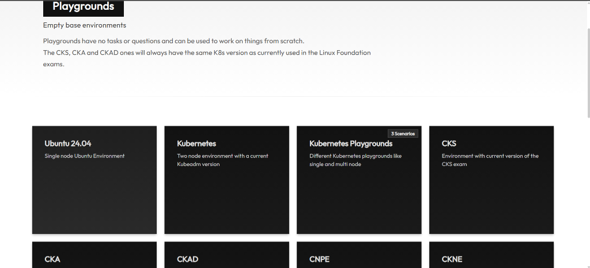

2. Dans le terminal web (Linux Ubuntu), cliquez sur **START** puis interrogez le cluster distant :
   ```bash
   kubectl get nodes
   kubectl get pods -n kube-system
   ```

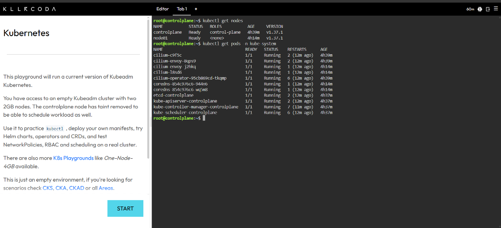

3. Constatez la différence d'architecture avec Minikube : KillerCoda fournit immédiatement deux nœuds distincts (`controlplane` et `node01`) et affiche en haut à droite un décompte de **60 minutes** illustrant le caractère éphémère de la session.

---

### 1.3 Le Premier Déploiement Express (Le "Quick Win")

Mettons immédiatement à l'épreuve la portabilité de Kubernetes. Vous pouvez exécuter ces commandes sur votre terminal **Minikube** ou sur **KillerCoda** pour constater que l'API réagit exactement de la même manière.

1. **Créer un déploiement instantané** de 2 réplicas avec une image web légère Nginx :
   ```bash
   kubectl create deployment flash-web --image=nginx:alpine --replicas=2
   ```

2. **Observer les conteneurs instanciés** en temps réel :
   ```bash
   kubectl get deployments
   kubectl get pods -o wide
   ```
   *Remarquez comment Kubernetes planifie et répartit vos 2 conteneurs sur les nœuds.*

3. **Le passage à l'échelle (Scaling) instantané** :
   Simulez une augmentation subite de trafic en passant à 4 conteneurs en une seule commande :
   ```bash
   kubectl scale deployment flash-web --replicas=4
   kubectl get pods -l app=flash-web
   ```
   *En moins de 2 secondes, les 4 instances sont prêtes et opérationnelles !*

4. **Exposer le service vers l'extérieur avec NodePort** :
   Au lieu de restreindre le trafic à une IP interne privée, exposons notre service directement sur un port externe des nœuds (**NodePort**) :
   ```bash
   kubectl expose deployment flash-web --port=80 --type=NodePort
   kubectl get svc flash-web
   ```
   *Exemple d'affichage obtenu dans le terminal KillerCoda (port alloué automatiquement : `80:30088/TCP`) :*

   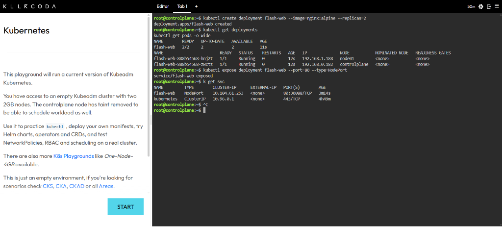

5. **Accéder à l'application web dans votre navigateur** :

   * **Sur KillerCoda (via le Traffic Port Accessor)** :
     1. En haut à droite de l'écran, cliquez sur le menu hamburger (trois barres horizontales `≡`) et sélectionnez **Traffic / Ports** :
     
     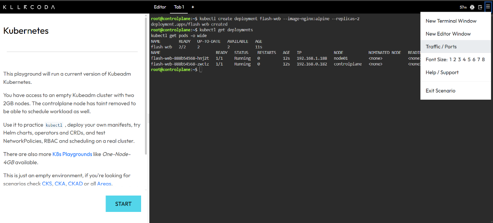

     2. **Le piège classique à éviter (Erreur 502 Bad Gateway)** :  
     Si vous cliquez sur le bouton de raccourci `8080` sous *Common Ports*, le navigateur renvoie immédiatement une erreur **502 Bad Gateway** car aucun processus n'écoute sur le port 8080 de l'hôte (Kubernetes alloue exclusivement une plage entre 30000 et 32767 pour les NodePorts) :
     
     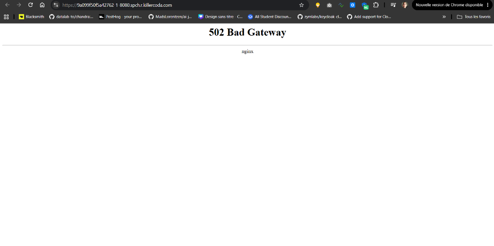

     3. **La bonne démarche** :  
     Dans la section de votre hôte (**Host 1**), renseignez le port à 5 chiffres alloué par Kubernetes (dans notre exemple `30088`) dans le champ **Custom Ports**, puis cliquez sur **Access** :
     
     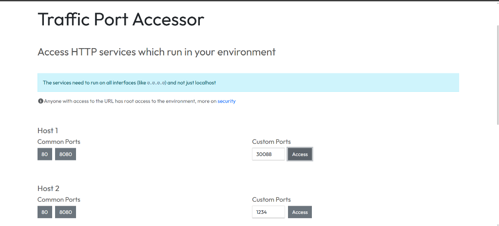

     4. Une nouvelle page s'ouvre dans votre navigateur et affiche la page d'accueil officielle : **"Welcome to nginx!"** :
     
     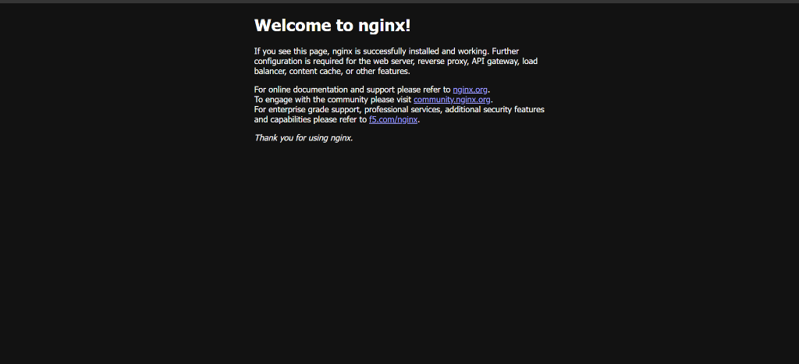

   * **Sur Minikube (en local)** :
     Ouvrez le service dans le navigateur par défaut en une commande :
     ```bash
     minikube service flash-web
     ```
     *Minikube résout le routage local et ouvre automatiquement la page web dans votre navigateur !*

6. **Nettoyer les ressources de test** :
   ```bash
   kubectl delete deployment flash-web
   kubectl delete service flash-web
   ```

<details>
<summary>💡 <b>Indice 1 : Que retenir de ce premier test ?</b></summary>

En moins de 5 minutes, en passant successivement par Minikube et KillerCoda :

* Vous avez créé un contrôleur de déploiement (`Deployment`).
* Vous avez multiplié vos conteneurs à chaud (`scale`).
* Vous avez exposé un point d'entrée réseau accessible depuis l'extérieur via **NodePort** (`Service`).
* Vous avez ouvert l'interface web directement dans votre navigateur grâce aux passerelles KillerCoda / Minikube.

Ces commandes sont universelles : elles s'exécutent de manière rigoureusement identique sur Minikube en local, sur KillerCoda dans le navigateur, ou sur un cluster de production hébergé dans le cloud.
</details>

---

### 1.4 Périmètre Technique : Pourquoi Franchir le Cap du Cluster Multi-Nœuds sur AWS

Bien que **Minikube** (sur poste local) et **KillerCoda** (dans le navigateur) soient des outils d'initiation et de prototypage remarquables, ils présentent des limites structurelles pour simuler une architecture d'entreprise en conditions réelles :

1. **Mono-nœud par conception locale (Minikube)** : Minikube concentre généralement le Control Plane et le rôle de Worker sur une seule et même machine virtuelle ou conteneur. Il est donc impossible de tester la haute disponibilité inter-serveurs, la coupure physique d'un nœud worker, ou l'encapsulation réseau CNI distribuée entre serveurs distants.
2. **Session éphémère (KillerCoda)** : Les bacs à sable web expirent au bout de 60 minutes, effaçant l'ensemble des manifestes et de l'état du cluster.
3. **Stockage limité à une seule machine** : Sur Minikube comme sur KillerCoda, les volumes persistants vivent sur l'unique machine du cluster. Sur notre cluster AWS, nous utiliserons le provisionneur `local-path` (disque local de chaque worker) : vous verrez au Lab 05 qu'un volume reste alors attaché au nœud qui l'héberge, ce qui pose de vraies questions de placement et de résilience. En production cloud, on lui préfère un pilote CSI (par exemple AWS EBS CSI) capable de détacher et rattacher le disque sur un autre nœud.
4. **Accès réseau et routage public** : Les charges de travail déployées sur Minikube ou KillerCoda sont difficilement exposables de l'extérieur sans tunnels spécifiques (`minikube tunnel`).

**Conclusion :** Pour héberger l'ensemble des microservices du projet Campus, éprouver la haute disponibilité distribuée, manipuler la persistance réelle et fiabiliser la résilience sur les deux jours, nous déployons notre propre cluster multi-nœuds (1 Control Plane + 2 Workers) sur **AWS**.

---

## Étape 2 : Démarrage du Bac à Sable AWS & Création Manuelle dans la Console

> **Objectif :** Démarrer le lab AWS Academy, télécharger ses accès et toucher du doigt la réalité d'une infrastructure cloud.

### 2.1 Démarrage de la Session AWS Academy Learner Lab

1. Connectez-vous à votre portail **AWS Academy** et entrez dans votre cours **Learner Lab**.
2. En haut à droite, cliquez sur le bouton **Start Lab** :
   * Le voyant circulaire à côté de *AWS* passe au rouge, puis au jaune pendant l'initialisation des quotas cloud.

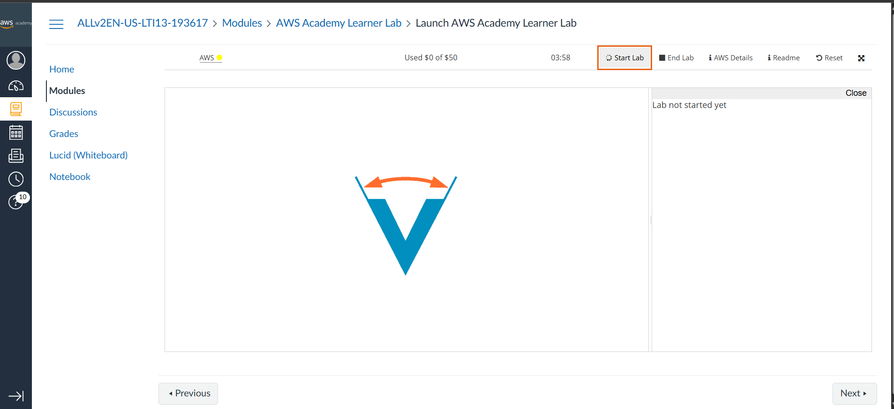

3. Patientez environ 1 à 2 minutes jusqu'à ce que le voyant devienne **vert avec la mention "Ready"** :

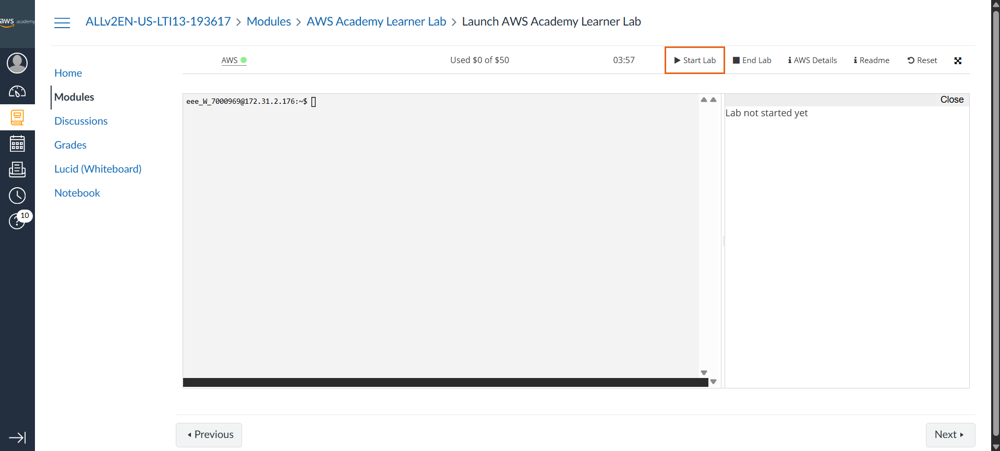

---

### 2.2 Récupération de la Clé SSH et des Identifiants Cloud

1. Dès que le statut est vert, cliquez sur le bouton **AWS Details** situé juste à côté.
2. Un panneau latéral s'affiche :


3. Téléchargez votre clé privée SSH en cliquant sur **Download SSH Key** :
   * Vous obtenez le fichier `labsuser.pem`.
   * Enregistrez ce fichier dans le sous-répertoire `labs/00-provisioning-cluster/terraform/` de votre projet.
   * ⚠️ Ce fichier est votre clé **privée** : il est exclu de Git par le `.gitignore` (`*.pem`). Ne le committez jamais, ne l'envoyez jamais par messagerie.
4. Cliquez sur le bouton **Show** en face de *AWS CLI* pour afficher les identifiants temporaires (`aws_access_key_id`, `aws_secret_access_key`, `aws_session_token`). Ils sont indispensables à Terraform (étape 3.3) et **expirent à la fin de la session Learner Lab** (4 heures) : il faudra les recopier à chaque nouvelle session.
   > 🔒 Ces identifiants donnent un accès complet à votre compte AWS : ne les collez jamais dans un fichier versionné, un ticket, une messagerie ou un assistant en ligne.
5. Cliquez enfin sur le lien rouge **AWS** (à gauche du voyant vert) : la console de gestion **AWS Management Console** s'ouvre dans un nouvel onglet de votre navigateur !

---

### 2.3 Création Manuelle des 3 Instances EC2

Dans la console AWS, rendez-vous dans le service **EC2** → **Instances** → **Launch Instances**.

```text
       VPC AWS Learner Lab (Sous-réseau public/privé)
                         │
      ┌──────────────────┼──────────────────┐
      ▼                  ▼                  ▼
 [ k8s-control ]   [ k8s-worker-1 ]   [ k8s-worker-2 ]
   (Master K8s)       (Worker 1)         (Worker 2)
```

Configurez les paramètres suivants pour vos 3 machines :

1. **Noms des instances** : Créez 3 instances nommées respectivement :
   * `k8s-control` (Nœud maître du Control Plane)
   * `k8s-worker-1` (Nœud travailleur 1)
   * `k8s-worker-2` (Nœud travailleur 2)
2. **Système d'exploitation (AMI)** : Choisissez **Ubuntu Server 24.04 LTS (HVM)**, architecture 64 bits (x86) — la même version que celle utilisée par Terraform à l'étape 3.
3. **Type d'instance** : Sélectionnez **`t3.large`** (2 vCPU, 8 Gio de mémoire vive — *indispensable pour supporter Spring Boot, PostgreSQL, le CNI Calico et le contrôle d'accès sans saturer la RAM*).
4. **Paire de clés (Key Pair)** : Sélectionnez la clé existante **`vockey`** : c'est le nom, côté AWS, de la paire de clés dont vous avez téléchargé la partie privée sous le nom `labsuser.pem`.
5. **Paramètres réseau & Security Group** :
   Créez un nouveau Security Group nommé `k8s-cluster-sg` et autorisez les ports suivants :

   * `SSH (Port 22)` : Autorisé depuis votre adresse IP publique
   * `API Server Kubernetes (Port 6443)` : Autorisé pour tous les nœuds
   * `etcd (Ports 2379-2380)` : Requis pour la communication Control Plane
   * `Kubelet API (Port 10250)` : Requis pour la gestion des pods
   * `NodePort Services (Ports 30000-32767)` : Requis pour exposer les services vers l'extérieur
   * Tout le trafic interne entre membres du groupe : `All traffic` sur le même `k8s-cluster-sg`.
6. **Stockage** : 30 Go gp3 par instance.

Cliquez sur **Launch Instances** et attendez que les 3 serveurs passent au statut *Running*.

---

## Le Grand Moment de Friction !

Prenez quelques secondes pour mesurer l'effort réalisé :

* Vous avez dû cliquer sur des dizaines d'écrans pour configurer 3 serveurs.
* Avez-vous bien ouvert le port 6443 sur les 3 machines ?
* Avez-vous bien sélectionné `t3.large` et non `t2.micro` ?
* **La question qui tue :** Si vous devez détruire le lab ce soir pour économiser les 50$, êtes-vous prêts à refaire tous ces clics et réglages manuels demain matin à 08h30 ?

**La réponse est non !** C'est ici qu'intervient le savoir-faire DevOps.

---

## Étape 3 : L'Automatisation DevOps — Destruction & Rénovation par Terraform

> **L'action spectaculaire :**  
> Dans la console AWS, cochez vos 3 instances manuelles → Menu **Instance State** → **Terminate** (Détruire).  
> *Oui, on efface tout ce qu'on vient de faire à la main !*

Nous allons maintenant voir comment un ingénieur DevOps provisionne exactement la même infrastructure, sans aucune erreur humaine, en **une seule commande**.

### 3.1 Prérequis : Vérification et Installation du Binaire Terraform

Terraform est un binaire unique et autonome (exécutable sans dépendance complexe). Avant de lancer le déploiement, vérifiez si l'outil est déjà disponible sur votre poste :

```bash
terraform version
```

Si la commande renvoie une version (ex: `Terraform v1.x.x`), l'outil est opérationnel !  
Si le système indique que la commande n'est pas reconnue, installez-le en quelques secondes selon votre système :

* **Sous Windows (PowerShell)** :
  * *Option recommandée via Winget* :
    ```powershell
    winget install HashiCorp.Terraform
    ```
  * *Option portable (sans aucun droit administrateur)* :  
    Téléchargez le fichier zip `terraform_..._windows_amd64.zip` depuis [developer.hashicorp.com/terraform/install](https://developer.hashicorp.com/terraform/install), extrayez simplement l'exécutable `terraform.exe` et collez-le directement dans le dossier `labs/00-provisioning-cluster/terraform/`.
* **Sous Linux (Ubuntu / Debian)** :
  ```bash
  sudo apt-get update && sudo apt-get install -y gnupg software-properties-common curl
  wget -O- https://apt.releases.hashicorp.com/gpg | sudo gpg --dearmor -o /usr/share/keyrings/hashicorp-archive-keyring.gpg
  echo "deb [signed-by=/usr/share/keyrings/hashicorp-archive-keyring.gpg] https://apt.releases.hashicorp.com $(lsb_release -cs) main" | sudo tee /etc/apt/sources.list.d/hashicorp.list
  sudo apt update && sudo apt install -y terraform
  ```
* **Sous macOS (Homebrew)** :
  ```bash
  brew tap hashicorp/tap
  brew install hashicorp/tap/terraform
  ```

> 💡 *Alternative cloud zéro-installation :* Si la politique de sécurité de votre poste vous empêche formellement d'exécuter un binaire local, vous pouvez utiliser **AWS CloudShell** directement depuis la console web AWS (icône de terminal en haut à droite) où Terraform peut être téléchargé en une commande.

---

### 3.2 Découverte de l'Automatisation : Terraform et le Script d'Amorçage (bootstrap.sh)

Rendez-vous dans le répertoire du lab :
```bash
cd labs/00-provisioning-cluster/terraform
```

#### Qui installe les dépendances Kubernetes ? (La répartition des rôles)

Une question architecturale clé se pose : **est-ce Terraform qui installe Kubernetes ?**

* **Terraform** gère le **socle matériel cloud** : il provisionne les instances EC2 (`t3.large`), attache les disques EBS de 30 Go, réserve l'Elastic IP fixe et applique le Security Group avec tous les ports réseau requis.
* **Le script d'amorçage (`scripts/bootstrap.sh`)** gère la **couche système d'exploitation** : Terraform injecte ce script dans la directive `user_data` de chaque instance. Lors du premier démarrage d'Ubuntu, le démon système `cloud-init` l'exécute automatiquement en tâche de fond pour configurer l'OS et installer l'ensemble des dépendances Kubernetes.

#### Les 6 étapes clés du script `bootstrap.sh` :

Ouvrez `scripts/bootstrap.sh` pour comprendre les réglages bas niveau indispensables à un nœud Kubernetes :

0. **Nommage du nœud (`hostnamectl set-hostname`)** :  
   Terraform transmet à chaque instance son nom (`k8s-control`, `k8s-worker-1`, `k8s-worker-2`) via `templatefile()`. Kubernetes reprend le nom d'hôte comme nom de nœud : sans cette étape, vos nœuds s'appelleraient `ip-172-31-x-y` et les commandes des labs (`kubectl label node k8s-worker-1 …`) échoueraient. Le script empêche aussi `cloud-init` de rétablir le nom AWS au redémarrage des instances.

1. **Désactivation du swap (`swapoff -a` et `/etc/fstab`)** :  
   Kubernetes exige que le swap soit totalement désactivé afin de garantir une gestion déterministe de la mémoire vive (RAM) allouée aux Pods et d'éviter que le système ne dégrade ses performances en swappant sur disque.
2. **Chargement des modules du noyau Linux (`overlay` et `br_netfilter`)** :  
   Le module `overlay` permet le stockage des conteneurs en couches superposées. Le module `br_netfilter` permet au pont réseau virtuel de filtrer et router les paquets selon les règles de pare-feu Linux (iptables).
3. **Configuration réseau sysctl** :  
   Activation de `net.bridge.bridge-nf-call-iptables = 1` et `net.ipv4.ip_forward = 1` pour permettre au cluster de router le trafic entre les Pods et l'extérieur.
4. **Installation et paramétrage du Container Runtime CRI (`containerd`)** :  
   Installation de containerd et configuration de `SystemdCgroup = true` dans `/etc/containerd/config.toml` pour synchroniser la gestion des ressources de conteneurs avec le gestionnaire `systemd` natif d'Ubuntu.
5. **Configuration du dépôt officiel Kubernetes v1.30** :  
   Ajout de la clé cryptographique GPG et du dépôt de paquets officiel (`pkgs.k8s.io`).
6. **Installation et verrouillage du trio de binaires (`kubelet`, `kubeadm`, `kubectl`)** :  
   * `kubelet` : l'agent système qui pilote les conteneurs sur chaque nœud.
   * `kubeadm` : l'outil d'initialisation et d'assemblage du cluster.
   * `kubectl` : le client en ligne de commande.
   * `apt-mark hold` : verrouille les versions pour interdire toute mise à jour non planifiée du système.

Grâce à cette séparation, Terraform rend la main en 1 à 2 minutes, puis `cloud-init` installe les dépendances en tâche de fond pendant encore **3 à 5 minutes** : profitez-en pour configurer vos connexions SSH (étape 4). Vous vérifierez la fin de l'installation à l'étape 5.1.

> 📦 **Bonus du script :** il clone également le dépôt de la formation dans `/home/ubuntu/formation` et crée le raccourci `~/labs`. C'est ce qui permet de travailler entièrement depuis `k8s-control` (Option B) avec tous les manifests à portée de main.

---

### 3.3 Injection des identifiants temporaires AWS

Dans votre terminal local, collez les variables copiées depuis le panneau *AWS Details* :

#### Sous Windows (PowerShell) :
```powershell
$env:AWS_ACCESS_KEY_ID="ASI..."
$env:AWS_SECRET_ACCESS_KEY="..."
$env:AWS_SESSION_TOKEN="..."
$env:AWS_DEFAULT_REGION="us-east-1"
```

#### Sous Linux (Ubuntu) / macOS (Bash) :
```bash
export AWS_ACCESS_KEY_ID="ASI..."
export AWS_SECRET_ACCESS_KEY="..."
export AWS_SESSION_TOKEN="..."
export AWS_DEFAULT_REGION="us-east-1"
```

---

### 3.4 Lancement de l'Automatisation

#### Sous Windows (PowerShell) :
```powershell
terraform init
terraform apply -auto-approve
```

#### Sous Linux (Ubuntu) / macOS (Bash) :
```bash
terraform init
terraform apply -auto-approve
```
> 📌 *Remarque OS : **identique Windows PowerShell et Linux/macOS***

En **1 à 2 minutes**, Terraform a créé vos 3 serveurs EC2, leurs disques, le Security Group complet et une **Elastic IP** fixe pour `k8s-control`, sans un seul clic.

<details>
<summary>💡 <b>Indice : <code>terraform apply</code> échoue avec une erreur d'authentification</b></summary>

* `ExpiredToken` / `InvalidClientTokenId` : vos identifiants temporaires ont expiré ou ont été mal copiés. Recopiez les trois variables depuis *AWS Details* (le jeton `AWS_SESSION_TOKEN` est très long : vérifiez qu'il est complet).
* `UnauthorizedOperation` sur une région : le Learner Lab n'autorise que `us-east-1` et `us-west-2`. Vérifiez la variable `aws_region` dans `terraform.tfvars`.
* `InvalidKeyPair.NotFound` : la paire de clés s'appelle `vockey` dans le Learner Lab (variable `key_name`).
</details>

Pour afficher les adresses IP publiques générées :
```bash
terraform output
```

<details>
<summary>💡 <b>Indice 1 : Gestion des coûts AWS (Pause du soir vs Destruction finale)</b></summary>

Pour préserver l'enveloppe de 50$ du compte AWS Academy / Learner Lab :

* **Entre le Jour 1 et le Jour 2 (Mise en pause le soir) :**  
  Éteignez simplement les VMs sans les détruire afin de conserver l'état du cluster, vos volumes et vos déploiements :
  ```bash
  ./scripts/stop-session.sh   # Linux/macOS
  .\scripts\stop-session.ps1  # Windows PowerShell
  ```
  Le lendemain matin, relancez les instances en 30 secondes avec `./scripts/start-session.sh` (ou `.\scripts\start-session.ps1`).

  > 📌 Ces scripts utilisent l'**AWS CLI** (`aws --version` pour vérifier ; installation : `winget install Amazon.AWSCLI` sous Windows, `brew install awscli` sous macOS). Ils réutilisent les identifiants exportés à l'étape 3.3, à recopier depuis *AWS Details* à chaque nouvelle session.
  >
  > Au redémarrage, `k8s-control` conserve son adresse publique grâce à l'**Elastic IP** : votre kubeconfig local reste valide. Les **workers changent en revanche d'IP publique** : relevez les nouvelles adresses affichées par le script pour accéder aux NodePorts (Labs 04 et 08).

* **À la fin de la formation (Destruction définitive - Teardown) :**  
  Pour résilier l'intégralité des instances, disques EBS et IP élastique afin de ramener les coûts à 0$ :
  ```bash
  terraform destroy -auto-approve
  ```
  *(Ou via les scripts fournis : `./scripts/destroy-cluster.sh -y` ou `.\scripts\destroy-cluster.ps1 -AutoApprove`).*
</details>

---

## Étape 4 : Connexions SSH & L'Importance de MobaXterm

Pour administrer notre cluster Kubernetes, nous devons nous connecter aux machines distantes.

### 4.1 La Connexion SSH Classique en Ligne de Commande

Récupérez l'adresse IP publique de `k8s-control` depuis les sorties Terraform.

#### Sous Windows (PowerShell) :
```powershell
ssh -i .\labsuser.pem ubuntu@<IP_PUBLIQUE_CONTROL_PLANE>
```

<details>
<summary>💡 <b>Indice : Windows refuse la clé (« UNPROTECTED PRIVATE KEY FILE »)</b></summary>

OpenSSH refuse une clé privée lisible par d'autres comptes. Sous Windows, l'équivalent de `chmod 400` consiste à retirer l'héritage des droits et à ne laisser l'accès qu'à vous-même :

```powershell
icacls .\labsuser.pem /inheritance:r
icacls .\labsuser.pem /grant:r "$($env:USERNAME):(R)"
```

Relancez ensuite la commande `ssh`.
</details>

#### Sous Linux (Ubuntu) / macOS (Bash) :
```bash
chmod 400 labsuser.pem
ssh -i labsuser.pem ubuntu@<IP_PUBLIQUE_CONTROL_PLANE>
```

---

### 4.2 L'Atout Maître des Administrateurs : MobaXterm

Lorsque vous devez gérer plusieurs nœuds simultanément (1 Master et 2 Workers), ouvrir 3 terminaux noirs séparés et répéter les mêmes commandes sur chaque worker devient vite laborieux.

C'est pourquoi les ingénieurs et administrateurs Kubernetes plébiscitent un outil comme **MobaXterm** ([mobaxterm.mobatek.net](https://mobaxterm.mobatek.net/)) sous Windows :

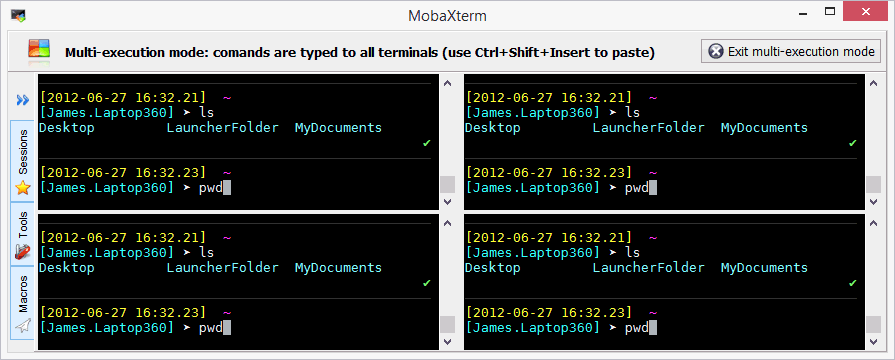

#### Les 4 Super-Pouvoirs de MobaXterm pour Kubernetes :
1. **Le Mode Multi-Execution (Multi-Exec)** :
   * Cliquez sur le bouton **Multi-Exec** en haut à droite.
   * Vous tapez une commande sur un écran : elle est transmise et exécutée **en temps réel et en simultané** sur vos deux nœuds workers !
   * C'est idéal pour installer des paquets communs, vérifier l'état des conteneurs ou lancer la commande `kubeadm join` sur tous les workers en un seul geste.
2. **Le Navigateur SFTP Graphique Intégré** :
   * Dès qu'une session SSH est ouverte, le panneau gauche affiche l'arborescence des fichiers du serveur distant.
   * Glissez-déposez vos fichiers manifests YAML, scripts ou clés privées directement depuis l'explorateur Windows sans taper de commande `scp`.
3. **Le Gestionnaire de Sessions Pré-Enregistrées** :
   * Menu **Session** → **SSH** : Renseignez l'IP de la machine et l'utilisateur `ubuntu`.
   * Onglet **Advanced SSH settings** : Cochez *Use private key* et pointez vers votre fichier `labsuser.pem`.
   * Enregistrez 3 sessions : `k8s-control`, `k8s-worker-1`, `k8s-worker-2`. Un double-clic le matin suffit pour vous reconnecter instantanément.
4. **Le Découpage d'Écran (Split Terminals)** :
   * Affichez les 3 consoles côte-à-côte (2x2 ou 1x3) pour observer en direct ce qui se passe sur le master et les workers lors des déploiements.

> 🐧 *Alternative pour Linux / macOS : Vous pouvez utiliser **Terminator**, **iTerm2** (mode broadcast input) ou **tmux** avec la commande `:setw synchronize-panes on` pour obtenir le même comportement multi-écrans.*


---

## Étape 5 : L'Amorçage du Cluster avec Kubeadm

Nos 3 machines EC2 sont prêtes et accessibles. Nous allons maintenant initialiser Kubernetes.

### 5.1 Initialisation du Plan de Contrôle (sur `k8s-control`)

1. Connectez-vous en SSH au nœud maître (`k8s-control`).

2. **Vérifier l'achèvement du bootstrap des dépendances** :  
   Assurez-vous que `cloud-init` a terminé l'exécution de `bootstrap.sh` et que les binaires sont opérationnels :
   ```bash
   # Attendre la fin de cloud-init (rend la main quand bootstrap.sh est terminé)
   cloud-init status --wait

   # Vérifier le log de fin d'installation
   tail -n 5 /var/log/cloud-init-output.log

   # Vérifier les versions installées
   kubeadm version
   containerd --version
   ```
   *La dernière ligne du log doit être `==> Initialisation du nœud terminée avec succès !`. Si `cloud-init status` affiche `error`, consultez `/var/log/cloud-init-output.log` pour identifier l'étape en échec.*

3. **Lancer l'initialisation Kubeadm** :
   ```bash
   sudo kubeadm init --pod-network-cidr=192.168.0.0/16
   ```
   *Le CIDR `192.168.0.0/16` est la plage d'adresses des Pods attendue par Calico. Elle ne doit pas chevaucher celle du VPC AWS par défaut (`172.31.0.0/16`).*

   > ⚠️ **Copiez immédiatement la commande `kubeadm join …` affichée à la fin** : vous en aurez besoin à l'étape 5.2. Si vous la perdez, régénérez-la avec `sudo kubeadm token create --print-join-command`.

À la fin de la commande, Kubeadm affiche les instructions de configuration et le token d'adhésion `kubeadm join`.  
Exécutez sur `k8s-control` :
```bash
mkdir -p $HOME/.kube
sudo cp -i /etc/kubernetes/admin.conf $HOME/.kube/config
sudo chown $(id -u):$(id -g) $HOME/.kube/config
```

Installez le CNI réseau **Calico** :
```bash
kubectl create -f https://raw.githubusercontent.com/projectcalico/calico/v3.28.0/manifests/calico.yaml
```

Attendez que le réseau soit opérationnel (environ 1 à 2 minutes) :
```bash
kubectl get pods -n kube-system -w
```
*Quand les pods `calico-node` et `coredns` sont `Running`, le nœud `k8s-control` passe à l'état `Ready` (`kubectl get nodes`). Quittez l'observation avec `Ctrl + C`.*

---

### 5.2 Raccordement Simultané des Workers avec Multi-Exec

1. Dans **MobaXterm**, ouvrez les deux sessions SSH vers `k8s-worker-1` et `k8s-worker-2`.
2. Activez le bouton **Multi-Exec** en haut à droite.
3. Collez la commande `kubeadm join` fournie par le master :
   ```bash
   sudo kubeadm join <IP_PRIVEE_CONTROL_PLANE>:6443 --token <token> --discovery-token-ca-cert-hash sha256:<hash>
   ```
4. Constatez que la commande s'exécute simultanément sur les deux workers !

---

### 5.3 Validation Finale des Nœuds du Cluster

Revenez sur votre session `k8s-control` et vérifiez :
> 📌 *Remarque OS : **identique Windows PowerShell et Linux/macOS***

```bash
kubectl get nodes -o wide
```

```text
NAME           STATUS   ROLES           AGE     VERSION   INTERNAL-IP
k8s-control    Ready    control-plane   5m12s   v1.30.x   172.31.20.10
k8s-worker-1   Ready    <none>          2m45s   v1.30.x   172.31.25.41
k8s-worker-2   Ready    <none>          2m30s   v1.30.x   172.31.19.87
```
*Les adresses privées et la version de correctif (`v1.30.x`) varient d'un stagiaire à l'autre.*

<details>
<summary>💡 <b>Indice : un worker reste <code>NotReady</code></b></summary>

* Vérifiez sur le worker que `cloud-init status` affiche `done` : si le `join` a été lancé avant la fin de l'installation, relancez-le.
* Vérifiez que le pod `calico-node` de ce worker est `Running` : `kubectl get pods -n kube-system -o wide | grep calico-node`.
* Un token `kubeadm join` expire au bout de 24 heures : régénérez-le avec `sudo kubeadm token create --print-join-command`.
</details>

---

### 5.4 Installation des Composants Additionnels de la Formation

Un cluster Kubeadm « nu » ne fournit que le strict minimum. Pour la suite des ateliers, deux composants sont indispensables :

| Composant | Rôle | Utilisé au |
| :--- | :--- | :---: |
| **local-path-provisioner** | `StorageClass` par défaut qui crée automatiquement les volumes persistants sur le disque des workers | Lab 05 |
| **Ingress NGINX** (NodePort `30080`) | Point d'entrée HTTP du cluster ; il réserve le port `30080` | Labs 04 et 08 |

Le script fourni installe aussi **Helm**, l'autocomplétion de `kubectl` et l'alias `k`. Sur `k8s-control`, exécutez :

```bash
bash ~/labs/00-provisioning-cluster/scripts/setup-addons.sh
source ~/.bashrc
```

<details>
<summary>💡 <b>Indice : le dossier <code>~/labs</code> n'existe pas</b></summary>

Le clonage automatique du dépôt par `bootstrap.sh` a échoué (problème réseau temporaire au démarrage). Clonez-le manuellement :

```bash
git clone --depth 1 https://github.com/h4mdi/training.git ~/formation
ln -sfn ~/formation/labs ~/labs
```
</details>

Vérifiez le résultat :
```bash
kubectl get storageclass
kubectl get pods -n ingress-nginx
```
*`local-path` doit apparaître avec la mention `(default)`, et le contrôleur Ingress NGINX doit être `Running`.*

> 💡 Le **Metrics-Server** n'est volontairement pas installé ici : vous le déploierez vous-même au Lab 06 pour comprendre son fonctionnement.

---

## Étape 6 : Administration Locale (kubectl & FreeLens) et Modalités de Travail

Votre cluster Kubernetes d'entreprise est désormais opérationnel. Vous avez le choix entre administrer votre cluster directement depuis votre machine locale ou via la session SSH.

### 6.1 Récupération et Adaptation du Kubeconfig Local

Pour piloter le cluster depuis votre propre terminal ou via une interface graphique :

#### 1. Récupération du fichier kubeconfig
* Sur le nœud maître `k8s-control`, visualisez votre configuration :
  ```bash
  cat ~/.kube/config
  ```
* Copiez son contenu sur votre machine locale, ou téléchargez-le directement via le navigateur SFTP de MobaXterm dans le dossier de votre choix (ex: `kubeconfig.yaml` à la racine de votre projet) :


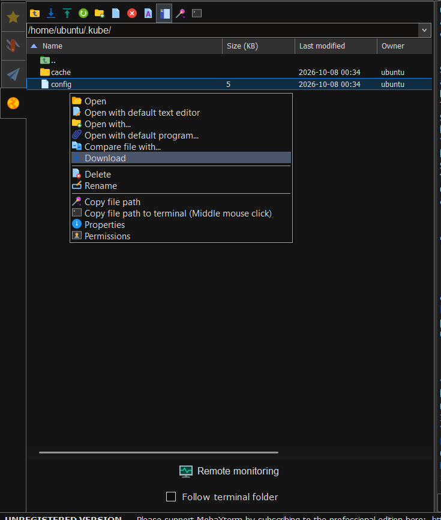

#### 2. Ajustement de l'adresse et de la validation TLS dans votre kubeconfig local
Par défaut, le fichier `admin.conf` généré par Kubeadm utilise l'adresse IP privée du nœud (`https://172.31.x.y:6443`) et valide l'autorité de certification interne. Pour permettre la connexion externe :

1. **Commenter** (ou supprimer) la ligne `certificate-authority-data:` (avec un `#` devant).
2. **Ajouter** la directive `insecure-skip-tls-verify: true`.
3. **Remplacer** l'adresse IP dans `server:` par l'**IP publique** de votre instance `k8s-control`.

**Exemple dans le bloc `clusters:` de votre fichier kubeconfig local :**
```yaml
clusters:
- cluster:
    # certificate-authority-data: LS0tLS1CRUdJTi...   <-- 1. Commenter cette ligne
    insecure-skip-tls-verify: true                    # <-- 2. Ajouter cette directive
    server: https://<IP_PUBLIQUE_CONTROL>:6443         # <-- 3. Remplacer par l'IP publique
  name: kubernetes
```

<details>
<summary>💡 <b>Pourquoi commenter l'autorité et ajouter insecure-skip-tls-verify: true ?</b></summary>

Par défaut, `kubeadm` génère le certificat TLS interne de l'API Server uniquement pour l'adresse **IP privée** de la machine (`172.31.x.y`). Lorsque vous contactez l'API Server depuis l'extérieur (votre poste ou FreeLens) via son **adresse IP publique**, le client TLS détecte une discordance de nom d'hôte (*"certificate is valid for 172.31.x.y, not <IP_PUBLIQUE>"*).  
La directive `insecure-skip-tls-verify: true` ordonne au client d'accepter la connexion sur l'IP publique tout en conservant le chiffrement HTTPS du flux, ce qui évite d'avoir à régénérer les certificats internes du cluster.

> ⚠️ Attention : Ne laissez **jamais** à la fois `certificate-authority-data` et `insecure-skip-tls-verify: true`, sinon FreeLens et `kubectl` renverront une erreur d'incompatibilité (*"error: certificate-authority-data and insecure-skip-tls-verify cannot be specified together"*).
</details>

---

### 6.2 Utilisation Directe de kubectl depuis votre Poste Local

Si vous disposez de `kubectl` installé sur votre machine locale, vous pouvez immédiatement tester la connexion :

* **Sous Windows (PowerShell) :**
  ```powershell
  # Définir le kubeconfig pour la session en cours
  $env:KUBECONFIG = ".\kubeconfig.yaml"

  # Tester la communication avec le cluster AWS
  kubectl get nodes
  ```
  *(Alternative sans variable d'environnement : `kubectl --kubeconfig .\kubeconfig.yaml get nodes`)*

* **Sous Linux / macOS (Bash) :**
  ```bash
  # Définir le kubeconfig pour la session en cours
  export KUBECONFIG=./kubeconfig.yaml

  # Tester la communication avec le cluster AWS
  kubectl get nodes
  ```

---

### 6.3 Visualisation Graphique avec FreeLens (Optionnel)

[**FreeLens**](https://freelensapp.github.io/) est le fork communautaire 100% libre et gratuit de Lens/OpenLens. Contrairement à Lens Desktop propriétaire (qui impose une création de compte obligatoire et des abonnements payants), **FreeLens est sans inscription, sans télémétrie et immédiatement prêt à l'emploi**.

> **Téléchargement** : Installez FreeLens pour Windows, macOS ou Linux directement depuis le site officiel :  
> 👉 [**https://freelensapp.github.io/**](https://freelensapp.github.io/)

1. Ouvrez l'application **FreeLens**.
2. Cliquez sur **Catalog** → **Clusters** → **Add from Kubeconfig** (ou l'icône `+` en bas à droite).

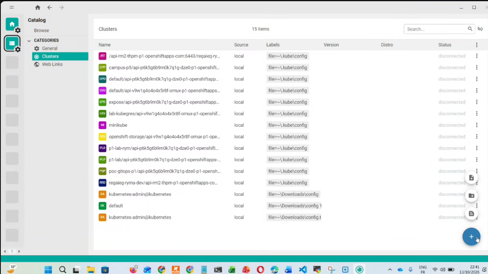

3. Collez le texte du kubeconfig modifié ou sélectionnez le fichier `kubeconfig.yaml`.
4. Validez : FreeLens se connecte directement à l'API Server de votre cluster Kubeadm !

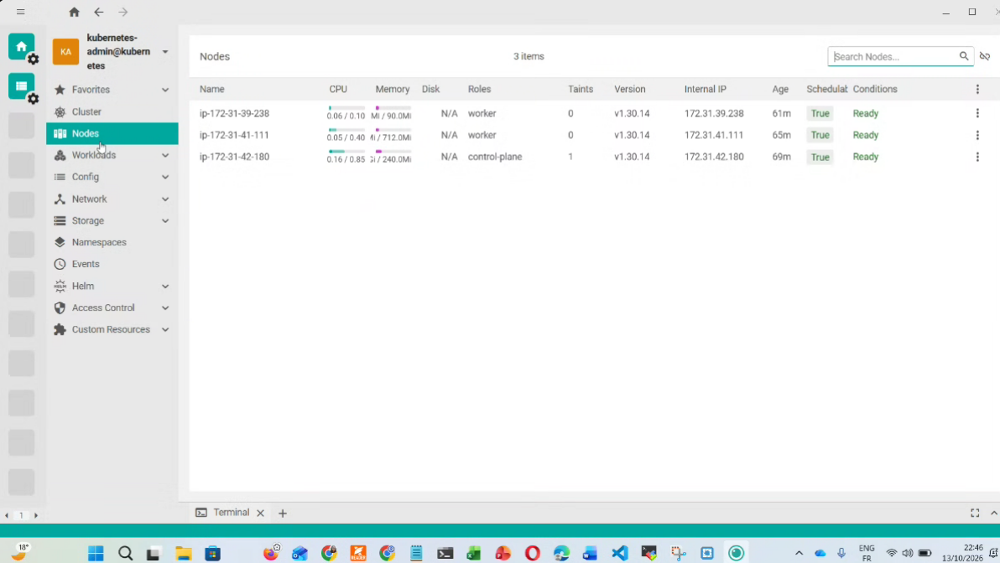

* **Vue Nodes** : Surveillez la charge CPU/RAM en temps réel et l'état de santé des nœuds workers.
* **Vue Pods & Workloads** : Suivez le démarrage des conteneurs, examinez les ReplicaSets et filtrez par namespace (`campus-dev`, `kube-system`).
* **Logs en streaming** : Cliquez sur n'importe quel conteneur pour afficher ses logs en continu sans taper `kubectl logs -f`.

---

### 6.4 Les Deux Modalités de Travail pour la Suite de la Formation (Labs 02 à 08)

Pour tous les ateliers pratiques de déploiement (Labs 02 à 08), vous avez toute liberté pour choisir votre modalité d'exécution :

* **Option A (Recommandée - Confort DevOps Local) :**  
  * Vous ouvrez le dossier du projet dans votre IDE préféré (VS Code, Cursor, IntelliJ...).
  * Vous modifiez directement les manifests YAML en local avec coloration syntaxique et autocomplétion.
  * Vous appliquez vos ressources directement depuis votre terminal local avec `kubectl apply -f ...`.  
  * **Avantage :** Zéro transfert de fichier, confort maximal, conformité avec le workflow DevOps réel.

* **Option B (Secours - PC d'entreprise verrouillé) :**  
  * Si la politique de sécurité de votre entreprise empêche d'installer `kubectl` ou bloque le port 6443, travaillez directement dans votre terminal SSH connecté à `k8s-control` (via MobaXterm).
  * `kubectl` et tous les répertoires d'exercices y sont déjà pré-déployés dans `~/labs/` (dépôt cloné par `bootstrap.sh`, voir l'étape 5.4 en cas d'absence).

> ⚠️ **Exception Unique : Le Lab 01 (Anatomie du Control Plane)**  
> Le Lab 01 nécessite obligatoirement d'être connecté en SSH sur `k8s-control`, car vous allez ausculter le répertoire système `/etc/kubernetes/manifests`, exécuter `etcdctl` et analyser les logs bas niveau de l'hôte, actions impossibles à distance via `kubectl`.

---

### 6.5 Créer votre Espace de Travail : le Namespace `campus-dev`

Un cluster Kubernetes d'entreprise est partagé entre plusieurs équipes, applications et environnements. Le **namespace** est la cloison logique qui regroupe les objets d'un même projet : il délimite la portée des noms, des quotas (Lab 07), des règles réseau (Lab 07) et des droits RBAC (Lab 07).

Tout objet créé sans namespace précis atterrit dans le namespace `default`, qui devient vite un fourre-tout ingérable. **Bonne pratique : on ne déploie jamais une application dans `default`.**

Voici la cartographie des namespaces que vous utiliserez pendant la formation :

| Namespace | Contenu | Labs |
| :--- | :--- | :---: |
| `campus-dev` | L'application fil rouge en cours de construction | 01 à 07 |
| `campus-prod` | La plateforme finale durcie, déployée en autonomie | 08 |
| `monitoring` | La pile d'observabilité (Prometheus, Loki, Grafana…) | 06 |
| `kube-system` | Les composants du cluster (API Server, etcd, CoreDNS, Calico, NPD) : **on n'y déploie rien** | 01, 06 |

1. Créez le fichier `namespace-campus-dev.yaml` (approche déclarative, versionnable) :
   ```yaml
   apiVersion: v1
   kind: Namespace
   metadata:
     name: campus-dev
     labels:
       app.kubernetes.io/part-of: campus-summer-portal
       environment: dev
   ```

2. Appliquez-le et vérifiez sa présence :
   ```bash
   kubectl apply -f namespace-campus-dev.yaml
   kubectl get namespaces --show-labels
   ```

3. Faites de `campus-dev` le **namespace courant** de votre contexte `kubectl`, pour ne pas avoir à taper `-n campus-dev` à chaque commande :
   ```bash
   kubectl config set-context --current --namespace=campus-dev
   ```

4. Vérifiez le namespace courant (commande identique sous PowerShell et Bash) :
   ```bash
   kubectl config view --minify -o jsonpath='{..namespace}'
   ```
   *Sortie attendue : `campus-dev`.*

> ⚠️ **Le namespace courant est enregistré dans le fichier kubeconfig utilisé.** Si vous alternez entre l'Option A (poste local, fichier `kubeconfig.yaml`) et l'Option B (SSH sur `k8s-control`, fichier `~/.kube/config`), exécutez l'étape 3 **dans les deux environnements**. Le namespace, lui, n'est créé qu'une fois : il existe dans le cluster.

<details>
<summary>💡 <b>Indice : J'ai oublié de changer de namespace, où sont passés mes objets ?</b></summary>

Ils ont été créés dans `default`. Retrouvez-les avec :

```bash
kubectl get all -n default
kubectl get pods -A | grep campus
```

Supprimez-les de `default` (`kubectl delete -f <fichier>.yaml -n default`), repositionnez votre contexte avec l'étape 3, puis réappliquez vos manifests.
</details>

---

Vous disposez d'un véritable cluster Kubernetes multi-nœuds d'entreprise, déployé de manière reproductible avec Terraform et Kubeadm, et administré efficacement grâce à votre outillage moderne.

👉 Rendez-vous au [Lab 01 : Anatomie du Plan de Contrôle](../01-control-plane-anatomy/README.md) pour explorer comment `etcd` et l'API Server communiquent sous le capot !

