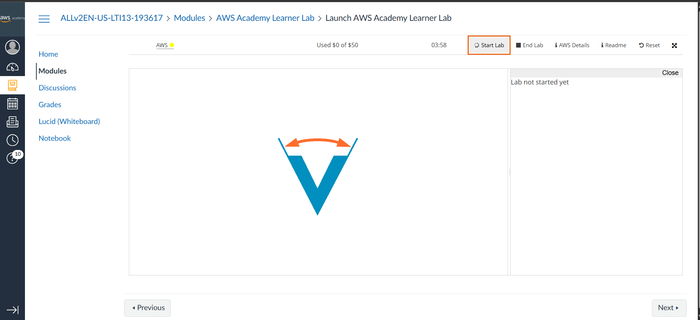
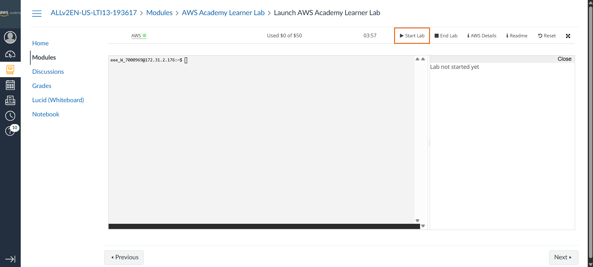
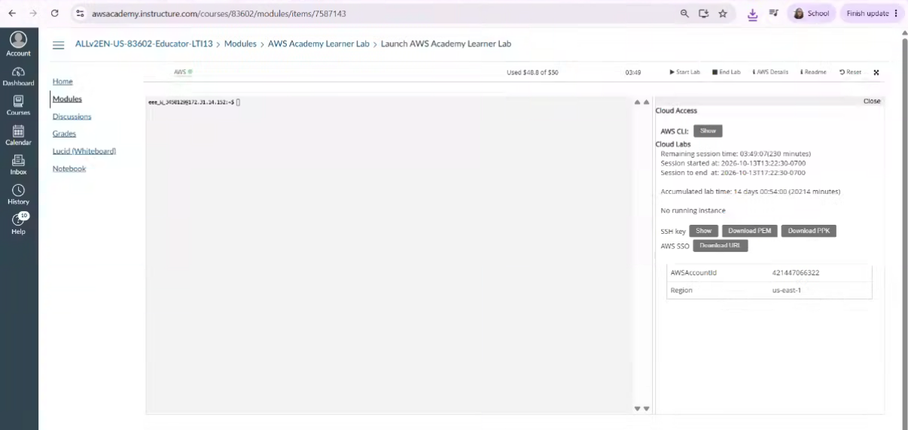

# Atelier 01 : Provisionnement du Cluster — D'un cluster mono-nœud avec Minikube au cluster multi-nœuds avec Kubeadm

### Objectifs Pédagogiques :
* **Installer** un cluster local **Minikube**.
* **Provisionner** les 3 instances EC2 du cluster avec **Terraform**.
* **Se connecter** aux 3 nœuds en **SSH**.
* **Assembler** un cluster multi-nœuds avec **Kubeadm** et le CNI **Calico**.
* **Administrer** le cluster depuis son poste avec `kubectl`.

<div class="admonition info" markdown>
<p class="admonition-title"><strong>Compatibilité OS</strong></p>

Sur **votre poste**, les commandes sont données pour **Windows (PowerShell)** et **Linux/macOS (Bash)** lorsqu'elles diffèrent. Les **nœuds** sont sous **Ubuntu**.

</div>

<div class="admonition note" markdown>
<p class="admonition-title"><strong>Environnement : votre poste, puis les 3 nœuds du cluster</strong></p>

Le libellé en gras au-dessus de chaque bloc indique où lancer les commandes : **Votre poste**, ou un nœud dans une session SSH (**k8s-control — SSH**, **Les trois nœuds — SSH**…).

</div>

---

## Contexte Métier

Le **Campus Summer Portal** (frontend Nginx, API Spring Boot, base PostgreSQL) se développe sur **Minikube**, mais s'éprouve sur un cluster **multi-nœuds** : 1 Control Plane et 2 Workers, que vous allez construire.

| Qui ? | Fait quoi ? |
| :--- | :--- |
| **Terraform** | Crée 3 instances EC2 sur AWS. |
| **`bootstrap.sh`** (au démarrage des instances) | Installe `containerd`, `kubeadm`, `kubelet`, `kubectl`. |
| **Vous** | Initialisez le Control Plane, installez Calico et raccordez les Workers. |

<div class="admonition note" markdown>
<p class="admonition-title"><strong>Budget AWS Academy : 50 $ pour toute la formation</strong></p>

Éteignez vos instances chaque soir (encadré « Maîtriser le budget » de l'étape 8).

</div>

---

## Étape 0 : Récupérer le dépôt de la formation

**Votre poste**

```bash
git clone https://github.com/Rym28/kubernetes-training.git formation
cd formation
```

Tous les chemins de l'atelier sont relatifs à ce dossier `formation`.

---

## Exercice 1 : Le cluster local avec Minikube

### Étape 1 : Installer Minikube

Prérequis : 2 vCPU, 4 Go de RAM libres et **Docker Desktop** démarré.

**Votre poste**

```bash
docker ps
minikube version
```

Si `minikube` n'est pas reconnu :

| Système | Commande |
| :--- | :--- |
| Windows (PowerShell) | `winget install Kubernetes.minikube` |
| macOS | `brew install minikube` |
| Linux | `curl -LO https://storage.googleapis.com/minikube/releases/latest/minikube-linux-amd64 && sudo install minikube-linux-amd64 /usr/local/bin/minikube` |

<div class="admonition info" markdown>
<p class="admonition-title"><strong>Poste verrouillé (pas de Docker, pas de droits admin) ?</strong></p>

Passez directement à l'**exercice 2**.

</div>

### Étape 2 : Démarrer le cluster

**Votre poste**

```bash
minikube start --cpus=2 --memory=4096 --driver=docker
kubectl get nodes
```

Résultat attendu : un seul nœud, `minikube`, à l'état `Ready`.

---

## Exercice 2 : Provisionner l'infrastructure AWS avec Terraform

### Étape 3 : Démarrer le Learner Lab

1. Connectez-vous à **AWS Academy**, ouvrez votre cours **Learner Lab** et cliquez sur **Start Lab**.



2. Attendez que le voyant passe au **vert** :



### Étape 4 : Récupérer la clé SSH

Cliquez sur **AWS Details** :



1. **Download SSH Key** : enregistrez `labsuser.pem` dans `labs/01-Installation-Cluster/terraform/`.
2. **AWS CLI → Show** : gardez cette fenêtre ouverte pour l'étape 7.

<div class="admonition warning" markdown>
<p class="admonition-title"><strong>Sécurité</strong></p>

Ne committez et ne partagez jamais la clé `.pem` ni les identifiants AWS.

</div>

### Étape 5 : Installer Terraform et l'AWS CLI

**Votre poste**

```bash
terraform version
aws --version
```

Si une commande n'est pas reconnue, installez l'outil puis **rouvrez votre terminal** :

| Système | Terraform | AWS CLI |
| :--- | :--- | :--- |
| Windows (PowerShell) | `winget install HashiCorp.Terraform` | `winget install Amazon.AWSCLI` |
| macOS | `brew tap hashicorp/tap && brew install hashicorp/tap/terraform` | `brew install awscli` |
| Linux | [Procédure APT HashiCorp](https://developer.hashicorp.com/terraform/install#linux) | [Procédure AWS](https://docs.aws.amazon.com/cli/latest/userguide/getting-started-install.html) |

### Étape 6 : Se placer dans le dossier Terraform

**Votre poste**

```bash
cd labs/01-Installation-Cluster/terraform
ls
```

Résultat attendu :

```text
labsuser.pem  main.tf  outputs.tf  provider.tf  scripts  terraform.tfvars.example  variables.tf
```

### Étape 7 : Enregistrer les identifiants AWS

Terraform a besoin de vos identifiants AWS pour créer les instances.

**1. Fixer la région** (une seule fois) :

**Votre poste**

```bash
aws configure set region us-east-1
```

**2. Enregistrer les identifiants :** dans **AWS Details → AWS CLI → Show**, copiez **tout le bloc** (de `[default]` à la fin de `aws_session_token=...`), puis collez-le à la place de tout le contenu du fichier `credentials`, et enregistrez :

| Système | Fichier |
| :--- | :--- |
| Windows | `C:\Users\<votre_nom>\.aws\credentials` |
| macOS / Linux | `~/.aws/credentials` |

```ini
[default]
aws_access_key_id=ASI...
aws_secret_access_key=...
aws_session_token=...
```

Le fichier n'existe pas ? Créez-le, nommé exactement `credentials`, **sans extension**.

**3. Vérifier :**

**Votre poste**

```bash
aws sts get-caller-identity
```

Résultat attendu : un `Arn` contenant `voclabs`.

<details class="tip" markdown>
<summary><strong>Indice : <code>ExpiredToken</code> alors que le fichier vient d'être mis à jour</strong></summary>

Des variables d'environnement `AWS_*` sont définies dans votre terminal et priment sur le fichier. Ouvrez un nouveau terminal, ou supprimez-les :

* PowerShell : `Remove-Item Env:AWS_ACCESS_KEY_ID, Env:AWS_SECRET_ACCESS_KEY, Env:AWS_SESSION_TOKEN -ErrorAction SilentlyContinue`
* Bash : `unset AWS_ACCESS_KEY_ID AWS_SECRET_ACCESS_KEY AWS_SESSION_TOKEN`

</details>

<details class="warning" markdown>
<summary><strong>Session AWS expirée (après 4 h) ? Rafraîchissez les identifiants</strong></summary>

1. Sur AWS Academy, cliquez sur **Start Lab** et attendez le voyant vert.
2. Copiez le nouveau bloc **AWS Details → AWS CLI → Show** à la place du contenu du fichier `credentials`.
3. Vérifiez avec `aws sts get-caller-identity`, puis relancez vos instances si besoin (`start-session`).

</details>

### Étape 8 : Lancer le provisionnement

**Votre poste**

```bash
terraform init
terraform apply -auto-approve
terraform output
```

Résultat attendu : en 1 minute environ, les 3 instances sont créées et `terraform output` affiche leurs IP publiques et privées.

<details class="tip" markdown>
<summary><strong>Indice : <code>terraform apply</code> échoue</strong></summary>

* `ExpiredToken` / `InvalidClientTokenId` : identifiants expirés ou incomplets (encadré « Session AWS expirée » de l'étape 7).
* `UnauthorizedOperation` : seules les régions `us-east-1` et `us-west-2` sont autorisées.
* `InvalidKeyPair.NotFound` : la paire de clés doit s'appeler `vockey`.

</details>

<details class="note" markdown>
<summary><strong>Maîtriser le budget : pause du soir et destruction finale</strong></summary>

**Le soir**, éteignez les instances (le cluster est conservé). Depuis le dossier `terraform/` :

**Votre poste — Windows (PowerShell)**

```powershell
..\scripts\stop-session.ps1
```

**Votre poste — Linux / macOS (Bash)**

```bash
bash ../scripts/stop-session.sh
```

**Le matin**, relancez-les avec `start-session`. Les **workers changent d'IP publique** : utilisez les adresses affichées par `start-session`. `k8s-control` garde la sienne (Elastic IP).

**En fin de formation**, supprimez tout :

```bash
terraform destroy -auto-approve
```

</details>

---

## Exercice 3 : Installer le cluster avec Kubeadm

### Étape 9 : Ouvrir une session SSH sur chaque nœud

Depuis le dossier `terraform/`, restreignez les droits de la clé (une seule fois), puis connectez-vous à `k8s-control` :

**Votre poste — Windows (PowerShell)**

```powershell
icacls .\labsuser.pem /inheritance:r
icacls .\labsuser.pem /grant:r "$($env:USERNAME):(R)"
ssh -i .\labsuser.pem ubuntu@<IP_PUBLIQUE_CONTROL>
```

**Votre poste — Linux / macOS (Bash)**

```bash
chmod 400 labsuser.pem
ssh -i labsuser.pem ubuntu@<IP_PUBLIQUE_CONTROL>
```

Ouvrez **deux autres terminaux** (ou onglets), placez-vous dans `terraform/` et connectez-vous aux workers de la même façon :

| Nœud | IP (`terraform output`) | Prompt attendu |
| :--- | :--- | :--- |
| `k8s-control` | `control_plane_public_ip` | `ubuntu@k8s-control:~$` |
| `k8s-worker-1` | `worker_1_public_ip` | `ubuntu@k8s-worker-1:~$` |
| `k8s-worker-2` | `worker_2_public_ip` | `ubuntu@k8s-worker-2:~$` |

Le prompt affiche `ubuntu@ip-172-31-…` ? L'installation n'est pas terminée : reconnectez-vous dans une minute.

### Étape 10 : Vérifier que les nœuds sont prêts

**Les trois nœuds — SSH**

```bash
cloud-init status --wait
kubeadm version -o short
```

Résultat attendu : `status: done` et `v1.30.x` sur chaque nœud.

### Étape 11 : Initialiser le Control Plane

Remplacez `<IP_PUBLIQUE_CONTROL>` par la valeur `control_plane_public_ip` de `terraform output` :

**k8s-control — SSH**

```bash
sudo kubeadm init --pod-network-cidr=192.168.0.0/16 --apiserver-cert-extra-sans=<IP_PUBLIQUE_CONTROL>
```

| Option | Rôle |
| :--- | :--- |
| `--pod-network-cidr` | Plage d'adresses des Pods (Calico) |
| `--apiserver-cert-extra-sans` | Ajoute l'IP publique au certificat de l'API Server, pour que `kubectl` la joigne depuis votre poste (étape 17) |

<div class="admonition warning" markdown>
<p class="admonition-title"><strong>Copiez la commande <code>kubeadm join …</code> affichée à la fin</strong></p>

Vous en aurez besoin à l'étape 14.

</div>

### Étape 12 : Donner à `kubectl` l'accès au cluster

`kubeadm init` a créé le fichier de connexion administrateur `/etc/kubernetes/admin.conf` (**kubeconfig**). Copiez-le là où `kubectl` le cherche :

**k8s-control — SSH**

```bash
mkdir -p $HOME/.kube
sudo cp -i /etc/kubernetes/admin.conf $HOME/.kube/config
sudo chown $(id -u):$(id -g) $HOME/.kube/config
kubectl get nodes
```

Résultat attendu : `k8s-control` est `NotReady`, car aucun plugin réseau (CNI) n'est encore installé.

### Étape 13 : Installer le plugin réseau Calico (CNI)

**k8s-control — SSH**

```bash
kubectl create -f https://raw.githubusercontent.com/projectcalico/calico/v3.28.0/manifests/calico.yaml
kubectl get nodes -w
```

Résultat attendu : après 20 à 30 secondes, `k8s-control` passe `Ready`. Quittez avec `Ctrl + C`.

### Étape 14 : Raccorder les Workers

Dans le terminal de `k8s-worker-1`, puis dans celui de `k8s-worker-2`, collez la commande copiée à l'étape 11, **précédée de `sudo`** :

**k8s-worker-1 et k8s-worker-2 — SSH**

```bash
sudo kubeadm join <IP_PRIVEE_CONTROL>:6443 --token <token> --discovery-token-ca-cert-hash sha256:<hash>
```

<details class="tip" markdown>
<summary><strong>Indice : commande <code>kubeadm join</code> perdue ou expirée (24 h)</strong></summary>

Régénérez-la sur `k8s-control` :

```bash
sudo kubeadm token create --print-join-command
```

</details>

### Étape 15 : Valider le cluster

**k8s-control — SSH**

```bash
kubectl get nodes -o wide
kubectl get pods -n kube-system
```

Résultat attendu : les 3 nœuds sont `Ready` (en 1 minute environ), et les pods `calico-node` et `coredns` sont `Running`.

```text
NAME           STATUS   ROLES           AGE   VERSION
k8s-control    Ready    control-plane   3m    v1.30.x
k8s-worker-1   Ready    <none>          1m    v1.30.x
k8s-worker-2   Ready    <none>          1m    v1.30.x
```

<details class="tip" markdown>
<summary><strong>Indice : un worker reste <code>NotReady</code></strong></summary>

* Sur le worker, `cloud-init status` doit afficher `done` ; sinon, relancez le `join` une fois l'installation terminée.
* Le pod `calico-node` du worker doit être `Running` : `kubectl get pods -n kube-system -o wide | grep calico-node`.

</details>

### Étape 16 : Installer les composants additionnels de la formation

Le script installe la StorageClass `local-path` (Atelier 05), Ingress NGINX (Ateliers 04 et 08), Helm et l'alias `k` :

**k8s-control — SSH**

```bash
bash ~/labs/01-Installation-Cluster/scripts/setup-addons.sh
source ~/.bashrc
kubectl get storageclass
kubectl get pods -n ingress-nginx
```

Résultat attendu : `local-path (default)` et le contrôleur Ingress `Running`.

<details class="tip" markdown>
<summary><strong>Indice : le dossier <code>~/labs</code> n'existe pas</strong></summary>

```bash
git clone --depth 1 https://github.com/Rym28/kubernetes-training.git ~/formation
ln -sfn ~/formation/labs ~/labs
```

</details>

---

## Exercice 4 : Administrer le cluster depuis votre poste

### Étape 17 : Récupérer le kubeconfig sur votre poste

Le script `get-kubeconfig` copie le kubeconfig de `k8s-control` dans `terraform/kubeconfig.yaml`, y remplace l'IP privée de l'API Server par l'IP publique, puis teste la connexion. Depuis le dossier `terraform/` :

**Votre poste — Windows (PowerShell)**

```powershell
..\scripts\get-kubeconfig.ps1
```

**Votre poste — Linux / macOS (Bash)**

```bash
bash ../scripts/get-kubeconfig.sh
```

Résultat attendu : le script affiche les 3 nœuds `Ready`.

<div class="admonition warning" markdown>
<p class="admonition-title"><strong>Ce fichier donne tous les droits sur votre cluster</strong></p>

Ne committez et ne partagez jamais `kubeconfig.yaml`.

</div>

<details class="tip" markdown>
<summary><strong>Indice : le script échoue</strong></summary>

* **`x509: certificate is valid for …, not <IP_PUBLIQUE>`** : le cluster a été initialisé sans `--apiserver-cert-extra-sans`. Sur `k8s-control`, régénérez le certificat de l'API Server, puis relancez le script :

    ```bash
    sudo mv /etc/kubernetes/pki/apiserver.{crt,key} ~/
    sudo kubeadm init phase certs apiserver --apiserver-cert-extra-sans=<IP_PUBLIQUE_CONTROL>
    sudo crictl rm -f $(sudo crictl ps -q --name kube-apiserver)
    ```

* **`Permission denied (publickey)` ou délai dépassé** : vérifiez l'IP (`terraform output control_plane_public_ip`) et les droits de la clé (étape 9).
* **Windows : « l'exécution de scripts est désactivée »** : lancez d'abord `Set-ExecutionPolicy -Scope Process Bypass`.

</details>

### Étape 18 : Utiliser ce kubeconfig dans votre terminal

Depuis le dossier `terraform/` :

**Votre poste — Windows (PowerShell)**

```powershell
$env:KUBECONFIG = "$PWD\kubeconfig.yaml"
kubectl get nodes
```

**Votre poste — Linux / macOS (Bash)**

```bash
export KUBECONFIG=$PWD/kubeconfig.yaml
kubectl get nodes
```

<div class="admonition warning" markdown>
<p class="admonition-title"><strong>Une variable par terminal</strong></p>

Redéfinissez `KUBECONFIG` dans chaque nouveau terminal, aux ateliers suivants également.

</div>

### Étape 19 : Choisir votre modalité de travail (Ateliers 02 à 08)

| | **Option A : poste local (recommandée)** | **Option B : SSH sur `k8s-control`** |
| :--- | :--- | :--- |
| Quand ? | `kubectl` installé et port 6443 accessible | Poste d'entreprise verrouillé |
| Comment ? | `kubectl` lancé depuis votre poste, avec `KUBECONFIG` | Commandes lancées dans la session SSH, manifests dans `~/labs/` |

---

## Critères de Validation (Checklist)

- [ ] `minikube status` indique un cluster en fonctionnement *(sauf poste verrouillé)*.
- [ ] `terraform output` affiche les IP des 3 instances.
- [ ] `kubectl get nodes` affiche `k8s-control`, `k8s-worker-1` et `k8s-worker-2` à l'état `Ready`.
- [ ] `kubectl get pods -n kube-system` : `calico-node` et `coredns` sont `Running`.
- [ ] `kubectl get storageclass` affiche `local-path (default)`.
- [ ] `kubectl get pods -n ingress-nginx` : le contrôleur est `Running`.
- [ ] `kubectl get nodes` fonctionne depuis votre poste (Option A) ou depuis `k8s-control` (Option B).

---

👉 Rendez-vous à l'[Atelier 02 : Les Pods](../02-Les%20Pods/README.md).
