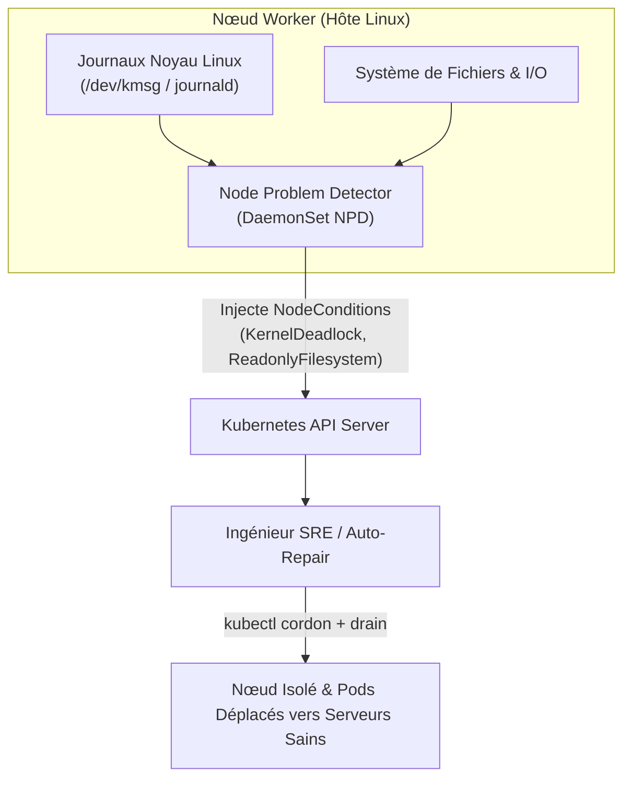
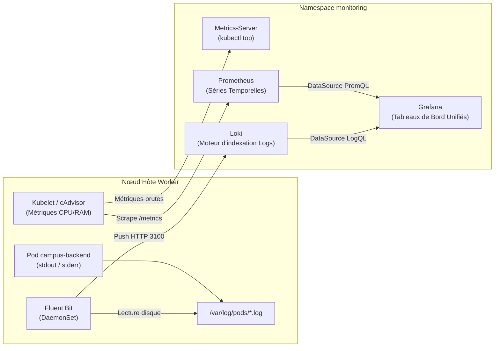
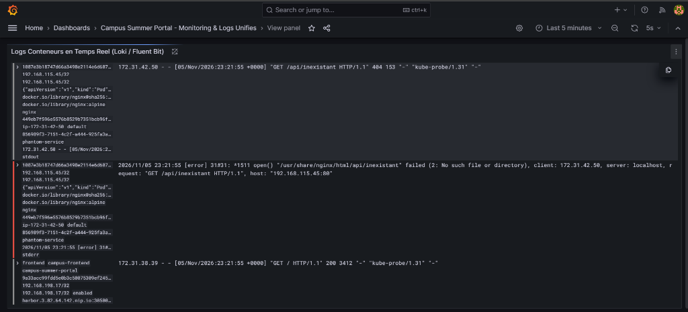
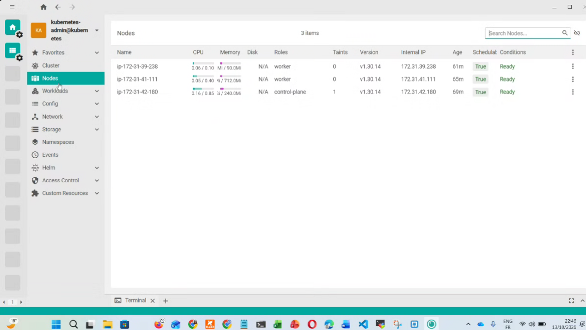

# Lab 06 : Exploitation, Observabilité & Reverse Debugging

### Objectifs Pédagogiques :
* Configurer les sondes de santé indispensables : **Liveness Probe** et **Readiness Probe**.
* Maîtriser l'extraction et le filtrage des logs d'application (`kubectl logs` en direct et historique de crash).
* Diagnostiquer et réparer méthodiquement 3 incidents de production classiques :
  * Panne 1 : `CrashLoopBackOff` (erreur applicative au démarrage)
  * Panne 2 : `OOMKilled` (dépassement de quota mémoire)
  * Panne 3 : `Endpoints vides / Pod Not Ready` (échec de probe)
* Détecter, analyser et remédier aux pannes du noyau Linux avec **Node Problem Detector (NPD)** (simulation d'erreur kmsg, inspection d'événements et mise en quarantaine `kubectl cordon/drain`).
* Déployer et exploiter la **chaîne complète d'observabilité CNCF** en production :
  * Métriques temps réel : **Metrics-Server** (`kubectl top nodes`, `kubectl top pods`)
  * Collecte et expédition de logs : **Fluent Bit** (DaemonSet)
  * Moteur d'indexation des logs : **Loki**
  * Métriques et séries temporelles : **Prometheus**
  * Tableaux de bord unifiés et requêtes LogQL : **Grafana**
  * *(Optionnel)* Vue graphique en direct des objets du cluster : **FreeLens**
* Situer cette pile par rapport aux services managés des Clouds, notamment **StackDriver** (aujourd'hui Google Cloud Observability).

> 📌 **Note Compatibilité OS :**  
> Les commandes d'investigation (`kubectl logs -f`, `kubectl describe`, `kubectl top`, `kubectl cordon`, `kubectl port-forward`) sont **rigoureusement identiques** sous **Windows (PowerShell)**, **Linux (Ubuntu)** et **macOS (Terminal)**.
>
> 💡 **Modalités d'exécution (Au choix) :**  
> * **Option A (Recommandée - Confort DevOps Local) :** Exécutez vos commandes `kubectl`, investigations et consultations de tableaux de bord directement depuis votre poste local.  
> * **Option B (Secours - PC d'entreprise verrouillé) :** Connectez-vous en SSH sur `k8s-control` où les manifests et outils sont prêts à l'emploi *(seule la simulation d'erreur kernel dans l'Exercice 2 requiert une commande directe sur le worker)*.
>
> 🗂️ **Namespace de travail : `campus-dev`.** Avant de commencer, créez-le s'il n'existe pas encore et définissez-le comme namespace courant (les commandes sont sans effet s'il existe déjà) :
>
> ```bash
> kubectl create namespace campus-dev --dry-run=client -o yaml | kubectl apply -f -
> kubectl config set-context --current --namespace=campus-dev
> kubectl config view --minify -o jsonpath='{..namespace}'   # doit afficher campus-dev
> ```
>
> *Le namespace est présenté en détail à l'Exercice 0 du [Lab 02](../02-premiers-pods-labels/README.md#exercice-0--le-namespace-votre-périmètre-de-travail).*

---

## Contexte Métier
En tant qu'administrateur Kubernetes ou ingénieur SRE, plus de 70% de votre temps d'exploitation consiste à comprendre pourquoi un conteneur ne démarre pas, pourquoi il redémarre en boucle, pourquoi il ne reçoit aucun trafic utilisateur ou quel processus sature la mémoire du serveur. Cet atelier vous entraîne aux réflexes d'investigation méthodique en situation d'incident réel et vous guide dans le déploiement de la pile d'observabilité complète de référence de la Cloud Native Computing Foundation (CNCF).

---

## Exercice 1 : Configurer Liveness & Readiness Probes

### 1. Pourquoi trois sondes différentes ?
* **Startup Probe** : *"L'application a-t-elle fini de démarrer ?"*  
  Tant qu'elle n'a pas réussi, Kubernetes **suspend les deux autres sondes**. Indispensable pour une JVM : Spring Boot met 20 à 60 secondes à démarrer selon le CPU disponible, et une liveness trop pressée le tuerait en plein démarrage (boucle de redémarrages).
* **Liveness Probe** : *"L'application est-elle vivante ?"*  
  Si elle échoue, Kubernetes **tue et redémarre** le conteneur pour tenter de restaurer le service.
* **Readiness Probe** : *"L'application est-elle prête à recevoir du trafic utilisateur ?"*  
  Si elle échoue, Kubernetes **retire immédiatement le pod des Endpoints du Service** sans le redémarrer (aucun client n'est envoyé vers lui).

Spring Boot Actuator expose un point de contrôle adapté à chaque question :

| Sonde | Chemin | Ce qu'il vérifie | Pourquoi ce choix |
| :--- | :--- | :--- | :--- |
| `startupProbe` | `/actuator/health/liveness` | Le processus Java a démarré | Laisse jusqu'à 3 minutes (36 × 5 s) au démarrage |
| `livenessProbe` | `/actuator/health/liveness` | Le processus est vivant, **sans** tester la base | Redémarrer l'API ne répare pas une base en panne : la liveness ne doit pas en dépendre |
| `readinessProbe` | `/actuator/health` | L'API **et** sa connexion PostgreSQL | Si la base tombe, le pod sort du Service, sans redémarrer en boucle |

### 2. Injecter les sondes dans le backend
Ajoutez les trois sondes à votre fichier `deployment-backend.yaml` (état de fin du Lab 05), au même niveau que `ports` :

```yaml
apiVersion: apps/v1
kind: Deployment
metadata:
  name: campus-backend
spec:
  replicas: 2
  strategy:
    type: RollingUpdate
    rollingUpdate:
      maxSurge: 1
      maxUnavailable: 0
  selector:
    matchLabels:
      app: campus-backend
  template:
    metadata:
      labels:
        app: campus-backend
    spec:
      affinity:
        podAntiAffinity:
          preferredDuringSchedulingIgnoredDuringExecution:
          - weight: 100
            podAffinityTerm:
              topologyKey: kubernetes.io/hostname
              labelSelector:
                matchLabels:
                  app: campus-backend
      containers:
      - name: campus-backend
        image: regaieg/campus:backend-1.0.0
        ports:
        - containerPort: 8080
        startupProbe:
          httpGet:
            path: /actuator/health/liveness
            port: 8080
          periodSeconds: 5
          failureThreshold: 36
        readinessProbe:
          httpGet:
            path: /actuator/health
            port: 8080
          periodSeconds: 5
          failureThreshold: 3
        livenessProbe:
          httpGet:
            path: /actuator/health/liveness
            port: 8080
          periodSeconds: 10
          failureThreshold: 3
        envFrom:
        - configMapRef:
            name: campus-config
        env:
        - name: SPRING_DATASOURCE_URL
          value: "jdbc:postgresql://postgres:5432/campus"
        - name: SPRING_DATASOURCE_USERNAME
          valueFrom:
            secretKeyRef:
              name: campus-db-credentials
              key: POSTGRES_USER
        - name: SPRING_DATASOURCE_PASSWORD
          valueFrom:
            secretKeyRef:
              name: campus-db-credentials
              key: POSTGRES_PASSWORD
```

Appliquez le manifest et observez la colonne `READY` lors du démarrage :

```bash
kubectl apply -f deployment-backend.yaml
kubectl get pods -l app=campus-backend -w
```
*Remarquez que chaque nouveau pod affiche `0/1` pendant le démarrage de Spring Boot, puis passe à `1/1` dès que les sondes répondent HTTP 200. Grâce à `maxUnavailable: 0`, un ancien pod n'est arrêté qu'une fois son remplaçant prêt. Quittez avec `Ctrl + C`.*

Interrogez vous-même les deux points de contrôle depuis un pod de test :

```bash
kubectl run test-probes --image=curlimages/curl --rm -i --restart=Never -- sh -c 'curl -s http://campus-backend:8080/actuator/health/liveness; echo; curl -s http://campus-backend:8080/actuator/health; echo'
```
*Le premier renvoie seulement `{"status":"UP"}` ; le second détaille aussi l'état de la base (`"db":{"status":"UP"…}`).*

---

## Exercice 2 : La Boîte à Outils du Debugging & Filtrage des Logs

Exercez-vous sur ces commandes fondamentales de l'exploitation en production :

### 1. Suivi des logs en temps réel (Streaming)
Affichez les 50 dernières lignes de log du backend et suivez les nouvelles arrivées :

```bash
kubectl logs -f deployment/campus-backend --tail=50
```
*(Appuyez sur `Ctrl + C` pour quitter le mode streaming).*

### 2. Affichage avec préfixe multi-pods
Lorsque vous avez plusieurs réplicas, l'option `--prefix=true` permet de distinguer la source exacte de chaque message :

```bash
kubectl logs -l app=campus-backend --tail=10 --prefix=true
```

### 3. Investigation post-mortem : Les logs du crash précédent
Si un conteneur a planté et vient de redémarrer, ses logs actuels sont vides ou réinitialisés. L'option `--previous` permet de lire la mémoire tampon du conteneur juste avant sa destruction :

```bash
kubectl logs <nom-du-pod> --previous
```

### 4. Chronologie des événements du cluster
Affichez les événements récents classés par ordre chronologique d'apparition :

```bash
kubectl get events --sort-by='.metadata.creationTimestamp'
```

---

## Exercice 3 : Atelier Reverse Debugging - Résolution de 3 Incidents Réels

Dans cet exercice, nous déclenchons 3 pannes volontaires caractéristiques des environnements d'entreprise. Votre objectif est d'appliquer la démarche de diagnostic en 3 étapes : **`kubectl get` → `kubectl describe` → `kubectl logs`**.

---

### Incident A : Redémarrage en boucle applicatif (`CrashLoopBackOff`)

1. Déployez un conteneur configuré pour échouer immédiatement après son démarrage :
   ```bash
   kubectl run crash-app --image=busybox:1.36 --restart=Always -- sh -c "echo Initialisation du service... ; sleep 3 ; echo Erreur fatale code 42 ; exit 42"
   ```

2. Observez le statut du pod :
   ```bash
   kubectl get pod crash-app -w
   ```
   *Le pod passe de `Running` à `Error`, puis bascule en `CrashLoopBackOff` avec le compteur de redémarrages qui s'incrémente. Le délai entre deux tentatives double à chaque échec (10 s, 20 s, 40 s… jusqu'à 5 minutes). Quittez avec `Ctrl + C`.*

3. **Investigation méthodique** :
   ```bash
   kubectl describe pod crash-app
   ```
   *Examinez la section `Last State: Terminated` : vous identifiez `Exit Code: 42`. Un code différent de 0 signifie que le processus principal s'est arrêté sur une erreur fatale.*

4. Affichez les logs avant le crash pour lire le message d'erreur :
   ```bash
   kubectl logs crash-app --previous
   ```
   *Vous lisez immédiatement : `Erreur fatale code 42`.*

5. Nettoyez l'incident :
   ```bash
   kubectl delete pod crash-app
   ```

---

### Incident B : Dépassement de seuil mémoire (`OOMKilled`)

1. Déployez un conteneur limité à 50 Mio de mémoire (`50Mi`) exécutant un processus qui tente d'en allouer 150 Mo. L'image `polinux/stress` est celle utilisée par la documentation officielle de Kubernetes pour cette démonstration :
   ```bash
   kubectl apply -f - << 'EOF'
   apiVersion: v1
   kind: Pod
   metadata:
     name: oom-victim
   spec:
     containers:
     - name: mem-eater
       image: polinux/stress
       resources:
         requests:
           memory: "32Mi"
         limits:
           memory: "50Mi"
       command: ["stress"]
       args: ["--vm", "1", "--vm-bytes", "150M", "--vm-hang", "1"]
   EOF
   ```

2. Surveillez le pod (quittez avec `Ctrl + C`) :
   ```bash
   kubectl get pod oom-victim -w
   ```
   *Le statut passe à `OOMKilled`, puis à `CrashLoopBackOff` : le conteneur est relancé et retué à chaque tentative.*

3. **Investigation méthodique** :
   ```bash
   kubectl describe pod oom-victim
   ```
   *Dans la section `Last State: Terminated`, observez la mention explicite : **`Reason: OOMKilled`**.*  
   *Le noyau Linux (via les cgroups) a déclenché l'OOM Killer car le processus a franchi la barrière physique infranchissable définie dans `limits.memory`.*

4. Nettoyez l'incident :
   ```bash
   kubectl delete pod oom-victim
   ```

---

### Incident C : Échec de sonde de disponibilité (`Pod Not Ready`)

1. Déployez un serveur web dont la readiness probe pointe vers une route inexistante (`/api/inexistant`) qui renverra un code HTTP 404 :
   ```bash
   kubectl apply -f - << 'EOF'
   apiVersion: v1
   kind: Pod
   metadata:
     name: phantom-service
     labels:
       app: phantom
   spec:
     containers:
     - name: nginx
       image: nginx:1.27-alpine
       readinessProbe:
         httpGet:
           path: /api/inexistant
           port: 80
         initialDelaySeconds: 3
         periodSeconds: 3
   EOF
   ```

2. Observez le statut :
   ```bash
   kubectl get pod phantom-service
   ```
   *Le pod reste indéfiniment à l'état `0/1` bien qu'il soit marqué `Running` !*

3. **Investigation méthodique** :
   ```bash
   kubectl describe pod phantom-service
   ```
   *Consultez la liste des événements en bas :*
   > `Warning Unhealthy readiness probe failed: HTTP probe failed with statuscode: 404`

   *Conséquence directe : si un Service ciblait ce pod, l'objet `Endpoints` resterait vide et aucun utilisateur ne pourrait y accéder.*

4. Nettoyez l'incident :
   ```bash
   kubectl delete pod phantom-service
   ```

---

## Exercice 4 : Détection Avancée de Pannes Noyau & Système avec Node Problem Detector (NPD)

### 1. Contexte & Architecture de NPD
Par défaut, le `kubelet` ne surveille qu'un ensemble très restreint de métriques du serveur hôte : la mémoire disponible, l'espace disque et le nombre de processus (`PIDPressure`).

**Le Piège Silencieux :** Si le système d'exploitation du serveur worker subit une panne sous-jacente grave :
1. **Kernel Deadlock** : Un bug de thread système fige une partie des opérations du processeur.
2. **Read-only Filesystem** : À la suite d'un problème sur le disque SSD ou EBS, le noyau Linux monte le système de fichiers en lecture seule pour protéger les données (`remount-ro`).
3. **Container Runtime Unresponsive** : Le démon `containerd` freeze sans que son processus ne soit formellement arrêté.

Dans ces situations, le `kubelet` peut continuer à répondre « `Ready=True` » à l'API Server. Le scheduler continue d'envoyer de nouveaux pods vers ce serveur malade, causant des pannes en cascade !



### 2. Décryptage sous le Capot : L'Anatomie du Manifeste npd.yaml

Avant d'appliquer le fichier, ouvrons la boîte noire pour comprendre son architecture interne :

* **Pourquoi un `DaemonSet` et non un `Deployment` ?**  
  Un `Deployment` ordonnance des pods où il le souhaite selon les ressources disponibles. NPD, lui, ne surveille pas du code applicatif : il surveille le matériel et le système d'exploitation du serveur hôte. Il doit donc obligatoirement exécuter **exactement une instance par machine physique**, ce qui est la définition même d'un `DaemonSet`.
* **L'accès bas niveau via volume `hostPath` et mode privilégié :**
  ```yaml
  securityContext:
    privileged: true
  volumeMounts:
  - name: kmsg
    mountPath: /dev/kmsg
    readOnly: true
  volumes:
  - name: kmsg
    hostPath:
      path: /dev/kmsg
  ```
  Pour intercepter les alertes critiques émises par le noyau Linux (deadlock, disque corrompu en lecture seule), le conteneur monte directement le pseudo-fichier `/dev/kmsg` du serveur hôte et requiert le drapeau `privileged: true`.
* **Le moteur de détection par expressions régulières (ConfigMap) :**  
  La ConfigMap `node-problem-detector-config` injecte les règles de filtrage regex surveillées dans les logs système (ex: `BUG: unable to handle kernel NULL pointer dereference`, `Kernel panic`, `Task blocked for more than 120 seconds`).
* **L'injection de conditions dans l'API Server (RBAC) :**  
  NPD utilise un `ServiceAccount` lié à un `ClusterRole` avec les droits `patch` sur la ressource `nodes/status`. Dès qu'une panne noyau est détectée, NPD appelle directement l'API Server pour faire basculer la condition du nœud `KernelDeadlock=True` et émettre un `Event` Kubernetes.

---

### 3. Déploiement Complet de Node Problem Detector
Placez-vous dans le dossier du lab : depuis la racine du dépôt en Option A (`cd labs/06-exploitation-debugging`), ou `cd ~/labs/06-exploitation-debugging` sur `k8s-control` en Option B. Appliquez ensuite le manifest :

```bash
kubectl apply -f npd/npd.yaml
```

Vérifiez que les pods NPD sont actifs sur vos nœuds :
```bash
kubectl get daemonset -n kube-system node-problem-detector
kubectl get pods -n kube-system -l app=node-problem-detector -o wide
```
*Un pod par **worker** : le DaemonSet ne déclare pas de *toleration* pour la taint du plan de contrôle (Lab 03), il ne tourne donc pas sur `k8s-control`.*

Nous allons travailler sur le nœud `k8s-worker-1` (adaptez le nom à votre environnement, voir `kubectl get nodes`). Observez ses conditions enrichies :
```bash
NODE_NAME=k8s-worker-1
kubectl describe node $NODE_NAME | grep -A 25 "Conditions:"
```
*Constatez l'apparition des nouvelles sondes : `KernelDeadlock=False`, `ReadonlyFilesystem=False`.*

### 4. Simulation Active d'une Panne Noyau
Simulons une anomalie critique du noyau Linux en écrivant, dans le journal du noyau (`/dev/kmsg`) de `k8s-worker-1`, le motif d'erreur exact surveillé par NPD (`BUG: unable to handle kernel NULL pointer dereference`) :

* **Méthode universelle (Pod privilégié épinglé sur le worker)** :
  ```bash
  kubectl apply -f - << 'EOF'
  apiVersion: v1
  kind: Pod
  metadata:
    name: inject-kernel-err
  spec:
    nodeName: k8s-worker-1
    restartPolicy: Never
    containers:
    - name: inject
      image: busybox:1.36
      securityContext:
        privileged: true
      command: ["sh", "-c", "echo '<3>kernel: BUG: unable to handle kernel NULL pointer dereference at 0000000000000000' > /dev/kmsg"]
  EOF
  ```
  *`nodeName` court-circuite le scheduler pour placer le pod sur ce nœud précis, et `privileged: true` lui donne accès aux périphériques de l'hôte, dont `/dev/kmsg`. Supprimez-le ensuite : `kubectl delete pod inject-kernel-err`.*

* **Méthode directe (si accès SSH au nœud worker)** :
  ```bash
  echo '<3>kernel: BUG: unable to handle kernel NULL pointer dereference at 0000000000000000' | sudo tee /dev/kmsg
  ```
  *Attention : `logger` écrit dans le journal système (`journald`), pas dans le journal du noyau surveillé par NPD.*

> ⚠️ Un pod privilégié a les pleins pouvoirs sur le nœud : c'est exactement ce que le Lab 07 apprendra à interdire. Il n'est utilisé ici que pour la simulation.

### 5. Constat de Détection et Réflexe SRE : Mise en Quarantaine (`cordon`)
1. Surveillez les événements générés par NPD et la condition du nœud :
   ```bash
   kubectl get events -A --field-selector reason=KernelDeadlock
   kubectl describe node $NODE_NAME | grep KernelDeadlock
   ```
   *NPD a intercepté l'erreur du noyau : il a émis un événement (enregistré dans le namespace `default`, car un nœud n'appartient à aucun namespace) et basculé la condition `KernelDeadlock` à `True`.*

2. **Réflexe SRE de protection immédiat (Mise en Quarantaine)** :  
   Pour empêcher tout nouveau déploiement sur ce serveur instable, isolez-le immédiatement :
   ```bash
   kubectl cordon $NODE_NAME
   kubectl get nodes
   ```
   *Le nœud affiche le statut **`Ready,SchedulingDisabled`** ! Le cluster est protégé contre toute nouvelle assignation.*

3. **Évacuation préventive des charges saines** :
   Pour déplacer les pods applicatifs déjà en cours d'exécution sur ce serveur vers d'autres nœuds sains :
   ```bash
   kubectl drain $NODE_NAME --ignore-daemonsets --delete-emptydir-data --force
   kubectl get pods -o wide
   ```
   *Les pods `campus-backend` et `campus-frontend` sont recréés sur l'autre worker. Si le pod `campus-postgres` tournait sur `k8s-worker-1`, il reste en revanche `Pending` : son volume `local-path` est physiquement sur le disque de ce nœud (`kubectl describe pod -l app=campus-postgres` affiche `volume node affinity conflict`). C'est la limite du stockage local évoquée au Lab 00 : en production, un volume réseau (EBS, Ceph…) suivrait le pod. Dans ce cas, observez aussi le backend, qui illustre la différence entre les sondes : le pod backend **déjà démarré** voit sa readiness (qui teste la base) échouer, passe à `0/1` **sans redémarrer** et sort du Service ; le pod backend **recréé** par le drain, lui, ne peut pas démarrer sans base (`Connection to postgres:5432 refused`, `Exit Code: 1`) et redémarre en boucle jusqu'au retour de PostgreSQL. Les deux reviennent à `1/1` après l'étape 4.*

4. Rétablissez le nœud pour la suite de nos travaux :
   ```bash
   kubectl uncordon $NODE_NAME
   kubectl get pods -o wide
   ```
   *La condition `KernelDeadlock=True` reste affichée sur le nœud : une condition « permanente » ne retombe qu'au redémarrage de NPD, une fois l'erreur sortie de sa fenêtre d'analyse (`lookback` de 5 minutes). Pour repartir d'un état propre, attendez 5 minutes puis redémarrez le pod NPD du nœud : `kubectl delete pod -n kube-system -l app=node-problem-detector --field-selector spec.nodeName=$NODE_NAME`.*

---

## Exercice 5 : La Chaîne Complète d'Observabilité CNCF

En production Kubernetes moderne, l'observabilité repose sur le triptyque **Métriques (Metrics-Server & Prometheus)**, **Collecte de Logs (Fluent Bit)**, **Stockage & Indexation (Loki)** et **Visualisation Unifiée (Grafana)**.



> ☁️ **Et dans le Cloud ? De StackDriver à Google Cloud Observability**  
> Sur un cluster managé, vous n'installez généralement pas cette pile vous-même : le fournisseur Cloud la fournit en service géré. Chez Google, ce service s'appelait **StackDriver**. Google a abandonné cette marque en 2020 au profit de *Google Cloud Operations Suite*, aujourd'hui nommée **Google Cloud Observability** (Cloud Logging, Cloud Monitoring, Cloud Trace). Sur GKE, il est activé par défaut : les logs système, d'audit et applicatifs partent vers **Cloud Logging** et les métriques système vers **Cloud Monitoring**, avec en option **Managed Service for Prometheus**.
>
> | Besoin | Pile CNCF de ce lab (auto-hébergée) | Google Cloud (ex-StackDriver) | AWS | Azure |
> | :--- | :--- | :--- | :--- | :--- |
> | Collecte des logs | Fluent Bit (DaemonSet) | Agent de logging GKE | Fluent Bit + CloudWatch Agent | Azure Monitor Agent |
> | Stockage & recherche de logs | Loki (LogQL) | Cloud Logging | CloudWatch Logs | Log Analytics (KQL) |
> | Métriques | Prometheus (PromQL) | Cloud Monitoring / Managed Service for Prometheus | CloudWatch Container Insights / Amazon Managed Prometheus | Azure Monitor / Managed Prometheus |
> | Tableaux de bord | Grafana | Console Cloud Monitoring | CloudWatch Dashboards / Amazon Managed Grafana | Azure Managed Grafana |
>
> Les concepts manipulés ici (collecte par DaemonSet, logs indexés par labels, scraping des métriques du kubelet, tableaux de bord) sont **identiques** : seule l'exploitation change. La pile CNCF a l'avantage d'être portable entre clouds et sur site ; le service managé supprime la charge d'exploitation mais facture au volume ingéré.

### 1. Décryptage Architectural des Manifests (Ouvrons la Boîte Noire !)

Ne déployons pas ces fichiers à l'aveugle. Analysons les choix d'ingénierie Kubernetes qui composent ces 6 manifests :

| Fichier | Type d'Objet Kubernetes | Rôle Technique & Clé de Compréhension |
| :--- | :--- | :--- |
| **`00-namespace.yaml`** | `Namespace` | **Isolation du plan d'observabilité** : Cloisonne toute la pile dans `monitoring` pour ne pas impacter les quotas et réseaux des applications métiers (`campus-dev`, `campus-prod`). |
| **`01-metrics-server.yaml`** | `Deployment` + `ClusterRole` | **Alimentation de `kubectl top` et du HPA** : Scrape les métriques CPU/RAM instantanées. Contient l'argument `--kubelet-insecure-tls` car Kubeadm utilise des certificats TLS auto-signés sur le port 10250 du kubelet. |
| **`02-loki.yaml`** | `Deployment` + `ConfigMap` + `Service` | **Moteur d'indexation ultra-léger** : Contrairement à Elasticsearch qui indexe chaque mot du log (gourmand en RAM), Loki n'indexe **que les étiquettes** (`app`, `pod`, `namespace`) et stocke le texte brut compressé sur disque. Port d'écoute : `3100`. |
| **`03-fluentbit.yaml`** | `DaemonSet` + `ClusterRole` + `ConfigMap` | **Collecteur et enrichisseur de logs** (voir détail ci-dessous). |
| **`04-prometheus.yaml`** | `Deployment` + `ClusterRole` + `ConfigMap` | **Base de données de séries temporelles** (voir détail ci-dessous). |
| **`05-grafana.yaml`** | `Deployment` + `ConfigMap` + `Service NodePort` | **Visualisation unifiée en GitOps** (voir détail ci-dessous). |

---

#### Gros Plan : Comment fonctionne le pipeline Fluent Bit (`03-fluentbit.yaml`) ?
Fluent Bit est le composant le plus sophistiqué de la chaîne. Pourquoi est-il un `DaemonSet` ? Parce qu'il doit collecter les logs sur le disque de chaque machine hôte :

```text
[Fichier sur disque hôte]          [Pipeline interne Fluent Bit]             [Destination]
/var/log/containers/*.log  ──>  [INPUT: tail (CRI Parser)]
                                         │
                                         ▼
                                [FILTER: kubernetes]  <───> [Kubernetes API Server]
                                (Injecte app, pod, ns)      (Requête via ServiceAccount/ClusterRole)
                                         │
                                         ▼
                                [OUTPUT: loki:3100]   ───>  [Loki Ingestion API]
```

* **Le filtre Kubernetes** : Le fichier sur disque se nomme par exemple `campus-backend_campus-dev_c2a...log`. Grâce à son `ClusterRole`, Fluent Bit interroge l'API Server pour identifier les labels réels du pod (`app=campus-backend`, `env=dev`). C'est cette étape qui permet ensuite de filtrer `{app="campus-backend"}` dans Grafana !
* **L'exclusion anti-boucle** : `Exclude_Path /var/log/containers/*fluent-bit*.log` empêche Fluent Bit de collecter ses propres logs (ce qui saturerait le cluster en boucle infinie).

---

#### Gros Plan : Comment Prometheus découvre-t-il les métriques (`04-prometheus.yaml`) ?
Dans la ConfigMap de Prometheus :
```yaml
- job_name: 'kubernetes-nodes-cadvisor'
  kubernetes_sd_configs:
    - role: node
```
* **Auto-discovery (`kubernetes_sd_configs`)** : Prometheus demande à l'API Server la liste des nœuds disponibles sans qu'aucune adresse IP ne soit codée en dur.
* **cAdvisor** : Prometheus contacte chaque `kubelet` sur le port `10250` pour interroger l'agent **cAdvisor** (*Container Advisor*) intégré au moteur de conteneurs. C'est de là que proviennent les métriques `container_cpu_usage_seconds_total` et `container_memory_working_set_bytes`.

---

#### Gros Plan : Pourquoi Grafana est-il configuré automatiquement (`05-grafana.yaml`) ?
Dans les déploiements professionnels, on ne clique jamais dans l'interface pour ajouter une base de données.
Le fichier `05-grafana.yaml` injecte un ConfigMap monté dans `/etc/grafana/provisioning/datasources/datasources.yaml` :
```yaml
datasources:
  - name: Prometheus
    url: http://prometheus.monitoring.svc:9090
  - name: Loki
    url: http://loki.monitoring.svc:3100
```
Dès le démarrage du conteneur, Grafana est déjà interconnecté à Prometheus et Loki sans aucune intervention humaine ! Son service est typé en **`NodePort: 30300`** pour un accès direct depuis votre navigateur.

---

### 2. Déploiement de la Pile de Supervision en 1 Commande
Appliquez les manifests préparés situés dans le dossier `monitoring/` :

```bash
kubectl apply -f monitoring/00-namespace.yaml
kubectl apply -f monitoring/01-metrics-server.yaml
kubectl apply -f monitoring/02-loki.yaml
kubectl apply -f monitoring/03-fluentbit.yaml
kubectl apply -f monitoring/04-prometheus.yaml
kubectl apply -f monitoring/05-grafana.yaml
```

Attendez que l'ensemble des composants soient à l'état `Running` :
```bash
kubectl get pods -n monitoring -w
kubectl get pods -n kube-system -l k8s-app=metrics-server
```
*(Après environ 30 à 45 secondes, vous devez voir `fluent-bit` (un pod par nœud, `k8s-control` compris : son DaemonSet tolère la taint du plan de contrôle), `grafana`, `loki` et `prometheus` opérationnels dans `monitoring`, et `metrics-server` dans `kube-system`, où il est déployé comme les autres composants système. Quittez l'observation avec `Ctrl + C`.)*

---

### 3. Cas d'Usage Métriques : Mesure en Direct avec `kubectl top`
Interrogez l'utilisation processeur et mémoire globale des serveurs :

```bash
kubectl top nodes
```
*Vous obtenez la charge CPU (en millicores `m`) et mémoire (en `Mi`) pour chaque machine !*

Interrogez l'utilisation de vos pods applicatifs :

```bash
kubectl top pods
kubectl top pods -l app=campus-backend
```

#### Crash-Test de Surcharge CPU :
1. Démarrez un conteneur qui sature volontairement 1 cœur de calcul processeur à 100% :
   ```bash
   kubectl run cpu-stresser --image=busybox:1.36 --restart=Never -- sh -c "md5sum /dev/urandom"
   ```

2. Patientez 15 secondes (cycle d'échantillonnage de Metrics-Server), puis observez :
   ```bash
   kubectl top pod cpu-stresser
   ```
   *Vous observez immédiatement que `cpu-stresser` consomme près de 1000m (1 cœur CPU entier) !*  
   *C'est exactement grâce à cette métrique que le contrôleur **Horizontal Pod Autoscaler (HPA)** décide d'ajouter automatiquement de nouveaux réplicas en production.*

3. Supprimez le conteneur de stress :
   ```bash
   kubectl delete pod cpu-stresser
   ```

---

### 4. Cas d'Usage Logs : La Chaîne de Collecte Fluent Bit & Loki
1. Inspectez les logs de Fluent Bit pour constater qu'il a automatiquement détecté les flux de conteneurs de votre cluster :
   ```bash
   kubectl logs -n monitoring -l app=fluent-bit --tail=25
   ```
   *Vous devez voir des mentions confirmant la connexion réussie vers `loki.monitoring.svc:3100`.*

2. Générez des logs applicatifs sur le backend en redémarrant ses pods :
   ```bash
   kubectl rollout restart deployment/campus-backend
   kubectl rollout status deployment/campus-backend
   ```
   *Fluent Bit ne collecte que les lignes écrites **après** son démarrage, et Spring Boot ne journalise ni `/actuator/health` ni les appels `/api`. Le redémarrage produit en revanche une centaine de lignes (bannière, connexion à PostgreSQL, `Started CampusOpsApplication`) que vous retrouverez dans Grafana à l'étape suivante.*

---

### 5. Cas d'Usage Visualisation : Tableaux de Bord Unifiés Grafana

Sur votre cluster AWS multi-nœuds déployé au Lab 00, le service Grafana est exposé via son Service NodePort sur le port **`30300`** :

1. Récupérez l'adresse IP publique de votre nœud worker `k8s-worker-1` (notée dans votre session MobaXterm ou console AWS).
2. Ouvrez votre navigateur web à l'adresse : **`http://<IP_PUBLIQUE_WORKER>:30300`**.
   *(Alternative en Option A, si le port 30300 est filtré par votre réseau d'entreprise : ouvrez un tunnel depuis votre poste avec `kubectl port-forward svc/grafana 3000:3000 -n monitoring`, puis naviguez sur `http://localhost:3000`. N'ouvrez pas de tunnel sur `k8s-control` : le Security Group AWS n'autorise pas le port 3000.)*
3. Connectez-vous avec les identifiants configurés :
   * **Identifiant** : `admin`
   * **Mot de passe** : `admin2026`

4. **Explorer les Sources de Données Pré-configurées** :
   * Rendez-vous dans le menu **Connections** → **Data sources**.
   * Constatez que **Prometheus** (métriques) et **Loki** (logs) sont déjà configurés et opérationnels !

5. **Interroger les Logs Applicatifs avec LogQL (Loki)** :
   * Cliquez sur le menu **Explore** (boussole à gauche) et sélectionnez la source **Loki**.
   * Dans le champ de requête, saisissez :
     ```logql
     {app="campus-backend"}
     ```
   * Cliquez sur **Run query** en haut à droite :
     *Vous voyez s'afficher en direct les logs Spring Boot de votre application, horodatés et étiquetés avec les métadonnées Kubernetes (pod, conteneur, namespace) !*
   * *(Astuce de formatage direct)* : Pour afficher les logs de tous les conteneurs sous forme de texte clair épuré (sans les accolades JSON), utilisez l'expression :
     ```logql
     {job="fluent-bit"} | json | line_format "{{.log}}"
     ```

5. **Interroger les Métriques avec PromQL (Prometheus)** :
   * Dans le même menu **Explore**, basculez la source sur **Prometheus**.
   * Saisissez la requête de consommation mémoire des conteneurs :
     ```promql
     sum(container_memory_usage_bytes{namespace="campus-dev"}) by (pod)
     ```
   * Cliquez sur **Run query** :
     *Grafana trace instantanément la courbe d'empreinte mémoire de vos microservices en direct !*

---

### 6. Importer un Dashboard Prêt à l'Emploi depuis la Marketplace Grafana

Construire un tableau de bord complet panneau par panneau prend du temps. En entreprise, la communauté DevOps s'appuie sur la **Grafana Marketplace** (des milliers de dashboards partagés prêts à l'emploi identifiés par un numéro d'ID unique).

#### Méthode A : Import en 1 clic via l'ID de la Marketplace (Recommandé)

1. Dans le menu de navigation de gauche, cliquez sur **Dashboards**, puis sur le bouton bleu **New** en haut à droite → sélectionnez **Import** (ou ajoutez le chemin `/dashboard/import` dans l'URL de votre session Grafana).
2. Dans le champ **Import via grafana.com**, saisissez l'identifiant du tableau de bord officiel de référence :
   * **Dashboard ID `315`** : *Kubernetes cluster monitoring (via Prometheus)* — le dashboard communautaire le plus téléchargé au monde pour visualiser les conteneurs, les nœuds et les métriques cAdvisor.
   * *(Alternative moderne)* : **Dashboard ID `15759`** (*Kubernetes / Views / Pods*).
   * *(Pour les logs centralisés)* : **Dashboard ID `13639`** (*Loki Kubernetes Pod Logs*).
3. Cliquez sur le bouton bleu **Load**.
4. Dans le formulaire qui s'affiche, associez la source demandée :
   * Pour le champ **Prometheus**, sélectionnez votre source pré-configurée **`Prometheus`**.
5. Cliquez sur **Import** :
   *Le tableau de bord complet s'affiche instantanément avec ses jauges globales de processeur, sa consommation mémoire, ses débits réseau et son filtre par Namespace/Pod !*

#### Méthode B : Import direct du fichier JSON (Environnement Hors-Ligne / Clé en Main)

Si votre navigateur ou votre cluster n'a pas d'accès direct vers l'extérieur pour joindre `grafana.com` :

1. Sur la page d'importation de Grafana, cliquez sur **Upload dashboard JSON file**.
2. Sélectionnez le fichier préparé dans votre répertoire de formation :
   `labs/06-exploitation-debugging/monitoring/dashboard-kubernetes.json`
   *(Ou ouvrez ce fichier, copiez son contenu texte et collez-le directement dans la zone de texte sous « Import via panel json »).*
3. Cliquez sur **Load** puis **Import** :
   *Vous visualisez instantanément le tableau de bord sur-mesure **Campus Summer Portal - Monitoring & Logs Unifies**, affichant à la fois les courbes métriques de vos pods et les logs Loki en temps réel côte à côte !*



> 💡 **Astuce LogQL : Mise en forme lisible des logs conteneurs**  
> Par défaut, Fluent Bit encapsule les entrées dans un objet JSON enrichi avec les métadonnées Kubernetes. Pour afficher le corps du message en texte clair et faire ressortir les erreurs en rouge (`stderr`) et le flux standard en gris (`stdout`), vous pouvez éditer la requête du panneau avec le filtre suivant :
> ```logql
> {job="fluent-bit"} | json | line_format "{{.log}}"
> ```
> Cette directive `| json` décode l'objet et `line_format "{{.log}}"` extrait le message exact, facilitant grandement la détection d'incidents (comme l'erreur 404 du pod `phantom-service` visible sur la capture ci-dessus).


### 7. (Optionnel) Supervision visuelle avec FreeLens

Grafana affiche des tableaux de bord construits à partir des métriques et des logs. **FreeLens** offre une vue complémentaire : un IDE graphique qui montre en direct l'état des objets du cluster, sans rien installer dans le cluster.

[**FreeLens**](https://freelensapp.github.io/) est libre et gratuit, sans création de compte. Après l'installation sur votre poste : **Catalog → Clusters → Add from Kubeconfig**, puis sélectionnez le fichier `kubeconfig.yaml` du Lab 00 (dossier `labs/00-provisioning-cluster/terraform/`).



Vous y suivez en direct les nœuds, les Pods, leurs événements et leurs logs. Rejouez par exemple l'un des incidents de l'exercice 3 et observez le Pod passer en `CrashLoopBackOff` dans FreeLens.

> 💡 FreeLens lit les métriques CPU et mémoire du **Metrics-Server** (exercice 5.3) : sans lui, les graphiques de consommation restent vides.

> 🔒 Poste d'entreprise verrouillé (Option B) : FreeLens s'exécute sur votre poste et a besoin d'accéder au port 6443 du cluster. Sans cet accès, contentez-vous de Grafana.

---

## Critères de Validation (Checklist)

- [ ] Les probes `liveness` et `readiness` sont configurées et comprises sur `campus-backend`.
- [ ] Vous savez extraire les logs d'un crash passé avec l'option `kubectl logs --previous`.
- [ ] Vous avez diagnostiqué avec méthode les causes de `CrashLoopBackOff`, `OOMKilled` et `NotReady`.
- [ ] Vous avez déployé **Node Problem Detector (NPD)** et testé la mise en quarantaine d'un nœud avec `kubectl cordon` et `drain`.
- [ ] Le **Metrics-Server** est opérationnel et vous maîtrisez `kubectl top nodes` et `kubectl top pods`.
- [ ] La pile CNCF **Fluent Bit**, **Loki**, **Prometheus** et **Grafana** est déployée dans le namespace `monitoring`.
- [ ] Vous savez faire correspondre chaque brique de la pile CNCF à son équivalent managé (StackDriver / Google Cloud Observability, CloudWatch, Azure Monitor).
- [ ] Vous avez importé avec succès un tableau de bord officiel depuis la Marketplace Grafana (Dashboard ID `315` ou fichier JSON) unifiant métriques et flux de logs.

